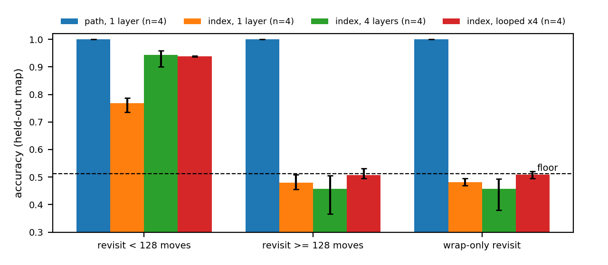
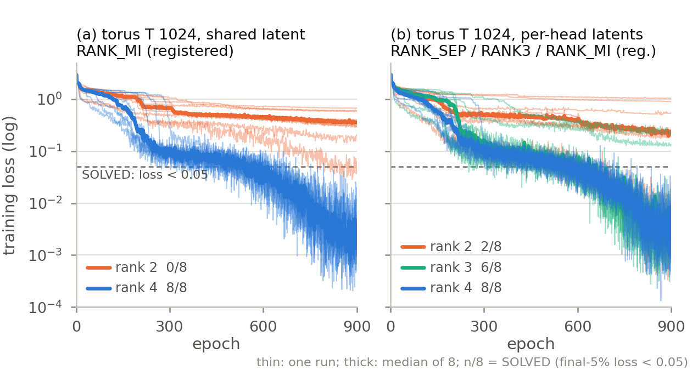
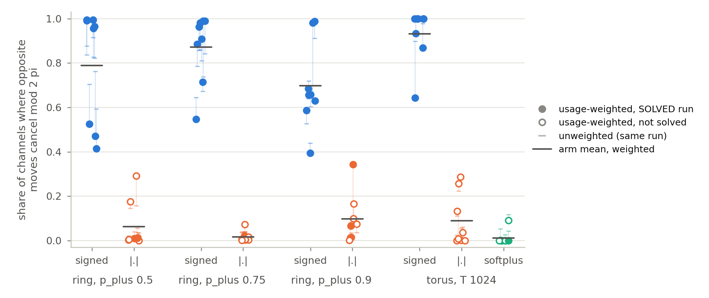
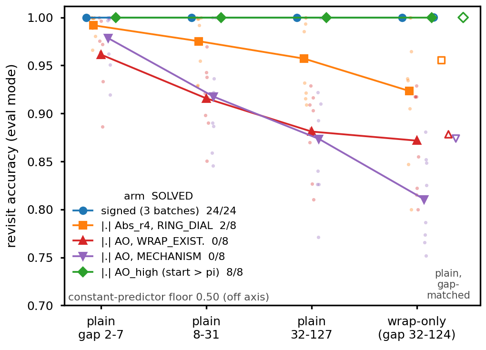

# Appendix to "A map is a phase without a clock: what path-integrated attention learns, and what decides whether training finds it"

*Draft 2 (2026-10-21), for `docs/paper/MAIN_DRAFT2.md`. Every number is copied from the file named beside it; a CORRECTED
or AUDIT block at the top of a results file supersedes its body. "Registered" = a pre-registered decision or declared
secondary; "(analysis)" = computed on stored streams or checkpoints, eval-only, never changing a verdict; its script is
listed in App. O. App. E states and proves every theory statement the main text uses; statements not used are in
`docs/paper/APPENDIX_theory_v3.md`. Delete this paragraph before submission.*

Contents. A: models, recipes, batches. B: floors. C: per-seed tables, SOLVED-threshold sensitivity, evaluation scale.
D: constructions. E: theory. F: exchange-rate details. G: rank details. H: sign details. I: CARoPE, CoPE and Selective
RoPE. J: text world. K: what and where; the leak. L: PoPE's score. M: loops and depth on a rank-2 code. N: EM's recency
deficit, a contrast case. O: analysis scripts.

---

## A. Models, recipes, batches

### A1. Architecture

| component | setting |
|---|---|
| layers | 1 (Sec. 6: 1-4 real layers and one block looped x4; ROBUST torus: 2 layers, d_model 256) |
| heads, width | 2 heads, d_model 128, d_head 64; feed-forward 4 x d_model with GELU; LayerNorm before attention and before the feed-forward; dropout 0.1 on attention weights, attention output and feed-forward output |
| rotary channels | 32 two-dimensional blocks per head, 64 channels; every query and key coordinate is rotated |
| score | channel c contributes q_c^T R(theta_{t',c} - theta_{t,c}) k_c (content Q and K rotated by the path angle; not additive) |
| step map | Delta = W_out W_in x, W_in: 128 -> r, W_out: r -> 64, no bias; r = 4 shared across heads unless stated (MapFormer's latent is per head); per-head variants: one W_in / W_out block per head; block-diagonal rank 4: the shared rank-4 latent with the off-diagonal blocks of W_out held at zero (each head reads rank 2) |
| frequencies | omega_c = 2 pi (1 / Delta_max)^(i / 31) for block i = 0..31, the same ladder in each head; Delta_max = grid size (torus 64, ring 32, line 256); omega is a free parameter, its sign unconstrained |
| vocabulary | torus: 4 moves + 17 observation tokens (16 types + blank); ring and line: 2 moves + 17 |
| parameters | about 204k for the one-layer torus MapWM; 798,741 for four index layers; 203,925 for the looped block (`FACTORIAL_RESULTS.md`); 1.59M for the ROBUST torus model |

Step parameterisations (`model.py`, `model_sign.py`, `model_wrap_exist.py`): signed (`Signed_r4` = `Vanilla_r4`),
|.| (`Abs_r4`; the absolute value is applied after W_out on each of the 64 channel steps, adding no parameters), softplus
(`Pos_r4`; softplus(0) = 0.693, so every token starts at about the same step), observation-step-free (`SignedAO_r4`,
`AbsAO_r4` on the ring, `SignedAO4_r4`, `AbsAO4_r4` on the torus: every non-move token's step is 0 by construction). Index
RoPE (`RoPE`): canonical ladder base^(-2c / d_head), base 10000.

### A2. Recipes

| | torus (Secs. 5-8) | ring and line (Secs. 6, 7) | Dyck-2 (Sec. 6) |
|---|---|---|---|
| optimiser | AdamW, weight decay 0.05 | AdamW, weight decay 0.05 | AdamW, weight decay 0.01 |
| peak learning rate | 1e-3 | 1e-3 (ROBUST and LRSWEEP vary it) | 1e-4 |
| schedule | 5% linear warm-up, cosine to 10% of the peak | same | same |
| batch | 16 walks of T = 1024 moves (2,048 tokens); T = 128 batches of 128 | 128 walks of T = 128 | 128 sequences |
| budget | 98 batches per epoch, 900 epochs (1800 in Sec. 7.2; 300 at T = 128) | 98 batches per epoch, 300 epochs | 560,000 sequences (1x) or 1,680,000 (3x) |
| loss | cross-entropy on revisited observations | same | next-token cross-entropy on every position |
| training map | one per run | redrawn for every walk | -- |
| evaluation | 100 walks on one held-out map, eval mode | 400 walks, maps redrawn | L32 D12 test set |

Run classes (`stats_core.classify_run`, per-epoch training loss): SOLVED if the mean of the final 5% of epochs is below
0.05; otherwise STALLED if the final-10% mean is within 5% of the preceding 10% mean, else DESCENDING. Continuations of
constructed models (App. D): ring 300 epochs at lr 1e-3 (schedule re-warmed, fresh optimiser state, fresh walk stream);
torus 300 epochs at lr 1e-4, fixed before launch (about the rate at which the source solution was reached).

### A3. Batches

"Code check" = an independent, results-blind code review, whose findings were amended into the pre-registration before
any result was read (before launch, except TEXTWORLD and LEAK, checked while the batch trained). "Reproduced" = the
analysis was re-run from stored checkpoints by an independent reproduction audit (`docs/paper/review_draft5/REPRO_AUDIT.md`,
`REPRO_AUDIT_nonsign.md`, 2026-10-16) and matched (spot re-evaluations within 7e-4); batches that landed after that audit
read "no". "Attention": standard, or `--fast-attn` (SDPA; agrees to ~1e-6 in logits, not bit-identical in training).
Pilots ran on seeds outside the batch except where noted.

| batch | main text | task | arms | seeds | epochs | attention | code check | reproduced |
|---|---|---|---|---|---|---|---|---|
| PAPER2X2 | 5, 7.4 | torus T = 128 | RoPE, PoPE, MapWM r2 / r4, MapPoPE r2 / r4 | 0-7 | 300 | standard | no | yes |
| SIGN_MATCHED | 5, 7.3, 9 | torus T = 1024 | signed, \|.\|, softplus, RoPE | 0-7 | 900 | standard | no (authors' pre-launch gate) | yes |
| GENERALITY | 5, 7.3 | torus; ring p_plus 0.5 | obs.-step-free signed / \|.\| and constructions; signed, CARoPE, CoPE, RoPE | 700-707 | 900 (ring 300); +300 | fast-attn (torus) | yes | yes |
| FACTORIAL | 6 | torus T = 1024 | path 1 layer; index 1, 4 layers, looped x4 | 500-503 (n = 4) | 900 | fast-attn | yes | yes |
| FACTORIAL_N8 (F7) | 6 | torus T = 1024 | FACTORIAL's four cells, its recipe asserted per run | 2800-2803 (fresh, n = 4) | 900 | fast-attn | yes | no (analysis re-run from the run dirs, identical) |
| DYCK_MDEPTH | 6 | Dyck-2 L32 D12 | MapWM, MapPoPE (r2), RoPE, PoPE at 1-4 layers; 3x; mixture | 0-7 | 1x / 3x | standard | no | yes |
| CANCEL | 6 | ring p_plus 0.5-1.0 | path 1 layer; index 1-3 layers | 0-7; main text 2-7 (0-1 were the pilot) | 300 | standard | no | yes |
| RANK_MI | 7.2 | torus | shared r2, per-head r2, shared r4 | 0-7 (per-head r2 s0-1 were a pilot) | 900 | standard | no | yes |
| RANK_SEP | 7.2 | torus | block-diagonal r4, per-head r4 | 0-7 | 900 | standard | no | yes |
| RANK3 | 7.2 | torus | per-head r3 | 0-7 | 900 | standard | no | yes |
| LOOP_RANK_E1800 (part 1) | 7.2 | torus | shared r2, shared r4 | 0-7 | 1800 | standard | no | yes |
| RANK_PROJ | 7.2 | torus | projected r2 (frozen, trained), r4 control, r2 continued | 0-7 | +900 | standard | no | yes |
| RANK_ND | 7.2 | 2D (32 per side), 3D (10 per side) tori | per-head rank D, D + 1 | 0-7 | 900 | standard | yes | yes |
| RANK_WRAP | 7.2 | 2D and 3D tori of two sizes | per-head rank D + 1 | 0-7 | 900 | standard | yes | yes |
| RANK_TESTS | 7.2 | ring; torus escape test | rank 1, 2 (+ variants); lifted / fresh rank 4 | 20-27; 0-7 | 300; 600 | standard | yes | yes |
| SCORE_RANK | 7.2, 7.4 | torus T = 1024 | MapWM / PoPE score at r2 and r4 | r2 10-21, r4 10-17 | 900 | standard | yes | no |
| RANKCLOCK (G7) | 7.2 | torus T = 1024 | shared r2; r2 + per-axis / per-token clock slot; r2 drift-forbidden; r2 actions-only; shared r4 at weight decay 0.05 and 0 | 1900-1907 | 900 | standard | yes | no |
| RANKRECIPE (G9) | 7.2 | torus T = 1024 | shared r2 at lr 1e-3 / wd 0.05, lr 3e-3, wd 0.2; shared r4 at the default | 2600-2607 | 900 | standard | yes | no |
| LOOP_RANK | 6, 7.4 | torus T = 1024 | r2 1 layer, r2 looped x4, r2 4 layers, r4 | 0-7 (A and C reused; A s0 reproduced bitwise) | 900 | standard | no | yes |
| RING_DIAL | 7.3 | ring p_plus 0.5 / 0.75 / 0.9 | signed, \|.\| | 30-37 | 300 | standard | yes | yes |
| WRAP_EXISTENCE | 7.3 | ring p_plus 0.5 | obs.-step-free signed / \|.\|, constructions | 600-607 | 300 + 300 | standard | yes | yes |
| LRSWEEP | 7.3 | ring | obs.-step-free signed / \|.\| at 1e-3 / 3e-3 / 1e-2 / 3e-2 | 1500-1507 | 300 | standard | yes | no (windowed run classes cross-checked) |
| TORUS_LRSWEEP (H12) | 7.3 | torus T = 1024 | obs.-step-free signed / \|.\| at 1e-3 / 3e-3 / 1e-2 | 2400-2407 | 900 | fast-attn | yes | no (windowed run classes cross-checked; cell means re-derived from the checkpoints) |
| ROBUST | 7.3 | ring (four recipes); torus 2 layers d 256 | obs.-step-free signed / \|.\| | 1400-1407 | 300; 900 | fast-attn (torus) | yes | yes |
| ACCOUNTS | 7.3 | ring; line | T1 continuations; T2 frozen latents; T4 CoPE on a line | 600-607; 1000-1007; 1100-1115 | 300 | standard | yes | yes |
| MECHANISM | 7.3 | ring p_plus 0.5 | eight start / step arms | 800-807 | 300 | standard | yes | yes |
| SIGNROUTE | 7.3 | ring, moves +1/-1 | obs.-step-free signed, \|.\|, hybrid, abs_tied, exp, softplus at lr 1e-3 and 3e-3 | 1800-1807 | 300 | standard | yes | no |
| G3_SSM (H10) | 7.3 | ring, moves +1/-1 | one-layer diagonal complex SSM: signed, \|.\|, softplus, exp, index; constructions (H at 3e-3, H2 at 1e-3) | 2100-2107 | 300; +100 | none (linear kernel) | yes | no (analysis re-run from the run dirs, identical) |
| G3_SSM block A2 (H13) | 7.3 | ring, moves +1/-1 | the same SSM arms at lr 1e-3 from scratch | 2100-2107 | 300 | none (linear kernel) | yes (Amendment 3) | no (analysis re-run from the run dirs, identical) |
| SIGNSEP (H11) | 7.3 | ring, moves +1/-1 | obs.-step-free signed, \|.\|, \|.\| + wrap offset (W), signed with frozen move latents (F), W from past pi (P), one common start, at lr 1e-3 and 3e-3 | 2300-2307 | 300 | standard | yes | no |
| SROPE_TORUS | 7.3 | torus T = 1024 | Selective RoPE (best LM config), without SiLU, state-tracking config, generator swap; MapWM; RoPE | 1700-1707 | 900 | fast-attn | yes | no |
| DELTA_FREE | 7.4 | torus T = 128, r2 | PoPE / MapPoPE with delta pinned, free, frozen-random (path) | 1600-1607 | 300 | standard | yes | no |
| TEXTWORLD | 8 | torus in words | path 1 layer; index 1, 2 layers | 0-7; main text 2-7 (0-1 were the pilot) | 900 | standard | yes | yes |
| TW_NORMSTEP | 8 | torus in words | MapWM, NormStep, DirOnly (direction words only step) | 10-17 | 900 | standard | yes | yes |
| LEAK | 8 | new-object torus | MapWM, ActOnly, NormStep | 0-7 | 900 | standard | yes | yes |
| IMAGE_TORUS (K4) | 8 | torus T = 1024, class images per observation | image ActOnly, MapWM (gain 30.37 and 1), RoPE; token MapWM, ActOnly | 3100-3107 | 900 | fast-attn | yes (twice: Amendments 1, 3) | no (analysis re-run from the run dirs, identical) |
| GAIN_PHASE (K) | -- | new-object torus | step x score 2x2 | 8-15 | 900 | standard | yes | no |
| RING_BUDGET (H) | -- | ring p_plus 0.5 | \|.\| at 300 and 900 epochs | 40-47 | 300 / 900 | standard | yes | yes |
| TORUS_START (H) | -- | torus | start arms | 1200-1207 | 900 | fast-attn | yes | yes |
| GAUGE (H) | -- | ring, moves +1/-1 or +1/+2 | obs.-step-free signed / \|.\|, RoPE | 1300-1307 | 300 | standard | yes | yes |
| WRAP_COPE (I) | -- | ring | CoPE table starts | 900-907 | 300 | standard | yes | yes |
| MAPPOPE_PAIR (L) | -- | torus T = 128 | MapWM r2, MapPoPE r2 (32 / 64 angles) | 10-25 | 300 | standard | yes | no |
| RECENCY_EM, WARM, NOLEAK, SPREAD, SEARCH (N) | 9 | k-back recency | MapEM variants and installs | 0-7 | 300 (SPREAD 1200) | standard | no | no |
| KNOB_SWEEP (A5) | 9 | torus T = 128, 16-epoch recipe | MapWM, RoPE under action variants | 8 seeds | 16 | standard | not registered | no |

ACCOUNTS T1's weight-decay-0.05 arms are bit-identical retrains of WRAP_EXISTENCE's constructed arms (a second readout of the
same runs, not a replication). The shared rank-2 arm of every rank contrast is one stored set of eight runs. SIGN_MATCHED's
signed arm is the source of the T = 1024 what/where analysis (App. K).

### A4. Reproduction of MapFormer v4 Table 2 (2D)

With the paper's recipe (16 epochs x 98 batches, linear decay, lr 3e-4; `python3 -m mapformer.main --device cuda --epochs
16 --n-batches 98`), our MapWM scores 0.989 +/- 0.010 and our MapEM (single p_0) 0.987 +/- 0.012 on fresh maps at T = 128
(`PAPER_TASK_ACCURACY.md`), against 1.00 / 1.00 in v4 and 0.99 / 1.0 in v1 (MapWM-r2, MapEM-os, 2D IID).

### A5. Egocentric actions (Sec. 9; `KNOB_SWEEP_n8.md`, not registered)

Torus at T = 128 with MapFormer's 16-epoch recipe, n = 8, held-out map. With allocentric moves (baseline) path
integration's position effect over index RoPE is +0.438 (MapWM 0.967, RoPE 0.529). With egocentric turn-and-forward actions
("rotate") it is +0.050 (0.558 vs 0.508): a cumulative phase cannot integrate a heading-dependent step. Recoding the same
walks into allocentric moves ("allocentric") restores it to +0.488 (0.996 vs 0.508). The index arm sits at the 0.508 floor in
both action conditions, so these are boundary statements about the path model, not exchange rates.

---

## B. Floors

A floor is the accuracy of the best map-free predictor on the same kind of evaluation walk. Rows marked (analysis) were
computed after the batches.

| task | predictor | value | stream | source |
|---|---|---|---|---|
| torus T = 128 (analysis) | blank / n-gram (orders 0-5) / retrace | 0.507 / 0.598 / 0.934 (retrace per seed 0.928-0.946); wrap-only share 0.000 | PAPER2X2 eval walks, seeds 0-7 | `docs/audits/2026-10-16/paper2x2_T128_floors_out.txt` |
| torus T = 1024 (analysis) | blank / n-gram / retrace | 0.506 / 0.575 / 0.843 (retrace per seed 0.837-0.849); wrap-only share 0.079 | SIGN_MATCHED eval walks, seeds 0-7 (shared by RANK_MI, RANK_SEP, RANK3) | `docs/audits/2026-10-16/sign_floors_out.txt` |
| torus T = 1024 (analysis) | same | 0.508 / 0.578 / 0.843; wrap-only 0.081 | GENERALITY, seeds 700-707 | `generality_floors_out.txt` (same directory) |
| torus T = 1024, 2 layers d 256 (analysis) | same | 0.509 / 0.578 / 0.844; every run of both arms above retrace (lowest \|.\| 0.910) | ROBUST, seeds 1400-1407 | `robust_floors_out.txt` |
| torus T = 1024 (analysis) | blank / retrace | 0.509 / 0.844 | FACTORIAL, seeds 500-503 | `docs/paper/figs/fig_factorial_strata_out.txt` |
| ring p_plus 0.5 / 0.75 / 0.9 (analysis) | retrace | 0.860 / 0.758 / 0.612 (blank 0.497-0.499; 0.864 at p_plus 0.5 on the registered eval stream) | 2000 walks per bias, another stream of the same task | `docs/audits/2026-10-16/ring_floors_out.txt` |
| ring p_plus 0.5 / 0.75 / 0.9 / 1.0 | better of best constant and n-gram (orders 1-5) | 0.554 / 0.544 / 0.520 / 0.498 | 1000 held-out walks | `CANCEL_PREREG.md`, `CANCEL_RESULTS.md` |
| line (256 cells) | blank | 0.503 | ACCOUNTS T4 | `ACCOUNTS_RESULTS.md` |
| ring, moves +1/+2 | blank (retrace reduces to it) | ~0.50 | GAUGE | `GAUGE_RESULTS.md` |
| torus in words | best constant / reversal-copy | 0.505 / 0.597 | TEXTWORLD eval set | `TEXTWORLD_RESULTS.md` |
| Dyck-2 L32 D12 | best stack-free A2f floor (n-grams of orders 1-6) | 0.594 | gate G4 | `DYCK_MDEPTH_RESULTS.md` |

**Per-stratum floors (analysis).** Torus, seeds 0-7 (`docs/paper/figs/torus_strata_floors_s0-7.json`): best constant
0.506 / 0.500 / 0.507 (short gap / long gap / wrap-only), retrace 0.911 on short gaps and equal to the constant on the
others (walk runs are at most 10 moves, so a retrace never reaches a gap of 128 moves or a wrap-only revisit). FACTORIAL's
stream: 0.508 / 0.515 / 0.517, retrace 0.912. Ring (`ring_strata_floors_out.txt`): retrace 0.9998 at gaps 2-7, 0.943 at
8-31, 0.570 at 32-127, 0.493 wrap-only; constant 0.49-0.50 in every stratum.

**Against its own seed's retrace floor** (analysis, torus T = 1024): signed falls below on 0/8 runs, |.| on 3/8 (0.637,
0.690, 0.717), softplus on 4/8, index RoPE on 8/8.

**Further floors (analysis unless marked).**

| task | predictor | value | stream | source |
|---|---|---|---|---|
| torus T = 1024 | blank / n-gram / retrace | 0.507 / 0.576 / 0.843 | SCORE_RANK (registered in its results file) | `SCORE_RANK_RESULTS.md` |
| torus T = 1024 | blank / n-gram / retrace | 0.509 / 0.578 / 0.845 | SROPE_TORUS, seeds 1700-1707 | `SROPE_TORUS_RESULTS.md`; `docs/audits/2026-10-20/srope_torus_floors_out.txt` |
| torus T = 128 | retrace | 0.938 | DELTA_FREE, seeds 1600-1607 | `DELTA_FREE_RESULTS.md`; `docs/audits/2026-10-20/delta_free_floors_out.txt` |
| torus in words | always-'nothing' / one-step reversal-copy / retrace | 0.5054 / 0.5965 / 0.9337 | TEXTWORLD registered eval stream | `docs/paper/expansion/scripts/language/tw_retrace_floor_out.txt` |
| torus in words | same | 0.5120 / 0.6024 / 0.9365 | TW_NORMSTEP eval stream | same |
| torus in words, revisits retrace cannot reach | best constant | 0.506 ('nothing'; 856 of 6,381 revisits, 13.4%) | all 200 walks of the TEXTWORLD stream | `docs/paper/expansion/scripts/language/tw_strata_200walks_out.txt` |
| torus in words, ... whose cell holds an object (the revisits retrace gets wrong) | best constant ('nothing' excluded by construction) | 0.088 ('cat'; 423 of 6,381, 6.6%) | same | same |
| ring, moves +1/-1, observation-step-free | n-gram / retrace | 0.554 / 0.860 | SIGNROUTE reference | `SIGNROUTE_RESULTS.md` |

---

## C. Per-seed tables

Accuracy at the training length on held-out maps, eval mode. SOLV / STAL / DESC = SOLVED / STALLED / DESCENDING; a number
in brackets is the final-5% training loss.

### C1. Torus sign batch (Secs. 5, 7.3; `SIGN_MATCHED_ANALYSIS.txt`)

| seed | signed | \|.\| | softplus | index RoPE |
|---|---|---|---|---|
| 0 | 1.000 SOLV (0.003) | 0.931 DESC (0.201) | 0.590 STAL (1.250) | 0.730 STAL (0.983) |
| 1 | 0.997 SOLV (0.003) | 0.917 DESC (0.314) | 0.527 STAL (1.510) | 0.729 STAL (0.939) |
| 2 | 1.000 SOLV (0.005) | 0.868 STAL (0.492) | 0.630 STAL (1.084) | 0.720 STAL (0.931) |
| 3 | 1.000 SOLV (0.008) | 0.637 STAL (1.043) | 0.972 DESC (0.158) | 0.739 STAL (0.910) |
| 4 | 1.000 SOLV (0.004) | 0.690 DESC (0.962) | 0.674 STAL (1.009) | 0.737 STAL (0.928) |
| 5 | 0.990 SOLV (0.003) | 0.888 STAL (0.446) | 0.935 DESC (0.295) | 0.744 STAL (0.885) |
| 6 | 1.000 SOLV (0.004) | 0.922 STAL (0.349) | 0.922 DESC (0.345) | 0.722 STAL (0.956) |
| 7 | 1.000 SOLV (0.004) | 0.717 STAL (0.834) | 0.995 SOLV (0.049) | 0.728 STAL (0.976) |
| mean | 0.998 | 0.821 | 0.781 | 0.731 |

Registered: |.| - signed -0.177 (permutation p 0.0002; 0/8 vs 8/8, Fisher p 0.0002); softplus - signed -0.218 (p 0.0003;
1/8 vs 8/8, p 0.0014); signed - RoPE +0.267 (p 0.0002; 8/8 vs 0/8, p 0.0002). r(final loss, accuracy) -0.992 over 32 runs.

### C2. Torus, index depth (Sec. 6; `FACTORIAL_{L1,L4,LOOP}.json`)

| seed | path, 1 layer | index, 1 layer | index, 4 layers | index, looped x4 |
|---|---|---|---|---|
| 500 | 1.000 | 0.719 | 0.814 | 0.868 |
| 501 | 1.000 | 0.731 | 0.870 | 0.861 |
| 502 | 1.000 | 0.688 | 0.874 | 0.860 |
| 503 | 1.000 | 0.739 | 0.881 | 0.868 |
| 2800 (fresh) | 0.996 | 0.730 | 0.840 (D) | 0.845 |
| 2801 (fresh) | 1.000 | 0.740 | 0.862 | 0.861 |
| 2802 (fresh) | 1.000 | 0.713 | 0.811 | 0.866 |
| 2803 (fresh) | 1.000 | 0.733 | 0.807 | 0.866 |

FACTORIAL (500-503): every path run SOLVED, every index run STALLED. Registered C0-C3: path beats index at one layer
(+0.281), four layers (+0.141) and loop x4 (+0.136); depth and loop each help index (+0.140, +0.145); every firing a
complete separation (p 0.029). FACTORIAL_N8 (2800-2803, analysed alone; App. F7): every path run SOLVED, every index run
STALLED except one 4-layer run still DESCENDING (D); the same five labels (+0.270, +0.169, +0.140; +0.101, +0.130), each a
complete separation (p 0.029): REPLICATES.

### C3. Ring exchange rate, fresh seeds 2-7 (Sec. 6; `docs/audits/2026-09-27/fresh_seeds.txt`)

| p_plus | path 1 layer | index 1 layer | gap to path at 1 / 2 / 3 index layers |
|---|---|---|---|
| 0.5 | 1.000 | 0.710 +/- 0.020 | +0.290 / +0.051 / +0.002 |
| 0.75 | 1.000 | 0.677 +/- 0.009 | +0.323 / +0.038 / +0.002 |
| 0.9 | 1.000 | 0.824 +/- 0.007 | +0.176 / +0.013 / +0.001 |
| 1.0 | 1.000 | 1.000 | 0 / 0 / 0 |

All eight seeds (`CANCEL_RESULTS.md`): index 1 / 2 / 3 layers 0.717 / 0.954 / 0.998 (p_plus 0.5), 0.676 / 0.969 / 0.998
(0.75), 0.825 / 0.988 / 0.999 (0.9), 1.000 (1.0); path 1.000 in every cell (32/32 SOLVED); registered exchange rate k = 3,
3, 3, 1 index layers.

### C4. Rank (Sec. 7.2; `RANK_MI_ANALYSIS.txt`, `RANK_SEP_ANALYSIS.txt`, `RANK3_ANALYSIS.txt`, `RANK_SEP.json`, `RANK3.json`)

| seed | shared r2 | per-head r2 | block-diag r4 | per-head r3 | shared r4 | per-head r4 |
|---|---|---|---|---|---|---|
| 0 | 0.849 STAL (0.587) | 0.656 STAL (1.049) | 0.879 STAL (0.482) | 0.942 DESC (0.243) | 1.000 SOLV (0.004) | 0.996 SOLV (0.004) |
| 1 | 0.998 DESC (0.051) | 1.000 SOLV (0.007) | 0.936 DESC (0.302) | 0.990 SOLV (0.003) | 1.000 SOLV (0.003) | 1.000 SOLV (0.010) |
| 2 | 0.917 DESC (0.308) | 1.000 SOLV (0.003) | 1.000 SOLV (0.010) | 1.000 SOLV (0.003) | 1.000 SOLV (0.003) | 1.000 SOLV (0.004) |
| 3 | 0.917 DESC (0.321) | 0.723 STAL (0.910) | 0.945 DESC (0.234) | 0.967 DESC (0.134) | 1.000 SOLV (0.003) | 1.000 SOLV (0.004) |
| 4 | 0.947 DESC (0.177) | 0.959 DESC (0.194) | 0.964 DESC (0.202) | 1.000 SOLV (0.003) | 1.000 SOLV (0.002) | 0.998 SOLV (0.002) |
| 5 | 0.907 STAL (0.404) | 0.949 DESC (0.211) | 0.917 DESC (0.310) | 1.000 SOLV (0.006) | 0.994 SOLV (0.004) | 1.000 SOLV (0.008) |
| 6 | 0.773 STAL (0.675) | 0.943 DESC (0.248) | 1.000 SOLV (0.010) | 1.000 SOLV (0.003) | 1.000 SOLV (0.004) | 1.000 SOLV (0.005) |
| 7 | 0.842 STAL (0.605) | 0.851 STAL (0.539) | 0.947 DESC (0.166) | 1.000 SOLV (0.005) | 0.987 SOLV (0.010) | 1.000 SOLV (0.003) |
| mean | 0.894, 0/8 | 0.885, 2/8 | 0.948, 2/8 | 0.987, 6/8 | 0.998, 8/8 | 0.999, 8/8 |

Per-head r2 seeds 0-1 were a pilot run before registration (1/6 SOLVED on seeds 2-7). Registered: per-head rank 4 vs
block-diagonal 8/8 vs 2/8 (Fisher and permutation p 0.0070); shared r4 vs block-diagonal the same (it also changes
per-head rank); sharing (per-head r4 vs shared r4, +0.001) and W_out scale (block-diagonal vs per-head r2, +0.063) not
detected; per-head r3 vs r2 +0.102 (permutation p 0.027; SOLVED 6/8 vs 2/8, Fisher p 0.13); r4 vs r3 +0.012, not
detected. Shared r4 vs shared r2: 8/8 vs 0/8 (Fisher p 0.0002), +0.104 (p 0.0005).

**Twice the budget** (`LOOP_RANK_E1800_P1_ANALYSIS.txt`, 1800 epochs from scratch): shared r2 0/8 (final-5% losses
0.489, 0.383, 0.390, 0.340, 0.141, 0.231, 0.305, 0.571; 3 STALLED, 5 DESCENDING), accuracy 0.908; shared r4 7/8 (s5
STALLED at 0.180), 0.994.

### C5. Sign, ring and torus (Sec. 7.3)

Ring dial (`RING_DIAL_VERDICTS.json`; full models, S = SOLVED):

| seed | 0.5 signed | 0.5 \|.\| | 0.75 signed | 0.75 \|.\| | 0.9 signed | 0.9 \|.\| |
|---|---|---|---|---|---|---|
| 30 | 1.000 S | 1.000 S | 1.000 S | 0.994 S | 1.000 S | 1.000 S |
| 31 | 1.000 S | 0.977 | 1.000 S | 0.958 | 1.000 S | 0.999 S |
| 32 | 1.000 S | 0.987 | 1.000 S | 0.957 | 1.000 S | 0.885 |
| 33 | 1.000 S | 0.964 | 1.000 S | 0.954 | 1.000 S | 1.000 S |
| 34 | 1.000 S | 1.000 S | 1.000 S | 0.964 | 1.000 S | 1.000 S |
| 35 | 1.000 S | 0.944 | 1.000 S | 0.967 | 1.000 S | 0.825 |
| 36 | 1.000 S | 0.977 | 1.000 S | 0.993 | 1.000 S | 0.960 |
| 37 | 1.000 S | 0.931 | 1.000 S | 0.958 | 1.000 S | 0.964 |

Registered: p_plus 0.5 -0.028 (permutation p 0.007), 2/8 vs 8/8 (Fisher p 0.0070); 0.75 -0.032 (p 0.0002), 1/8 vs 8/8
(p 0.0014); at 0.9 the contrast did not reach the registered threshold (-0.046, below the 0.05 materiality; 4/8 vs 8/8,
p 0.077).

Observation-step-free ring from scratch and constructed (`WRAP_EXISTENCE_ANALYSIS.txt`):

| seed | signed | \|.\| | constructed \|.\|: frozen -> trained (max continuation loss) | constructed signed: frozen -> trained |
|---|---|---|---|---|
| 600 | 1.000 S | 0.905 STAL | 1.000 -> 1.000 S (0.041) | 1.000 -> 1.000 S (0.019) |
| 601 | 1.000 S | 0.949 STAL | 1.000 -> 1.000 S (0.030) | 1.000 -> 1.000 S (0.042) |
| 602 | 1.000 S | 0.853 STAL | 1.000 -> 1.000 S (0.154) | 1.000 -> 1.000 S (0.072) |
| 603 | 1.000 S | 0.951 STAL | 1.000 -> 1.000 S (0.046) | 1.000 -> 1.000 S (0.017) |
| 604 | 1.000 S | 0.907 STAL | 1.000 -> 1.000 S (0.024) | 1.000 -> 1.000 S (0.039) |
| 605 | 1.000 S | 0.930 STAL | 1.000 -> 1.000 S (0.032) | 1.000 -> 1.000 S (0.028) |
| 606 | 1.000 S | 0.950 STAL | 1.000 -> 1.000 S (0.031) | 1.000 -> 1.000 S (0.112) |
| 607 | 1.000 S | 0.922 STAL | 1.000 -> 1.000 S (0.036) | 1.000 -> 1.000 S (0.015) |

Registered: from scratch 0.921 vs 1.000, -0.079 (permutation p 0.0002), 0/8 vs 8/8 (Fisher p 0.0002); constructed |.|
HELD (8/8 SOLVED, 0/8 LOST).

Observation-step-free torus (`GENERALITY_ANALYSIS.txt`):

| seed | signed | \|.\| | constructed signed (lr 1e-4) | constructed \|.\| (lr 1e-4): peak loss, epoch of peak / of re-entry |
|---|---|---|---|---|
| 700 | 1.000 S | 0.874 STAL | 1.000 S | 1.000 S; 0.168, 29 / 153 |
| 701 | 1.000 S | 0.707 STAL | 1.000 S | 1.000 S; 0.110, 40 / 121 |
| 702 | 1.000 S | 0.946 DESC | 1.000 S | 1.000 S; 0.173, 19 / 204 |
| 703 | 1.000 S | 0.879 STAL | 1.000 S | 1.000 S; 0.143, 52 / 149 |
| 704 | 1.000 S | 0.892 STAL | 1.000 S | 1.000 S; 0.131, 13 / 119 |
| 705 | 1.000 S | 0.907 STAL | 1.000 S | 1.000 S; 0.155, 13 / 148 |
| 706 | 1.000 S | 0.877 STAL | 1.000 S | 1.000 S; 0.208, 36 / 164 |
| 707 | 1.000 S | 0.960 DESC | 1.000 S | 1.000 S; 0.117, 23 / 139 |

Registered: from scratch 0.880 vs 1.000, -0.120 (p 0.0002), 0/8 vs 8/8; the constructed |.| model leaves the solved
region on 6/8 seeds (peak loss 0.11-0.21; signed control 0.004-0.017) and ends SOLVED on 8/8 at 1.000: by the reading fixed
before launch, perturbed and re-found.

Recipe and scale (`ROBUST_ANALYSIS.txt`, seeds 1400-1407; accuracy at the training length, class):

```
ring  seed | def:SO | def:AO | wd0:SO | wd0:AO | lrx3:SO | lrx3:AO | lrd3:SO | lrd3:AO
1400 | 1.0000 SOLV | 0.8230 STAL | 1.0000 SOLV | 0.9078 DESC | 1.0000 SOLV | 1.0000 DESC | 1.0000 SOLV | 0.8893 STAL
1401 | 1.0000 SOLV | 0.9155 STAL | 1.0000 SOLV | 0.6239 STAL | 1.0000 SOLV | 0.9596 STAL | 0.6194 STAL | 0.6221 STAL
1402 | 1.0000 SOLV | 0.9237 STAL | 1.0000 SOLV | 0.8878 STAL | 1.0000 SOLV | 0.9702 STAL | 1.0000 SOLV | 0.8319 STAL
1403 | 1.0000 SOLV | 0.9136 STAL | 1.0000 SOLV | 0.8800 STAL | 1.0000 SOLV | 0.9995 SOLV | 1.0000 SOLV | 0.9167 STAL
1404 | 1.0000 SOLV | 0.9118 STAL | 1.0000 SOLV | 0.9119 STAL | 1.0000 SOLV | 1.0000 SOLV | 1.0000 SOLV | 0.8313 STAL
1405 | 1.0000 SOLV | 0.8791 STAL | 1.0000 SOLV | 0.8858 STAL | 1.0000 SOLV | 0.9650 STAL | 1.0000 SOLV | 0.8526 STAL
1406 | 1.0000 SOLV | 0.9211 DESC | 1.0000 SOLV | 0.9110 STAL | 1.0000 SOLV | 1.0000 SOLV | 0.9794 STAL | 0.9062 STAL
1407 | 1.0000 SOLV | 0.9997 SOLV | 1.0000 SOLV | 0.9735 DESC | 1.0000 SOLV | 0.9998 SOLV | 1.0000 SOLV | 0.8801 STAL
torus 1400 SO 1.0000 SOLV | AO 0.9941 DESC     1404 SO 1.0000 SOLV | AO 0.9935 SOLV
      1401 SO 1.0000 SOLV | AO 0.9981 SOLV     1405 SO 1.0000 SOLV | AO 0.9706 DESC
      1402 SO 0.9941 SOLV | AO 0.9705 DESC     1406 SO 1.0000 SOLV | AO 0.9098 DESC
      1403 SO 1.0000 SOLV | AO 0.9454 DESC     1407 SO 1.0000 SOLV | AO 0.9544 DESC
```

Learning-rate sweep (`LRSWEEP_RESULTS.md`, seeds 1500-1507): per-seed table in H2.

### C6. Text world (Sec. 8; `TEXTWORLD_ANALYSIS.txt`)

| seed | path, 1 layer | index, 1 layer | index, 2 layers |
|---|---|---|---|
| 0 (pilot) | 0.881 | 0.504 | 0.695 |
| 1 (pilot) | 0.998 | 0.504 | 0.723 |
| 2 | 0.999 | 0.503 | 0.927 |
| 3 | 0.995 | 0.506 | 0.722 |
| 4 | 0.999 | 0.505 | 0.926 |
| 5 | 1.000 | 0.506 | 0.706 |
| 6 | 1.000 | 0.506 | 0.760 |
| 7 | 0.882 | 0.504 | 0.720 |

Fresh seeds 2-7 (`docs/audits/2026-09-27/fresh_seeds.txt`): path 0.979 +/- 0.048 (6/6 SOLVED), index 1 layer 0.505
(0/6), index 2 layers 0.793 (0/6); path - index one layer +0.474, permutation and Fisher p 0.0022. All eight seeds: path
0.969 +/- 0.054 (7/8; seed 0 still descending), +0.464 (p 0.0002; Fisher p 0.0014); path - index two layers +0.197
(p 0.0009).

### C7. Dyck-2

Per-seed values are in `DYCK_MDEPTH_RESULTS.json` (cells `T12|{RoPE,PoPE,MapWM,MapPoPE}|{1-4}L|L32D12`); every one of the
eight seeds has a positive position effect at every depth (sign-flip p 0.0078 per depth).

### C8. SOLVED-threshold sensitivity

Sign batches (`docs/audits/2026-10-15/reanalyses/solved_thresholds_out.md`; predictions and decision rules written before
the re-analysis; two-sided Fisher p in brackets):

| batch | contrast | loss < 0.02 | loss < 0.05 (registered) | loss < 0.1 | accuracy >= 0.99 |
|---|---|---|---|---|---|
| SIGN_MATCHED torus | \|.\| vs signed | 0/8 vs 8/8 (0.0002) | 0/8 vs 8/8 (0.0002) | 0/8 vs 8/8 (0.0002) | 0/8 vs 7/8 (0.0014) |
| SIGN_MATCHED torus | softplus vs signed | 0/8 vs 8/8 (0.0002) | 1/8 vs 8/8 (0.0014) | 1/8 vs 8/8 (0.0014) | 1/8 vs 7/8 (0.0101) |
| RING_DIAL p 0.5 | \|.\| vs signed | 2/8 vs 8/8 (0.0070) | 2/8 vs 8/8 (0.0070) | 4/8 vs 8/8 (0.0769) | 2/8 vs 8/8 (0.0070) |
| RING_DIAL p 0.75 | \|.\| vs signed | 1/8 vs 8/8 (0.0014) | 1/8 vs 8/8 (0.0014) | 2/8 vs 8/8 (0.0070) | 2/8 vs 8/8 (0.0070) |
| WRAP_EXISTENCE ring | \|.\| vs signed | 0/8 vs 8/8 (0.0002) | 0/8 vs 8/8 (0.0002) | 0/8 vs 8/8 (0.0002) | 0/8 vs 8/8 (0.0002) |
| MECHANISM ring | \|.\| vs signed, same-direction start | 0/8 vs 7/8 (0.0014) | 0/8 vs 7/8 (0.0014) | 0/8 vs 7/8 (0.0014) | 0/8 vs 7/8 (0.0014) |
| ACCOUNTS T2 ring | frozen vs free move latents | 1/8 vs 7/8 (0.0101) | 1/8 vs 7/8 (0.0101) | 1/8 vs 7/8 (0.0101) | 1/8 vs 7/8 (0.0101) |
| GENERALITY torus | \|.\| vs signed | 0/8 vs 8/8 (0.0002) | 0/8 vs 8/8 (0.0002) | 0/8 vs 8/8 (0.0002) | 0/8 vs 8/8 (0.0002) |
| GENERALITY ring | CoPE vs signed | 0/8 vs 8/8 (0.0002) | 0/8 vs 8/8 (0.0002) | 1/8 vs 8/8 (0.0014) | 0/8 vs 8/8 (0.0002) |

ROBUST (declared secondary, loss < 0.1): ring default 1/8 vs 8/8 (p 0.0014), weight decay 0 1/8 vs 8/8 (0.0014), lr / 3
0/8 vs 7/8 (0.0014), lr x3 4/8 vs 8/8 (0.077), torus 2 layers d 256 5/8 vs 8/8 (0.20); on that torus cell the accuracy
contrast (0.967 vs 0.999, p 0.0005) carries the result. LRSWEEP (loss < 0.1, selection redone): 2/8 vs 8/8, same label.

Rank batches (analysis; read from the per-seed final-5% losses in C4): at loss < 0.02 the counts are 0 / 2 / 2 / 6 / 8 /
8 of 8 (shared r2, per-head r2, block-diagonal r4, per-head r3, shared r4, per-head r4), identical to the registered
0.05; at loss < 0.1 they are 1 / 2 / 2 / 6 / 8 / 8 (shared r2 seed 1 at 0.051 enters).

### C9. Attention-dropout evaluation scale

Models trained with attention dropout expect the 1/(1 - p) attention scale; evaluated with it, below-ceiling one-layer
runs score higher. The registered text-world evaluation re-run with the scale (`docs/audits/2026-10-04/DROPOUT_RESCORE.md`,
all 24 runs) gives path 0.969 -> 0.993, index one layer 0.505 -> 0.506, index two layers 0.772 -> 0.772; path - index one
layer +0.464 -> +0.488 (p 0.0002). The re-score was a declared secondary of RING_DIAL, RING_BUDGET, WRAP_EXISTENCE,
GENERALITY, MECHANISM and WRAP_COPE and changed no label there; it was applied to SIGN_MATCHED by the same audit with no
verdict changed. ACCOUNTS, TORUS_START, GAUGE and ROBUST were not re-scored (the correction does not apply at two layers).
Main-text accuracies are eval mode without the scale except where marked re-scored (Sec. 8, Table 7, App. J).

### C10. Sign route (Sec. 7.3; `SIGNROUTE_RESULTS.md`, registered; ring, observation-step-free, seeds 1800-1807)

Accuracy at T = 128 and run class (S SOLVED, T STALLED, D DESCENDING; none diverged):

```
lr     arm       1800   1801   1802   1803   1804   1805   1806   1807
1e-3   signed    1.000S 1.000S 1.000S 1.000S 1.000S 1.000S 1.000S 1.000S
1e-3   abs       0.912T 0.874T 0.902T 0.926T 0.918T 0.968T 0.939T 0.902T
1e-3   hybrid    1.000S 1.000S 1.000S 1.000S 1.000S 1.000S 1.000S 1.000S
1e-3   abs_tied  0.748T 0.748T 0.672T 0.723T 0.749T 0.751T 0.748T 0.770T
1e-3   exp       0.904T 0.973T 0.929T 0.957T 0.852T 0.958T 0.936D 0.972S
1e-3   softplus  0.841T 0.794T 1.000S 0.984T 0.734T 0.861T 0.909T 0.906D
3e-3   signed    1.000S 1.000S 1.000S 1.000S 1.000S 1.000S 1.000S 1.000S
3e-3   abs       0.921T 0.944T 0.935T 0.968T 0.949T 1.000S 0.945T 1.000S
3e-3   hybrid    1.000S 1.000S 1.000S 1.000S 1.000S 1.000S 1.000S 1.000S
3e-3   abs_tied  0.743T 0.748T 0.652T 0.778T 0.775T 0.748T 0.774T 0.769T
3e-3   exp       0.897T 0.959D 1.000S 1.000D 0.902T 0.967D 0.960D 0.977D
3e-3   softplus  0.954T 0.959D 0.999S 1.000S 0.964T 0.975D 1.000S 0.880T
```

---

## D. Constructions

### D1. The rank-2 projection (Sec. 7.2; `RANK_PROJ_RESULTS.md`)

Each solved shared rank-4 model (seeds 0-7, a stored batch) is projected onto the top two directions of its action latent
over the vocabulary (top-2 spectral energy 0.99952-0.99994), every other weight kept, and installed in the shared rank-2
architecture. Frozen, the projections score 0.9955 at T = 1024 against their sources'
0.9966 (at least 0.981 on every seed; per seed 0.9993, 1.0000, 0.9988, 1.0000, 0.9850, 0.9806, 1.0000, 1.0000). Trained
900 epochs from a learning-rate restart at 1e-3, 7/8 are SOLVED (one DESCENDING), as for the rank-4 control trained from
its own solution (7/8); rank 2 continued from its own 900-epoch weights solves 1/8. Registered verdict: STABLE.

### D2. Per channel (Lemma P1.0 in v3)

For a signed step Delta and omega != 0, Delta' = Delta mod (2 pi / |omega|) lies in [0, 2 pi / |omega|) and
omega Delta' = omega Delta (mod 2 pi) for either sign of omega. The model reads each channel's angle only through cos and
sin, so the model with Delta' is the same function.

### D3. The balanced |.| construction (Proposition 3(a), E2; the registered existence test)

Given a solved signed observation-step-free model with m stepping move tokens (m = 2 ring, 4 torus; r = 4):

1. Re-solve W_in so that the move latents are c e_1, ..., c e_m (c = the source's mean move-latent norm). W_in acts only on
   the move embeddings, so this is a free gauge.
2. Per channel set omega' = max(|omega|, 1) and the steps to remainder(omega Delta, 2 pi) / omega' (angles in [0, 2 pi)
   for either sign of omega).
3. Set W_out[:, j] = step_j / c for the m move columns and 0 elsewhere; copy every other weight.

The signed control is built by the same function with the unwrapped signed angle (steps omega Delta / omega'), so the two
differ only in the wrap. On the torus m = 4 = r, exactly at Proposition 3(a)'s limit.

*Exactness.* Ring: frozen accuracy = source on 8/8; maximum angle error 1.2e-6 rad (|.|), 6.1e-7 (signed); maximum logit
difference 5.1e-4 at T = 128. Torus: frozen = source on 8/8; maximum angle error 1.4e-6 rad (|.|), 5.8e-7 (signed).
*Weight scale.* Ring: maximum |W_out| 0.31-0.38 in the signed sources, 1.07-1.70 built; |W_in| 0.15-0.21 -> 0.19-0.33.
Torus: maximum |W_out| 0.48-0.58 -> 1.23-1.55, maximum |omega| 0.68-0.96 -> 1.00. Within about 5x of the trained scale.

*Why the scale matters.* A construction that keeps the source's W_in and solves W_out at minimum norm is also exact, but in a
solved signed model the two move latents are nearly antiparallel (cosine -0.987 to -0.998), so W_out must be huge (up to
16,320 against 0.31-0.38). Adam's per-entry steps then lose that solution in the warm-up (8/8 LOST) before re-finding it
(7/8 SOLVED). An existence test is informative only near a trained scale, which the balanced construction provides.

### D4. The full |.| arms

To show that the task, not only a given signed table, is representable by a full |.| model (observations stepping), W_in
is chosen to project onto two directions orthogonal to all 17 observation embeddings and W_out is solved per channel
(`docs/audits/2026-10-12/ring_dial_audit.md` M1). In the real modules: |.| steps >= 0, observation-token |Delta| <= 1.7e-6,
cos / sin equal to the signed code's to 6.3e-4 over a 512-step walk, circular mismatch <= 4.6e-4 on 2,000 same-cell
revisit pairs.

### D5. Softplus (Proposition 3(f), E2)

Softplus cannot reach 0, but observation steps need only be 0 mod 2 pi. With W_in annihilating every observation
embedding, each observation steps softplus(0) = ln 2 in every channel, and omega'_c = 2 pi / ln 2 makes that exactly one
turn; the move columns are set to softplus^{-1}((remainder(Theta, 2 pi) + 2 pi) / omega'). Built in the real softplus model
from a solved ring model (`docs/paper/review_draft5/theory_check_extra.py` (2), CPU): minimum step 0.693 > 0, angle error
mod 2 pi 8.4e-15 rad over all 19 tokens, logits equal to the source's to 2.8e-11 (logit scale 21.6). On the torus m = 4 =
r, so the same construction applies.

### D6. Continuations and the LOST rule

A constructed model is trained further on a fresh walk stream and compared with its signed control at the same seed.
*LOST* (registered): the run's maximum per-epoch training loss during the continuation exceeds 0.3, or exceeds 10x its
control's maximum at that seed and 0.05. *HELD* = SOLVED on at least n - 1 seeds, mean accuracy at least control - 0.01,
and LOST on at most one seed. Ring (lr 1e-3): HELD, 8/8 SOLVED, 0/8 LOST (maximum per-epoch loss 0.024-0.154 against the
control's 0.015-0.112). Torus (lr 1e-4): LOST on 6/8 and SOLVED on 8/8 at the end, read by the rule fixed before launch as
perturbed and re-found; at lr 1e-3 (descriptive) 6/8 SOLVED (0.988).

### D7. What the held model keeps (ACCOUNTS T1, registered)

Weighted by usage (mean query norm at move tokens times mean key norm at observation tokens, per channel), the held ring
|.| model keeps its cancelling code from 0.99 at construction to 0.98 after training; unweighted (every channel equal) the
share falls from 0.87 to 0.18, because channels attention does not read leave the code. Weight decay 0 vs 0.05 changes
nothing detected (-0.003).

---

## E. Theory

Labels used here: **proved** (a proof is given), **cited** (a published construction applied to our setting),
**conjecture** (a derivation whose assumptions or dynamics are not checked). Main-text numbering: Proposition 1 = E6.1;
Proposition 2 = E7.1 + E7.2; Proposition 3 = E2 (a), (f), (g); Lemma 1 = E3; Proposition 4 = E8.1-E8.6; Proposition 5 and
Conjecture 1 = E9.2-E9.3; Remark 2 = E10; Proposition 6 = E11; Proposition 7 = E12; Proposition 8 = E5; Remark 3 = E13;
Remark 1 = E6.2. The check scripts named "(check)" are CPU-only and eval-only; those in `docs/paper/appendix_checks/`
were refereed with the v3 theory appendix, those in `docs/paper/expansion/scripts/` are listed in App. O.

**Notation.** A rotary channel is c = (h, b), head h and block b, acting on query and key coordinates (2b, 2b + 1) of head
h; R(phi) is the 2D rotation. The phase is theta_{t,c} = omega_c sum_{u <= t} S_{c, x_u}, with S = W_out W_in E the C x V
step table (rank at most r) and Theta = diag(omega) S the angle table; omega is free in sign. For token x the latent is
z_x = W_in e_x and channel c's readout row is w_c, so the pre-nonlinearity step is w_c . z_x and the angle
a_c(x) = omega_c w_c . z_x (signed), omega_c |w_c . z_x| (|.|), omega_c softplus(w_c . z_x) or omega_c exp(w_c . z_x).
For an inverse pair of tokens (x, y), such as opposite moves, write the clock k_c = a_c(x) + a_c(y), the map
m_c = a_c(y) and delta_c = (a_c(y) - a_c(x)) / 2. Channel c *cancels through zero* if k_c = 0 with a_c(x) != 0, *cancels
by wrapping* if k_c is a non-zero multiple of 2 pi, and is *blind* if both angles are 0 mod 2 pi. *Usage* q_c of a channel
is its mean query norm at move tokens times its mean key norm at observation tokens (exact per token at layer 0).

### E1. Score identity (proved; the identity is Mamba-3's Proposition 3)

With alpha piecewise constant, alpha = Delta_u on (u - 1, u], the homogeneous part of Howard et al.'s integrator,
dF/dt = -s alpha(t) F, has propagator F(t) = exp(-s (Phi_t - Phi_{t'})) F(t'). With s = i omega, channel c of the rotary
score is q_c^T R(theta_s - theta_t) k_c = Re(conj(q~_c) k~_c exp(-i omega_c (Phi_t - Phi_s))), with q~ = q_{2b} + i
q_{2b+1}.

*Proof.* On each interval the ODE is linear with constant coefficient -s Delta_u; flows over tokens compose by adding
exponents. R(theta) acts on q~ as multiplication by e^{i theta}, so (R(theta_t) q)^T (R(theta_s) k) =
Re(conj(q~) k~ e^{-i (theta_t - theta_s)}). [] With input, the zero-order-hold solution is
F(t) = e^{-s Phi_t} F(0) + sum_{u <= t} e^{-s (Phi_t - Phi_u)} ((1 - e^{-s Delta_u}) / s) f_u; a zero-rate token writes
nothing there, whereas in attention a zero-step token still writes its key and value at full strength. *Check*
(`a0_propagator.py`; `review_draft5/theory_check_extra.py` (1)): 3e-14 (propagator), 4e-15 (score), 1.1e-14 (input term).

### E2. Representability by wrapping (proved)

**(a) At most r stepping tokens.** Let S be a signed table with at most m <= r non-zero columns (stepping tokens
x_1, ..., x_m), whose embeddings are linearly independent modulo the span of the other embeddings (generic when
V <= d_model, here 19 or 21 <= 128; automatic in observation-step-free models). Then a |.| model with the same embeddings
and content weights has an angle table equal to Theta mod 2 pi, entrywise.

*Proof.* Pick W_in' with W_in' e_{x_j} = u_j (the j-th unit vector of R^r) and W_in' e_y = 0 for every other token. Set
omega' = max(|omega|, 1) per channel and W_out'[:, j] = remainder(Theta_{., x_j}, 2 pi) / omega' >= 0, other columns zero.
Then W_out' W_in' E is entrywise non-negative, so |.| leaves it unchanged, and it reproduces each stepping column mod 2 pi.
[] *Full arms:* choosing W_in' to annihilate every observation embedding leaves only the moves stepping, so every |.| model
in the paper can represent any code in which only the moves step. *Check* (`p1_wrap.py`): angle error <= 7e-14, logits
<= 8e-14.

**(f) Softplus.** Under the same assumptions, send the stepping embeddings to u_1, ..., u_m and every other embedding to
0, set omega'_c = 2 pi / ln 2 for every c, and W_out'[c, j] = softplus^{-1}((remainder(Theta_{c,x_j}, 2 pi) + 2 pi) /
omega'_c). Every non-stepping token then steps softplus(0) = ln 2, an angle of exactly 2 pi, and every stepping token's
angle is Theta mod 2 pi. *Proof.* softplus is a bijection from R onto (0, inf); the targets lie in [ln 2, 2 ln 2);
omega' ln 2 = 2 pi. [] *Check* (`theory_check_extra.py` (2)): built in the real softplus model, logits equal to the
source's to 2.8e-11.

**(g) Exp.** The same construction with omega'_c = 2 pi and W_out'[c, j] = ln((remainder(Theta_{c,x_j}, 2 pi) + 2 pi) /
2 pi) makes every non-stepping token step exp(0) = 1, an angle of exactly 2 pi, and every stepping token's angle
Theta mod 2 pi. *Proof.* exp is a bijection from R onto (0, inf); the targets (remainder + 2 pi) / 2 pi lie in [1, 2). []
Built in trained one-layer SSMs (App. H10): frozen accuracy equal to the source's on 8/8, move-angle error <= 2.3e-6 rad.

*What representability does not cover.* For a rank-1 |.| model and two stepping tokens with steps of strictly opposite
sign, exact representation mod 2 pi fails for almost every signed table (v3 P1(c), proved); rank-1 non-negative codes
approximate any table mod 2 pi at a large angle scale (P1(d), Kronecker). Every claim in the paper uses (a), (f) or the
full-arm construction, which are exact.

### E3. The relative-sign gauge (Lemma 1; proved)

*Take a MapWM model with any number of layers and a set F of channels. Form a second model by (a) negating every token's
step in each channel of F (by negating omega_c; in the signed class equivalently row c of W_out, which is not available in
the |.| class since |.| is applied after W_out) and (b) negating output coordinate h d_head + 2b + 1 of the query and key
projections (weight row and bias entry, every layer) for each c = (h, b) in F. The two models have identical attention
scores at every layer, hence identical logits.*

*Proof.* With J = diag(1, -1), J R(phi) J = R(-phi) and J is orthogonal. (a) replaces theta_{t,c} by -theta_{t,c}; (b)
replaces q_c, k_c by J q_c, J k_c, exactly including biases. The channel term becomes
(J q_c)^T R(-(theta_s - theta_t)) (J k_c) = q_c^T R(theta_s - theta_t) k_c. Every layer uses the same cos / sin, so the
scores agree layer by layer. [] *Check* (`t1_gauge.py`): 35 channels flipped and reflected give bitwise-identical logits
(control without the reflection: 6.6).

*Corollaries.* (i) The |.| class realises a signed angle table Theta exactly as real numbers, with the same latent, iff
every row of Theta is sign-coherent. (ii) It therefore excludes no map *function* for which a code with sign-coherent rows
exists, and that code needs no wrapping: one stepping token (parity, Z_m counting) or two moves that step the same way
(+1 and +2: a(+2) = 2 a(+1)). (iii) Up to the gauge, the excluded tables are exactly those with a row containing entries
of strictly opposite sign. For an inverse pair every through-zero cancelling channel is such a row; cancellation by
wrapping, (a, 2 pi - a), is allowed whenever E2 applies. The constraint removes the through-zero branch of the
inverse-pair problem, not cancellation.

### E4. One channel's geometry (proved)

Take one channel and an inverse pair (x, y) with angles (a_x, a_y), everything else fixed; the loss is a function on the
angle torus. Write sigma = a_x + a_y.

*E4.1 (cut circle).* (a) The closed quadrant [0, inf)^2 maps onto the torus, so the signed and |.| classes attain the same
loss values in this channel. (b) The non-blind cancelling set in the quadrant consists of the segments sigma = 2 pi k,
k >= 1; the through-zero line meets the quadrant only at the blind origin. (c) From a start in the open quadrant with
sigma < 2 pi, the infimum distance (in angle coordinates) to a non-blind cancelling point is min(sigma, 2 pi - sigma) /
sqrt 2 in the signed class and (2 pi - sigma) / sqrt 2 in the |.| class; they coincide iff sigma >= pi. (d) Any
continuous |.| path from |sigma| < pi to a non-blind cancelling point passes through |sigma| = pi.

*Proof.* (a), (b) from the quotient map. (c) The distance to sigma = 2 pi k is |sigma - 2 pi k| / sqrt 2; the |.| class has
only k >= 1. (d) |sigma| is continuous along a |.| path and a non-blind cancelling point has |sigma| >= 2 pi. [] *Check*
(`p3_p5_geometry.py`): a brute-force grid matches both formulas to 2e-4.

*E4.2 (sticky wall).* Let s be the pre-|.| step of one token in one channel and a = omega |s|, with L(s) = l(|s|) and l
continuously differentiable near 0. (a) For s != 0, dL/ds = omega sign(s) dL/da. (b) If l'(0) > 0, s = 0 is a strict
local minimum of L along s with every other parameter fixed. (c) Gradient descent on s with step eta, l' in [mu, M] on
[0, rho], mu > 0, eta M <= rho and |s_0| <= rho, gives |s_{k+1}| <= max(|s_k| - eta mu, eta M). *Proof.* Chain rule;
first-order expansion; case split. [] In parameter space s = w_c . z_x is shared across tokens and channels, so (b) is not a
local minimum of the loss. In trained |.| models the wall is the cone boundary of E8.2 (App. H7).

### E5. CARoPE cannot cancel (Proposition 8; proved)

CARoPE (faithful, `model_mono_baselines.MapFormerWM_CARoPEF`) advances channel i of head h by f_h(x)^i per token, with
f in (0, 1), so every per-token advance lies in (0, 1]; channel 0 advances by exactly 1, an index clock. (a) The phase of
any interval of k >= 1 tokens lies in (0, k]. The shortest return spans 3 tokens between the move query and the
observation key, and 4 between two observation tokens, so its phase lies in (0, 4], a subset of (0, 2 pi): no channel, at
any parameter value, reads every return at phase 0. (b) Fix eps in (0, pi - 2). If a channel reads each return of an
excursion of J moves out and J back within eps of 0 mod 2 pi, then the move-driven phase of any interval with at most 2J
moves lies in [0, 2 eps]: every channel is either a clock or blind over that range.

*Proof.* (a) Sum k numbers in (0, 1]. (b) The depth-j return phase P_j satisfies P_1 in (0, 3] and P_{j+1} - P_j in (0, 4];
the arc (eps, 2 pi - eps) is longer than 4 when eps < pi - 2, so a sequence starting in (0, eps] with increments at most 4
cannot jump it; induction gives P_j in (0, eps], hence J (c_+ + c_-) <= eps. [] *Check* (`p6_carope.py`): eight trained
ring CARoPE models; 10,331 random draws satisfy the bound.

### E6. Path integration supplies the prefix sum; index attention needs a count

**E6.1 (Proposition 1; proved).** Tokens interleave moves and observations, [a_1, o_1, a_2, o_2, ...]; o_t is predicted
at the token a_t. Let P_t be the unwrapped displacement after move t. The map is redrawn per evaluation, so the only
source of o_t is an earlier observation o_s with P_s = P_t (mod N per axis). In MapWM, with observation steps zero and a
fixed step vector per move, theta_t = omega P_t and score(t, s) = q^T R(omega (P_t - P_s)) k: the predicate is computed
outside attention, exactly (a float32 cumsum), for every gap and every T. In a channel whose frequency times the move step
is a multiple of 2 pi / N, the score is N-periodic in P, and wrap-around costs nothing. [] In an index-RoPE layer
score(t, s) = q(h_t)^T R((t - s) Omega) k(h_s): position enters only through t - s, so the predicate "the moves in (s, t]
sum to zero" must be written into the residual stream h.

**E6.2 (Remark 1; cited).** *Route A, a global count.* Layer 1: one head with constant query and key attends uniformly to
the prefix; its value carries the move vector on move tokens, so its output is P_t / n_t. A feature proportional to 1/n_t
is available in the same layer (for example a head with a fixed self-attention bonus). The MLP rescales to P_t and forms
periodic features cos(2 pi k P_t / N), sin(2 pi k P_t / N); layer 2 matches on them. This is Liu et al.'s (2023) Lemma 6
followed by a match, and Yao et al.'s (2021) depth-2 Dyck construction (as summarised in Liu et al., App. A.5). In RASP
terms the task has depth 2 in 1D and 2D alike. Its costs: a normaliser (Lemma 6 uses a padding token and an absolute
channel log(2T - t); our torus and ring sequences have neither, Dyck has a BOS token); precision 1/n_t (1/256 at the end of
a ring walk, 1/2048 per axis at the end of a torus walk); MLP width 4nT and weights up to 4nT + 2 in Lemma 6's mod gate
(32 x 256 for the ring, 64 x 2048 per axis for the torus; our MLP has width 512); and sensitivity growing with the gap
(Hahn and Rofin 2024, Cor. 5 and Thm. 6, Boolean inputs; used for direction only). *Route B, local return rules.* Retrace
(while the current run reverses the previous one, the cell is the one seen 2j moves, 4j tokens, earlier: a bounded-window
rule) and the one-lap clock (when the walk never reverses, the cell N moves back) need no count. A return that spans k
direction runs is a function of those k runs; selecting its offset needs a summary of k runs, and stacking layers extends
the reach. The reach is measured (App. F), not derived.

### E7. Clock, map, the position-factor bound and the tick rule (proved)

**E7.0 (phase decomposition).** Over an interval with n_x moves x and n_y moves y, displacement d = n_y - n_x, the phase
of channel c is a_c(y) n_y + a_c(x) n_x = m_c d + k_c n_x, exactly.

**E7.1 (Proposition 2(a), a bound on the position factor).** Let a revisit at displacement 0 have n backward moves; its
phase in channel c is k_c n. For usage weights q_c (sum 1), the same-cell position factor F(n) = sum_c q_c cos(k_c n)
equals 1 at n = 0; if a usage share s of the channels has kappa <= |k_c| <= K (unwrapped), then F(n) <= 1 - s (1 -
cos(kappa n)) for n <= pi / K.

*Proof.* phi = m d + k n with d = 0. For n <= pi / K, kappa n <= |k_c| n <= pi, and cos is decreasing on [0, pi], so
cos(k_c n) <= cos(kappa n) on the share s and <= 1 elsewhere. [] The bound covers n <= pi / K only. It says how fast a
clock erodes the position factor of a revisit; it is not a theorem that a clocked code loses long-gap revisits, and near
|k_c| n = pi it says nothing: two signed torus models started past pi solve with 0.43 and 0.99 of their usage on
channels whose per-pair clock is near pi (App. H7). Index RoPE is the extreme case: every token, observations included,
advances every channel, so the whole code is clock. Wrap-only revisits also need the lattice condition N m_c = 0 mod 2 pi.

**E7.1' (the measured clock / map ratio).** Every clock / map number in the paper (Table 4, G3, H7) is
rho_cm = sqrt( sum_{pairs} sum_c q_c wrap(k_c)^2 / sum_{pairs} sum_c q_c (wrap(a_c(x))^2 + wrap(a_c(y))^2) / 2 ), with the
usage q normalised over the channels of both heads (one value per run), or over one head's channels (per head). The
symmetric denominator makes it invariant to which move of a pair is called y (rule 8); for unwrapped |.| channels
|k_c| >= |m_c| (E8.1), so rho_cm >= 1 there by construction. Generator: `scripts/sign/clock_table.py`.

**E7.2 (Proposition 2(b), tick rule).** Split each move's contribution in channel c into the map part and a tick tau_c, the
phase every move adds whatever its direction. If the target at t is the key at the last visit to the same cell, matched
pairs come at lags L drawn from a distribution, and with the map part cancelling over the closed loop the matched phase
difference is L tau_c. A channel scores matched pairs consistently only if L tau_c is constant mod 2 pi over the lags that
occur, i.e. tau_c = 0 mod 2 pi / g, g the greatest common divisor of the return lags (g = 2 on a bipartite lattice such as
the even torus). Otherwise its matched score decorrelates once |wrap(tau_c)| sd(L) exceeds about 1 rad. [] A pi tick is
therefore invisible to revisits on the even torus: it encodes the parity of the cell.

### E8. Route inventory (Proposition 4; proved)

**E8.1 (the |.| clock floor).** In the |.| class, for an inverse pair in channel c (one omega_c of either sign):
(a) a_c(x) and a_c(y) have the same sign, so |k_c| = |a_c(x)| + |a_c(y)| >= max(|m_c|, 2 |delta_c|), with |k_c| = |m_c| iff
a_c(x) = 0 and |k_c| = 2 |delta_c| iff one of the two angles is 0. (b) As real numbers k_c = 0 iff the channel is blind, so
the non-blind zero-clock points are exactly the wrap sheets |k_c| in 2 pi Z_{>=1}. (c) On a zero-displacement revisit with
n = g/2 backward moves the phase is k_c g / 2 >= |m_c| g / 2; if |k_c| < 2 pi it is within eps of 0 mod 2 pi only for
g <= 2 eps / |k_c| <= 2 eps / |m_c| (or g near a multiple of 4 pi / |k_c|).

*Proof.* (a) same sign of omega_c times non-negative numbers; triangle equality cases. (b) from (a). (c) from E7.0. []
An unwrapped |.| channel is at least as much clock as map, and the better it resolves neighbouring cells, the shorter the
backtracks it can read. E4.1 is the geometric form of (b). *Check* (`sign/sign_clock.py`): zero violations of the
inequality in 4,059 sub-pi |.| channels.

**E8.2 (the collective route of the signed class).** Signed class, inverse pair, readout W in R^{C x r} of full column
rank, omega_c != 0. (a) The clock vector is k = diag(omega) W u with u = z_x + z_y. The latent pairs at which every channel
has zero clock form the r-dimensional linear subspace {u = 0}; the map part (z_y - z_x)/2 is free on it, so it contains
non-blind points. (b) Along z_y(tau) = (1 - tau) z_y - tau z_x (W, omega fixed), u(tau) = (1 - tau) u(0), and every
channel's clock is (1 - tau) k_c(0). (c) For the quadratic surrogate R(z) = (1/2) sum_c q_c k_c^2, gradient flow on
(z_x, z_y) gives du/dt = -2 H u with H = W^T diag(omega) diag(q) diag(omega) W, positive definite when the used channels'
rows span R^r, and the map part is constant: u(t) = exp(-2 H t) u(0) -> 0 from every start, and {u = 0} is the only
stationary set. (d) For almost every (W, omega), {u = 0} is the only latent set at which every channel cancels mod 2 pi
when C > r.

*Proof.* (a)-(c) linear algebra: k_c = omega_c (w_c . z_x + w_c . z_y) and dR/dz_x = dR/dz_y = H u. (d) diag(omega) W u is
in 2 pi Z^C iff (2 pi n_c / omega_c)_c lies in col(W); for fixed n != 0 the map omega -> (2 pi n_c / omega_c) is a
diffeomorphism of (R \ 0)^C onto itself, so the preimage of the r-dimensional subspace col(W) is null when r < C; take the
countable union over n. [] The surrogate guarantee concerns the clock term alone; with the content frozen, gradient descent
on the step map rarely takes this route from the same-direction start (App. H7).

**E8.3 (no collective route for |.| on an inverse pair).** |.| class, C channels, rank r. (a) The latent route of E8.2(b)
ends, under |.|, at a(y) = a(x) in every channel, since |w . (-z_x)| = |w . z_x|: a clock. (b) For almost every
(W, omega), at that fixed (W, omega) no latent pair (z_x, z_y) makes more than r channels of each sign-coherence class
(pre-|.| steps of equal or of opposite sign), hence more than 2r channels, cancel non-blindly. (c) Hence every |.| map code
with more than 2r cancelling channels has its readout tuned channel by channel: in step units the channel-c condition is
|w_c . z_x| + |w_c . z_y| = 2 pi n_c / |omega_c|, an offset that differs across the frequency ladder (omega_max /
omega_min = 32 on the ring, 64 on the torus).

*Proof.* (a) evenness of |.|. (b) Fix a set S of 2r + 1 channels, a sign pattern per channel and non-zero integers n_c (a
non-blind |.| channel cancels only by wrapping, E8.1(b)). On the sign region k_c = omega_c (e_c(x) w_c . z_x + e_c(y) w_c .
z_y) is linear in zeta = (z_x, z_y) in R^{2r}, k = diag(omega) N zeta, and the conditions k_c = 2 pi n_c for c in S hold
for some zeta iff (2 pi n_c / omega_c)_{c in S} lies in col(N), a subspace of dimension <= 2r < 2r + 1 that does not depend
on omega. As in E8.2(d) the set of omega_S for which it holds is null; Fubini and a countable union finish. Within one
coherence class the sum depends on zeta only through z_x + z_y or z_x - z_y, an r-vector, giving the per-class bound. []
*Check* (`sign/prop_checks.py` (1)): at the default readouts of eight seeds, least-squares latents never cancel 9 channels
exactly (smallest maximum error 0.027 rad); 8 channels cancel exactly (1e-14) only when they split 4 / 4 between the
coherence classes.

**E8.4 (same-direction moves).** For a relation n_x a(x) + n_y a(y) = 0 (+1/-1: n = (1, 1); +1/+2: n = (-2, 1)): signed
has one linear zero set; |.| with n_x n_y < 0 (no inverse pair) has two collective zero sets, {n_x z_x + n_y z_y = 0} and
its mirror under z_y -> -z_y, both with non-blind points; with n_x n_y > 0 (an inverse pair) neither is non-blind. In the
quadratic surrogate restricted to a sign region in which both coherence classes contain channels whose rows span R^r, the
only latent stationary point is the blind origin, and the latent flow contracts toward it until some step reaches zero.
*Proof.* As E8.2-E8.3; on the region the gradients are n_x (H_+ u_+ + H_- u_-) and n_y (H_+ u_+ - H_- u_-) with H_+-
positive definite, vanishing iff z_x = z_y = 0. [] For +1/-1 every channel's residual is the clock k_c >= 0, so the |.|
latent gradient that removes the clock is a contraction toward the wall, while the signed one projects onto u = 0 and
leaves the map alone (`prop_checks.py` (2): signed ends at |u| / |z| < 1e-3 with the map part unchanged; |.| ends at the
blind origin).

**E8.5 (rank; the clock shares every channel at rank D).** One head, latent dimension r, move latents in R^r; for a
D-dimensional map write the map frame U = [d_1 ... d_D] in R^{r x D} (half-differences of inverse pairs), rank U = D, and
the common clock c (the latent step shared by every move, plus the mean observation step). Channel i reads a phase per
unit displacement k_i = U^T f_i in R^D (f_i its readout row in diag(omega) W_out) and a drift tau_i = <f_i, c> per move.
(a) r = D, U invertible: c = U beta for a unique phantom displacement beta (cells per move), and tau_i = <k_i, beta> in
every channel. A channel is drift-free iff its wavevector is orthogonal to beta, i.e. iff it does not resolve the drift
direction. So while c != 0 no channel is both drift-free and a full D-dimensional map, and the only way to a clean code is
c = 0 (the collective route). (b) r >= D + 1: split c = c_par + c_perp with c_perp orthogonal to range(U). If c_perp != 0,
the readout change delta = -tau_i c_perp / |c_perp|^2 cancels channel i's drift with U^T delta = 0 exactly: the map is
untouched to all orders (*parking*). Independent clock directions can be parked only up to r - D of them: on the torus a
single common clock needs r >= 3, two independent pair clocks r >= 4. (c) At r = D the minimum-norm cancelling readout
change sets k_i <- k_i - (k_i . bhat) bhat: it removes the channel's resolution along the drift direction (*hiding*). (d) At
D = 1 hiding sets k_i = 0 (the channel dies), and the drift a channel sees in cells, tau_i / k_i = beta, is the same for
every channel and every readout: no readout change alters the drift-to-map ratio; only shrinking c or growing U does.

*Proof.* (a) c in R^D = range(U) when U is invertible; <f, U beta> = <U^T f, beta>. (b) U^T c_perp = 0 by definition; for
q independent clock directions solve <w_perp, c_j,perp> = -tau_j, a linear system with independent coefficient vectors.
(c) <delta, c> = <U^T delta, beta>; Cauchy-Schwarz; the minimiser has U^T delta parallel to beta. (d) D = 1: k_i = U f_i,
tau_i = c f_i, ratio c / U. [] Per head, because each head's channels read only that head's r-dimensional image: a
block-diagonal rank-4 latent gives each head rank 2 and no c_perp. E8.5 and E8.2 use different clocks (the common step c,
and the per-pair sums u); both vanish on a map code.

**E8.6 (route inventory, stated once).** For an inverse-pair map task, a class reaches the zero-clock set from a generic
small start through the collective route iff its clock is a linear function of one latent vector whose zero set contains
non-blind points, and through the per-channel route iff each channel has a clock-free, full-map readout reachable without
crossing a fold. Then: signed, r >= D + 1: both (E8.2, E8.5(b)); signed, r = D: collective only (E8.5(a)); signed with
frozen move latents: per-channel only (each channel can still cross zero through W_out); |.|: neither from a small start
(E8.3: the latent route ends at a clock and no latent choice wraps more than 2r channels; E8.1 + E4.1: the per-channel
zero-clock points lie at |k| = 2 pi n, across |k| = pi). A hybrid with readout |w_c| and signed latent,
a_c(x) = omega_c |w_c| . z_x, has the signed class's collective route (E8.2 with W replaced by |W|) and its near-side
cancelling point k = 0. |.| with one learnable offset per move, a_c(x) = omega_c |w_c . z_x + tau_x pi / |omega_c||,
keeps E8.1's barrier (both angles keep one sign) and gains a collective route to the wrap: where every pre-|.| step is
non-negative, k_c = omega_c w_c . u + pi sign(omega_c)(tau_x + tau_y), and u = 0, tau_x + tau_y = 2 cancels every channel
at once for any readout (`SIGNSEP_PREREG.md` W1, W2; tested in App. H11).

### E9. Hiding at rank D (Proposition 5; Conjecture 1)

Assumptions. (A1) Small drift: for the gaps that carry gradient, g |tau_i| << 1, so the drift loss is
L_d = (1/2) sum_i a_i tau_i^2 with a_i > 0. (A2) The map loss depends on the frame only through the spectrum of the head's
positional precision P = sum_i A_i k_i k_i^T, L_m = sum_j f(lambda_j(P)) with f decreasing and convex, plus a norm cost on
readout rows. (A3) U near-isometric on the readout's span, so rotating k_i preserves |f_i|. Write r_beta =
(bhat^T P bhat) / (tr P / D), the head's resolution along its own drift direction relative to its mean.

**E9.1 (two routes).** A change of parameters lowers tau_i only by changing c (shared by every channel of the head; the
collective route) or by changing f_i with <delta, c> = -tau_i (the local route); E8.5 says what the local route costs.

**E9.2 (Proposition 5; proved under A1-A3).** (i) D >= 2, P isotropic: rotating any channel's k_i by a small angle eps
from bhat toward a direction v orthogonal to bhat changes L_m by 0 at first order (a rotation leaves tr P unchanged) and
changes L_d by -eps a_i |k_i|^2 |beta|^2 sin(2 phi_i) / 2 < 0 for every channel not already aligned with or orthogonal to
bhat. So gradient flow on the readout moves resolution off the drift axis at once, for any beta != 0. (ii) D = 1: the only
readout move that lowers L_d is shrinking |k_i|, whose first-order map cost is -f'(lambda) A_i > 0; it does not change beta
(E8.5(d)). (iii) r >= D + 1 with c_perp != 0: parking lowers L_d at rate a_i |c_perp|^2 per channel with zero change in L_m
at all orders. *Derivation.* k_i = |k_i| (cos phi bhat + sin phi v), tau_i = |k_i| |beta| cos phi, and
d/deps (a_i / 2) tau_i^2 = -a_i |k_i|^2 |beta|^2 cos phi sin phi. []

**E9.3 (Conjecture 1).** Under A1 the gradient of L_d with respect to beta is P_a beta (P_a = sum_i a_i k_i k_i^T), so the
collective route removes the drift along bhat at a rate proportional to bhat^T P_a bhat, the quantity hiding lowers. At
rank D >= 2 this is a positive feedback (drift, then hiding, then slower removal, then persisting drift) that leaves the
drift in place or produces a long plateau; the clean state (beta = 0, P isotropic) remains a stable fixed point, which is
the projection that the rank-2 existence test installs and training holds. Two refinements: long gaps carry the loss but
not the gradient (once g |tau_i| > 1 the cosine averages out), so drift removal is driven by short gaps while the failure
shows at long gaps and wrap-only revisits; and the CLOCK and COLLAPSE end states of rank-D heads (partial and complete
hiding) are points on one curve. *Status.* The first-order statement is proved; the feedback is a conjecture. A CPU pilot
at T = 128 (n = 3) saw a failing rank-2 seed whose weak axis was present at initialisation, and at initialisation on the
real task the drift is too large for A1 (App. G6). A registered batch (App. G7) shows that on the torus removing the
clock by construction lets rank 2 solve (8/8 against 1/8 with only the observation steps zeroed); that supports the
premise that a remaining clock blocks rank D, and does not test the feedback.

### E10. Exists, kept, not found (Remark 2; definitional)

Let Phi_B be the stochastic training map for budget B, S_eps = {theta : L(theta) <= eps} the solution set of a class and
P_0 the initialisation distribution. Define the basin Bas = {theta : P(Phi_B(theta) in S_eps) >= 1/2}. *Exists:* S_eps is
non-empty in the class (E2, constructed). *Kept:* the constructed points lie in Bas (ring 8/8, torus re-found 8/8, rank-2
projection 7/8). *Not found:* P_0(Bas) is small (SOLVED fractions 0-2/8 estimate it). Together they place the obstruction
in the position of supp(P_0) relative to Bas, not in the emptiness or instability of S_eps. Two measurements of that
position are in App. H7: the loss along straight paths from the start to a constructed solution, and the basin's extent
along such a segment.

### E11. Readers and codes (Proposition 6; proved)

**E11.1 (one layer is a position-only reader).** In a one-layer MapWM the pre-softmax score between the query at i and the
key at j, head h, is s_h(i, j) = sum_c |q_c(x_i)| |k_c(x_j)| cos(theta_c(i) - theta_c(j) + psi_c(x_i, x_j)) / sqrt(d_head),
where q_c, k_c are 2D blocks of W_q LN(e(x_i)), W_k LN(e(x_j)) and psi_c the angle between them. Both depend only on the
token identities; position enters only through theta(i) - theta(j); the values depend on identity alone. So for scored
revisit queries a one-layer model is a channel-weighted cosine kernel with token-type-dependent weights and offsets, a
soft vote over the observations it lands on, and an MLP on the vote.

**E11.2 (extra passes widen the reader, not the code).** `MapFormerWM.forward` computes delta = action_to_lie(token_emb(x))
and cos, sin = path_integrator(delta) once and hands them to every layer; `MapFormerWM_Looped.forward` does the same and
applies one block n_loops times. From the second pass on, q and k depend on the residual stream, so the weights |q_c||k_c|
and offsets psi_c become context-dependent and values can carry retrieved content; theta is unchanged. A loop with the same
parameters and initialisation is therefore the same code family with a larger reader function class. []

**E11.3 (a score rule acts on the readout term).** Any score of the form sum_c A_c cos(dphi_c + beta_c), with A_c >= 0,
sees position only through dphi. Write the target coherence (the A-weighted cos(dphi + beta) on the target key) as
C = C0 + (C - C0), with C0 the A-weighted cos(dphi) on the target, the code term. A score rule changes A and beta, so it
changes C - C0 and can reweight channels within C0, but cannot change dphi. []

### E12. Peak pinning (Proposition 7; proved given delta = 0)

RoPE / MapWM score: s_ij = sum_c Re(q_c conj(k_c) e^{i dphi_c}), so A_c = |q_c||k_c| and beta_c = arg q_c - arg k_c, both
content-dependent. PoPE / MapPoPE (`model_pope.py`, cos(dphi - delta)): A_c = softplus(q_c) softplus(k_c), beta_c =
-delta_c, content-free. If beta_c = 0 for all c, then for any content pair s_ij <= sum_c A_c, with equality iff
dphi_c = 0 mod 2 pi on every channel with A_c > 0; as a function of displacement the kernel is a non-negative combination
of cosines, positive-definite by Bochner, so content can reweight the frequencies but cannot move or invert the peak.
*Corollary (index phase).* With PoPE's frequencies theta_c = 10000^(-c/64) <= 1 rad per token, each cos(theta_c D)
decreases on D in [0, pi], so with beta = 0 every content pair's kernel strictly decreases over offsets 0-3: a one-layer
pinned-peak index head cannot prefer the observation 3 tokens back to the one 1 token back, while the one-layer torus
solution needs peaks at the retrace offsets 4j - 1. *Assumption check:* delta is in the clamp's dead zone on 98-100% of
entries in every PoPE run (App. L).

### E13. The used-channel ratio (Remark 3; light theory)

With token frequencies f_w, split every step into a common part and a content part: Delta_c(w) = mu_c + d_c(w),
mu_c = sum_w f_w Delta_c(w), so sum_w f_w d_c(w) = 0. Over an interval of L tokens,
Phi_c(t) - Phi_c(t') = mu_c L + (sum of d_c over the interval). The first term is a clock (Case I if carried by every
token, Case II if only by selected tokens); the second can be a map (Case III) only if it cancels over closed loops.
Define rho_c = |mu_c| L / range(content_c, L) at the training length L. E7.2 constrains mu_c only in channels the readout
uses. Prediction: in used channels rho_c << 1 when targets are keyed to a latent state reached at variable lags, and
rho_c >> 1 when they are keyed to a token or event count. The pooled growth exponent of the summed step weights channels
by their raw range, so a large tick in unused channels dominates it; the used-channel median of rho does not have this
problem.

### E14. Status

| # | statement | status | check |
|---|---|---|---|
| E1 | rotary position factor = Howard's propagator with s = i omega | proved (identity: Mamba-3 Prop. 3) | `a0_propagator.py` |
| E2 (a), (f), (g) | exact non-negative (|.|, softplus, exp) representation mod 2 pi with <= r stepping tokens | proved; (a), (f) built in attention; (a), (f), (g) built in the SSM (App. H10) | `p1_wrap.py`, `theory_check_extra.py`, `construct_ssm_sign.py` |
| E3 | relative-sign gauge; excluded codes are opposite-sign rows | proved | `t1_gauge.py` |
| E4 | cut circle; sticky wall along s | proved | `p3_p5_geometry.py` |
| E5 | CARoPE: every channel a clock or blind | proved | `p6_carope.py` |
| E6.1 | prefix sum in the phase; one layer at any gap | proved | same-cell attention (App. F2) |
| E6.2 | two-layer global count (normaliser, precision, width) | cited (Liu et al. Lemma 6; Yao et al.) | probes (App. F3) |
| E7 | phase decomposition; position-factor bound; tick rule | proved | bound consistent with the strata, not a test of them; text-world drift (App. J) |
| E8.1-E8.4 | |.| clock floor; signed collective route; no |.| collective route; same-direction moves | proved (E8.2(c), E8.4 for the quadratic surrogate) | `prop_checks.py`, `sign_clock.py` |
| E8.5 | rank D: no clock-free full-map channel; rank > D: parking | proved | end states (App. G3-G4); that parking is why rank > D helps: conjecture, registered test PARTIAL (App. G7) |
| E8.6 | route inventory | proved (inventory) | Table 4; SIGNROUTE; SIGNSEP (App. H11: route class fails, 2x2 unmeasured); exp from its past-pi start learns in the SSM at 1e-3 by wrapping (App. H13) |
| E9.2 | hiding free to first order at D >= 2 | proved under A1-A3 | drift on the least-resolved axis (App. G) |
| E9.3 | hiding starves the collective route | conjecture | feedback not tested; its premise, that a remaining clock blocks rank D, has registered support on the torus (App. G7) |
| E10 | basins | definitional | App. H7 |
| E11 | readers and codes | proved (architecture, algebra) | one-pass reader (App. M) |
| E12 | peak pinning | proved given delta = 0 (measured) | DELTA_FREE (App. L) |
| E13 | used-channel ratio | light theory | App. J4 |

Statements of the theory appendix v3 not used here: P1(c)-(e), P2 (rescaling sensitivity; its drift account is withdrawn),
P5 (the pi-mirror) and P7 (the CoPE lattice); they are in `docs/paper/APPENDIX_theory_v3.md` with their check scripts.

---

## F. Exchange-rate details

**Dyck-2** (`DYCK_MDEPTH_RESULTS.md`). Task and metric as MapFormer v4 App. B.4, trained and scored at length L = 32 and
nesting depth D = 12; primary metric A2f, Hewitt's distance-averaged closing accuracy over prefixes where a closer can be
emitted (CE-optimal predictor 1.000, chance 0.500, best stack-free floor 0.594). 2 heads, d_model 128, 1-4 layers;
path-integrated arms MapWM and MapPoPE at rank 2; index arms RoPE and PoPE at base 10000 (and base 32 in the 4-layer 3x
cell); n = 8 paired seeds. Position main effect = ((MapWM - RoPE) + (MapPoPE - PoPE)) / 2.

| condition | layers | RoPE | PoPE | MapWM | MapPoPE | position main effect |
|---|---|---|---|---|---|---|
| 1x budget | 1 | 0.648 | 0.640 | 0.996 | 0.998 | +0.353 |
| 1x budget | 2 | 0.889 | 0.850 | 1.000 | 1.000 | +0.130 |
| 1x budget | 3 | 0.964 | 0.946 | 1.000 | 1.000 | +0.045 |
| 1x budget | 4 | 0.982 | 0.971 | 1.000 | 1.000 | +0.024 |
| 3x budget | 4 | 0.998 | 0.997 | 1.000 | 1.000 | +0.002 |
| mixture of depths 4-12 | 4 | 0.898 | 0.881 | 0.999 | 0.999 | +0.110 |

Every effect is positive on 8/8 seeds (sign-flip p 0.0078). Index base 32 minus base 10000 at four layers, 3x budget:
+0.001 (RoPE), -0.001 (PoPE), within the MDE. Three times the budget raises the index arms by +0.021 at four layers (8/8).

**Ring** (C3). The index-one-layer accuracies are not monotone in p_plus (0.710, 0.677, 0.824, 1.000 on fresh seeds; every
pair differs, p 0.0022-0.0108), so the exchange rate, not the one-layer accuracy, is the quantity that tracks whether steps
are undone.

**Torus** (`FACTORIAL_RESULTS.md`, Fig. F1). Strata (short gap / long gap / wrap-only; mean and run range, n = 4): path one
layer 1.000 / 1.000 / 1.000; index one layer 0.769 (0.735-0.787) / 0.480 (0.456-0.508) / 0.482 (0.470-0.495); four
layers 0.943 (0.900-0.958) / 0.458 (0.367-0.506) / 0.457 (0.381-0.494); looped x4 0.938 (0.937-0.940) / 0.507
(0.496-0.531) / 0.509 (0.496-0.521). Floors on this stream (analysis): constant 0.508 / 0.515 / 0.517, retrace 0.912 on
short gaps. Memorisation check: four index layers 0.897 on their own training map against 0.860 held out; looped 0.862
against 0.864; path 1.000 on both. The fresh-seed replication and the retrace-floor comparison are in F7.



*Figure F1 (`fig_factorial_strata`). Revisit accuracy by stratum on the torus at T = 1024 (trained and tested at T = 1024;
bars: means of n = 4 runs, dots: runs). Dashed: always-blank within each stratum, 0.508 / 0.515 / 0.517; dotted: retrace
within the short-gap stratum, 0.912 (elsewhere it equals the constant); floors on this batch's own evaluation walks. Path
integration with one layer is at 1.000 in every stratum. Four index layers or a loop of four lift short-gap revisits to
0.94, just above retrace; at long gaps and wrap-only revisits every index model stays at or below the constant
(0.46-0.51).*


### F1. Which revisits depth buys on the torus (analysis; `scripts/depth/torus_depth.py`, `summarize_torus.py` -> `out/torus_depth_out.txt`, `summarize_torus.py --segments` -> `out/torus_segments_out.txt`)

The FACTORIAL evaluation stream was regenerated (env seed 10000, np seed 1234 + s, 100 walks); overall accuracy per run
equals the stored strata files' "all" to 4 decimals for all 16 runs, and the re-implemented forward equals the model's
logits (max |diff| 0.0). Per revisit: s = the last visit to the cell; *retrace* = the current run reverses the previous one
and has not overshot it; *runs* = maximal single-action runs among moves s+1..t. Means of per-seed accuracies (n = 4;
range in brackets).

| revisit class | share | index 1L | index 4L | loop x4 | path 1L |
|---|---|---|---|---|---|
| short gap, retrace | 0.680 | 0.833 (0.79-0.86) | 0.996 (0.99-1.00) | 1.000 | 1.000 |
| short gap, not retrace | 0.148 | 0.475 | 0.699 (0.51-0.77) | 0.655 | 1.000 |
| ... 3-4 runs | 0.031 | 0.477 | 0.926 (0.74-0.99) | 0.977 | 1.000 |
| ... 5-8 runs | 0.056 | 0.476 | 0.735 (0.52-0.81) | 0.645 | 1.000 |
| ... 9-16 runs | 0.052 | 0.474 | 0.561 (0.38-0.64) | 0.499 | 1.000 |
| ... 17+ runs | 0.009 | 0.472 | 0.493 | 0.502 | 1.000 |
| long gap (>= 128) | 0.090 | 0.480 | 0.458 | 0.507 | 1.000 |
| wrap-only | 0.083 | 0.482 | 0.457 | 0.509 | 1.000 |

Gap in moves (plain revisits): index 4L / loop 1.000 / 1.000 at 2-7, 0.978 / 0.986 at 8-31, 0.614 / 0.551 at 32-127,
0.458 / 0.506 at 128-511; one layer 0.935 at 2-7, 0.681 at 8-31, floor beyond. Runs at a fixed gap of 32-127 moves (plain
revisits, retraces included; mean of per-seed accuracies, n pooled over the 4 seeds; the 2-run cells are all retraces of
merged runs; pooled over seeds instead, the small cells read 4L 0.896 at 2 runs and 0.785 at 3-4):

| runs spanned | n | index 1L | index 4L | loop x4 |
|---|---|---|---|---|
| 2 | 240 | 0.412 | 0.874 | 0.996 |
| 3-4 | 503 | 0.483 | 0.832 | 0.911 |
| 5-8 | 4565 | 0.464 | 0.688 | 0.575 |
| 9-16 | 6569 | 0.474 | 0.560 | 0.499 |
| 17+ | 1202 | 0.472 | 0.493 | 0.502 |

At gaps of 8-31 moves: 4L 0.993 / 0.940 / 0.818, loop 1.000 / 0.987 / 0.768 at 2 / 3-4 / 5-8 runs. Long-gap revisits
span 17 or more runs in 98.5% of cases (median 37, minimum 11), wrap-only revisits in 99% (median 65). The deep models
score below the constant floor there with high loss (2.1-4.8 nats): they predict a specific wrong object rather than
abstaining to blank. *Decomposition* (an identity, since short = retrace + not retrace): the short-gap retrace floor is
(0.680 x 1 + 0.148 x ~0.5) / 0.828 = 0.911 (measured 0.912); four index layers give (0.680 x 0.996 + 0.148 x 0.699) /
0.828 = 0.943. The class contrasts at n = 4 (e.g. 4L against the loop at 3-4 runs; 4L range 0.74-0.99) carry no test.

### F2. Where index attention looks (analysis; same script)

Attention at the revisit query (token a_t), final pass, per head; *same* = mass on earlier observation tokens of the same
cell (uniform chance 0.001-0.003); *last* = mass on the last visit's observation and arrival tokens.

| model, final pass | retrace: same / last | short, not retrace: same | long gap: same | wrap-only: same |
|---|---|---|---|---|
| index 1L | 0.05 / 0.10 (h0), 0.06 / 0.12 (h1) | 0.00 | 0.00 | 0.00 |
| index 4L, layer 4 | 0.55 / 0.56, 0.58 / 0.58 | 0.22 / 0.22 | 0.01 / 0.01 | 0.00 / 0.00 |
| loop x4, pass 4 | 0.50 / 0.52, 0.49 / 0.50 | 0.20 / 0.20 | 0.00 / 0.00 | 0.00 / 0.00 |
| path 1L | 0.83 / 0.70, 0.76 / 0.65 | 0.82 / 0.76 | 0.81 / 0.74 | 0.66 / 0.58 |

In the deep index models retrieval happens in the last pass only, and on retraces all of it is on the last visit: they find
the mirror point, not the cell.

### F3. No global count on the torus (analysis; `scripts/depth/torus_probe.py` -> `out/torus_probe_out.txt`)

Ridge probes from the residual stream at move tokens (train walks 0-29, test 30-39, t >= 16; out-of-sample R^2, mean of 4
seeds, x and y averaged; best pass):

| target | index 1L | index 4L | loop x4 | ring index 3L, p_plus 0.5 (t >= 8; see F5) |
|---|---|---|---|---|
| unwrapped displacement P_t | -0.06 | 0.10 | -0.01 | 0.60 |
| normalised count P_t / (t+1) | -0.03 | 0.21 | 0.06 | 0.69 |
| 1 / (t+1) | -0.01 | 0.78 | 0.74 | 0.89 |
| displacement over the last 4 moves | 0.90 | 0.96 | 0.95 | 0.97 |
| ... last 16 | 0.47 | 0.93 | 0.86 | 0.86 |
| ... last 64 | 0.09 | 0.77 | 0.56 | 0.70 |
| ... last 256 | -0.01 | 0.37 | 0.14 | -- |

The deep torus models know elapsed time (1/t) but carry no normalised count; they carry a recent-displacement code whose
error grows with the window (0.5 cells at 4 moves, 1.8 at 16, 7.1 at 64, 25 at 256 for 4L; the d_w targets at t < w are
the displacement since the start, so the rmse at w = 256 is approximate). Linear probes bound only what is linearly
readable; the attention readout of F2 does not rely on them. The ring column's count-like R^2 is a window code (F5).

### F4. Run length moved at evaluation (analysis, distribution-shifted; `scripts/depth/torus_runlen.py`)

The stored FACTORIAL models re-evaluated on walks whose run length is fixed at 2, 5 or 10 moves. Two-run returns are
gap-invariant for deep index models (retraces at gaps of 16-63 moves with runs of 10: 0.978 / 0.995 for 4L / loop). Down a
column of fixed gap (16-63 moves) 4L falls from 0.98 (2 runs) to 0.87-0.93 (3-4), 0.72-0.80 (5-8), 0.64-0.70 (9-16) and
0.58 (17+); within a run bin across gaps it moves by 0.02-0.2. Runs set the level and the gap trims it. Path 1.000 in every
cell of every condition.

### F5. The ring: rules, runs and a count (analysis; `scripts/depth/ring_depth.py`, `summarize_ring.py`)

CANCEL evaluation stream (overall accuracy equals each run's stored value for all 128 runs); fresh seeds 2-7. Classes:
*retrace*; *lap* = the displacement over the last 32 moves is 0 mod 32 (a fixed one-lap offset lands on the cell);
*neither*, split by runs. p_plus 0.5, mean (range):

| class | share | index 1L | index 2L | index 3L | path 1L |
|---|---|---|---|---|---|
| retrace | 0.716 | 0.797 | 0.987 | 1.000 | 1.000 |
| lap, not retrace | 0.035 | 0.497 | 0.977 | 1.000 | 1.000 |
| neither, 3-4 runs (wrap-only included) | 0.127 | 0.487 | 0.891 (0.72-0.94) | 0.997 | 1.000 |
| neither, 5-8 | 0.097 | 0.489 | 0.802 (0.55-0.87) | 0.993 | 1.000 |
| neither, 9-16 | 0.025 | 0.485 | 0.678 (0.48-0.75) | 0.972 | 1.000 |
| wrap-only | 0.118 | 0.503 | 0.819 | 0.989 | 1.000 |

The "neither" rows include wrap-only revisits (29% / 47% / 56% of the three bins); on plain revisits only, 2L scores
0.910 / 0.828 / 0.742 and 3L 0.999 / 0.996 / 0.988 (`ring_plain_bins.py`; the conclusions, 2L decays and 3L is flat, are
the same). p_plus 0.75 / 0.9 (index 1L): retrace 0.692 / 0.677, lap 0.987 / 0.994, neither 0.487 / 0.592, against
best-constant floors of 0.493 / 0.491 / 0.502 for the "neither" class at p_plus 0.5 / 0.75 / 0.9
(`ring_class_floors.py`): at 0.9 one layer sits an unexplained +0.09 above it. At p_plus 1.0 every revisit is a lap
revisit, 1.000 at every depth. *No global count on the ring either* (`ring_probe_window.py` ->
`out/ring_probe_window_out.txt`). Probes read at t >= 8 on 128-move walks (P_t R^2 0.60, P_t / t 0.69, 1/t 0.89 for
three layers; one layer 0.09 / 0.18 / 0.14; two 0.40 / 0.60 / 0.67) cannot separate a prefix count from a recent-window
code, since half of P_t / t's variance sits at t <= 32 and for t < 64 the 64-move window equals P_t. Read late, three
layers give P_t R^2 0.59 at t >= 64 (two layers 0.32), and at t >= 96 the displacement before the last 64 moves has R^2
0.01 (before the last 32: 0.31), while the windows are well coded (last 64 moves 0.72); the true 64-move displacement
alone predicts P_t there with R^2 0.51, against the model's 0.53. Three ring layers carry a displacement code reaching
32-64 moves back, which on 128-move walks covers most revisits; their last-layer attention reaches the cell on wrap-only
revisits (same-cell mass 0.36 / 0.38). *One-layer accuracy across p_plus (descriptive):* a p-invariant mixture does not
reproduce it: per-class accuracies pooled over p predict 0.678 / 0.683 / 0.749 against the observed 0.710 / 0.677 /
0.824 at p_plus 0.5 / 0.75 / 0.9, because the class accuracies themselves move with p (retrace 0.797 -> 0.692 from 0.5
to 0.75, as large as the net dip of 0.033). No mechanism is claimed for the dip at 0.75.

### F6. Dyck-2: blocks to skip (analysis; `scripts/depth/dyck_distance.py`, `dyck_crosstab.py`)

Closing accuracy by the number of complete balanced blocks between the top opener and the prefix (mean of 8 seeds):

| blocks to skip (n prefixes) | RoPE 1L | 2L | 3L | 4L | MapWM 1L |
|---|---|---|---|---|---|
| 0 (3682) | 0.998 | 0.999 | 0.999 | 0.999 | 0.999 |
| 1 (5839) | 0.640 | 0.925 | 0.984 | 0.991 | 0.997 |
| 2 (572) | 0.641 | 0.778 | 0.885 | 0.934 | 0.993 |
| 3-4 (161) | 0.613 | 0.760 | 0.860 | 0.925 | 0.993 |

Dyck has a BOS token, so the count route's normaliser is available, and both blocks and distance matter for the index
models; the path model is flat in both (0.987-0.998). 93% of scored prefixes need at most one block, which is why three
index layers already reach 0.964 in aggregate.

### F7. Fresh-seed replication of the torus factorial (FACTORIAL_N8; registered, `FACTORIAL_N8_RESULTS.md`, `FACTORIAL_N8_PREREG.md` + Amendment 1)

FACTORIAL repeated exactly (cells, recipe and flags asserted per run against FACTORIAL's checkpoints, evaluation and
decision functions imported unchanged) on fresh seeds 2800-2803, scored on new evaluation walks; kalman GPU 1, 2026-10-24/25,
code `ab872fb`; independent code check before launch. Registered primary = the fresh seeds alone (n = 4 per cell; minimum p
0.029); pooling with FACTORIAL is cross-batch and descriptive (two guarded training modules changed additively since
FACTORIAL's commit).

| cell | acc T = 1024 (fresh) | SOLVED | acc - retrace, same walks (seeds above) | short gap | long gap | wrap-only | own map | pooled n = 8 (SOLVED) |
|---|---|---|---|---|---|---|---|---|
| path, 1 layer | 0.999 | 4/4 | +0.153 (4/4) | 1.000 | 0.997 | 0.987 | 0.999 | 0.999 (8/8) |
| index, looped x4 | 0.859 | 0/4 | +0.014 (3/4) | 0.931 | 0.494 | 0.493 | 0.869 | 0.862 (0/8) |
| index, 4 layers | 0.830 | 0/4 | **-0.016 (1/4)** | 0.913 | 0.413 | 0.407 | 0.919 | 0.845 (0/8) |
| index, 1 layer | 0.729 | 0/4 | -0.117 (0/4) | 0.779 | 0.474 | 0.476 | 0.790 | 0.724 (0/8) |
| floors (these walks) | blank 0.511, retrace 0.846 | | | retrace 0.911 | 0.514 | 0.514 | | |

Registered (fresh alone): C0 PATH WINS AT ONE LAYER (+0.270); C1 and C2 INDEX DOES NOT CATCH UP (+0.169 and +0.140; 4/4 vs
0/4, Fisher p 0.029; one 4-layer run still descending); C3 both HELP (+0.101, +0.130); replication summary REPLICATES.
Declared secondaries: on FACTORIAL's own walks the deep cells sat at +0.015 (4 layers, 3/4 above) and +0.020 (loop, 4/4)
over retrace, so over both batches four index layers are at the retrace floor (-0.000, 4/8 above) and the loop +0.017
(7/8). Batch shift per cell <= 0.029 (perm p >= 0.17). Four layers learn more of their own map (0.919) than they transfer
(0.830). Out of distribution, T = 512 / 2048: path 1.000 / 0.968; 4 layers 0.881 / 0.573; loop 0.900 / 0.632; 1 layer
0.759 / 0.545. r(final loss, acc) -0.909 over the 16 runs. Predictions held except "no 4-layer run descending" (1/4).

---

## G. Rank details

### G1. Arms, curves and dimension

**Arms** (A1). Shared r2 (`Vanilla`), per-head r2 (`Vanilla_r2ph`), block-diagonal r4 (`Vanilla_r4mibd`: the shared rank-4
latent with W_out's off-diagonal blocks held at zero), per-head r3 (`Vanilla_r3ph`), shared r4 (`Vanilla_r4mi`), per-head
r4 (`Vanilla_r4ph`), all built from the shared rank-2 model's initial weights at each seed. Initial angle-increment scale
(std): 0.208 for block-diagonal r4 against 0.33-0.34 for the other arms, which fail (rank 2) or solve (rank 4) from the
same scale. Per-seed results: C4.

**Training curves** (Fig. G1; `fig_loss_curves_rank_out.txt`). Shared r2 0/8 SOLVED (4 STALLED, 4 DESCENDING; median final
loss 0.35) against shared r4 8/8 (2.8e-3); per-head r2 2/8 (median 0.22), r3 6/8 (3.5e-3), r4 8/8 (3.1e-3). The rank-3 and
rank-4 medians cross the threshold at epochs 478-532; the rank-2 medians never do.



*Figure G1 (`fig_loss_curves_rank`). Training loss per epoch on the torus (T = 1024) by the per-head rank of the
content-to-angle map; thin lines are runs, thick lines medians of 8; dashed: the SOLVED threshold. (a) One latent shared by
the heads: rank 2 solves 0/8, rank 4 8/8. (b) Per-head latents: rank 2 2/8, rank 3 6/8, rank 4 8/8.*

**Restart curves** (`RANK_PROJ_ANALYSIS.txt`). Projected rank 2: peak training loss 0.37-0.46 after the restart, back
below 0.05 at epochs 553-654 on 7/8 seeds. Rank-4 control: peak 0.26-0.30, back at 497-669 on 7/8. Rank 2 continued: peak
0.55-0.82, back on 1/8.

**Rank against dimension** (`RANK_ND_RESULTS.md`, `RANK_WRAP_RESULTS.md`, `RANK_TESTS_RESULTS.md`). Per-head rank, every arm
from the same base, trained and tested at T = 1024, 900 epochs:

| torus | D | per-head rank | wrap-only share of revisits | SOLVED | held-out accuracy |
|---|---|---|---|---|---|
| 32 per side | 2 | 2 | 0.37 | 1/8 | 0.769 |
| 32 per side | 2 | 3 | 0.37 | 8/8 | 0.999 |
| 10 per side | 3 | 3 | 0.71 | 1/8 | 0.800 |
| 10 per side | 3 | 4 | 0.71 | 4/8 | 0.847 |
| 18 per side | 3 | 4 | 0.35 | 8/8 | 1.000 |

2D rank 3 vs rank 2: 8/8 vs 1/8 (Fisher p 0.0014), +0.230 (permutation p 0.0014). 3D, 18 vs 10 per side at rank 4: +0.153
(p 0.0085). On a 100-cell 2D torus (10 per side) rank 3 memorises its training map (0.986 on it, 0.273 on an unseen map),
so that cell does not measure map learning. 1D ring (32 cells, T = 128, 300 epochs): rank 1 7/8 (0.993), rank 2 8/8
(1.000); with the component common to the move steps removed by construction, rank 1 solves 8/8 in a median of 24 epochs
(58 without).

**Escape test** (`RANK_TESTS_RESULTS.md`). Lifting the eight stalled shared-rank-2 runs to rank 4 (function-preserving)
and training 600 epochs solves 3/8, against 1/8 for rank 2 continued and 2/8 for a fresh rank-4 step map on the same
networks; at this budget the contrasts are not resolved.


### G2. PoPE's score does not rescue rank 2 (`SCORE_RANK_RESULTS.md`, registered NO RESCUE)

Torus at T = 1024, 900 epochs, 32 angles per head in every arm; rank-2 arms on seeds 10-21, rank-4 arms 10-17:

| arm | accuracy | SOLVED |
|---|---|---|
| MapWM r2 | 0.848 +/- 0.178 | 3/12 |
| PoPE score r2 | 0.946 +/- 0.040 | 3/12 |
| MapWM r4 | 0.9998 | 8/8 |
| PoPE score r4 | 0.9995 | 8/8 |

Primary: 3/12 vs 3/12 (Fisher p 1.00); the rank-2 deficit replicates on these fresh seeds under both scores (8/8 vs 3/12,
p 0.0014 each). The stratum readouts are secondaries (short gaps +0.115, p 0.036; gap >= 128 +0.043; wrap-only -0.015).

### G3. The clock at the end of training, per head (analysis; `scripts/sign/clock_table.py` -> `clock_table_out.txt`; latent column `scripts/sign/rank_clock.py` -> `rank_clock_out.txt`)

Clock / map ratio of Sec. 4 (E7.1') per run (usage pooled over both heads) and per head (usage normalised within the
head); full models (observations step). The latent clock (|z_x + z_y| over the map frame, raw latent coordinates, mean
over unsolved runs' heads) is a different quantity and not invariant to the GL(r) gauge of the latent (in the W_out image
the unsolved values become 1.4-2.6).

| arm | SOLVED | solved runs: run mean (heads median, range) | unsolved runs: run mean, median (heads median, range) | latent clock, unsolved |
|---|---|---|---|---|
| shared r2 | 0/8 | -- | 0.595, 0.579 (0.619, 0.07-1.26) | 1.72 |
| per-head r2 | 2/8 | 0.236 (0.045, 0.03-0.54) | 0.694, 0.792 (0.756, 0.02-1.98) | 3.19 |
| block-diagonal r4 (rank 2 per head) | 2/8 | 0.335 (0.067, 0.04-0.68) | 0.541, 0.575 (0.084, 0.01-1.41) | 1.63 |
| per-head r3 | 6/8 | 0.043 (0.038, 0.02-0.08) | 0.936 (0.678, 0.12-1.25) | 3.68 |
| shared r4 | 8/8 | 0.049 (0.036, 0.01-0.10) | -- | -- |
| per-head r4 | 8/8 | 0.051 (0.030, 0.02-0.14) | -- | -- |

The solved rank-2 run means hide a split: in each of the four solved rank-2 runs at least one head is clean (per-head r2
s1 h1 0.03, s2 0.05 / 0.05; block-diagonal s2 0.04 / 0.06, s6 h0 0.07), and two runs keep a drifting second head
(per-head s1 h0 0.54, block-diagonal s6 h1 0.68). Not every failure is clock-coupled: 5 of the 20 unsolved rank-2 runs
have both heads below 0.15 (shared s1; per-head s5, s6; block-diagonal s1, s7), and 4 of them (all but shared s1) are in
the collapsed class of `rank/sweep_final_out.txt`: visible drift <= 0.01 per move with the two map axes near-collinear
(frame conditioning 0.00-0.03), a map that has lost a dimension; shared s1 ends just above the SOLVED threshold (final
loss 0.051). Heads below 0.15 among unsolved runs: shared 4/16, per-head 4/12, block-diagonal 7/12. The rank-3 unsolved
runs are clock-coupled. The observation clock (mean observation step over the map; `rank_clock.py`) is 0.015-0.018 in
solved rank-3/4 heads and 0.18-0.52 in unsolved heads. At r = 2 = D, rank_clock's "in-span" share of the clock is 1 by
construction before wrapping, so it is not reported as a measurement.

### G4. The leftover latent clock and hiding (analysis; `scripts/rank/`; a latent quantity, not the ratio of G3)

Here the clock is c = a + o, the mean move latent a plus the mean observation latent o (the drift a walk accumulates per
move and observation), measured in the native latent of each head's read subspace against the map frame U (lam = |c| /
|U|); "off-plane share" = |c_perp| / |c|; "readgain" = how strongly the readout sees the leftover clock relative to the map
(1 = read like the map, 0 = invisible). This latent metric and G3's channel ratio agree that what is still read in solved
heads is small; they are not numerically comparable. The native latent metric is not invariant to the GL(r) gauge of the
latent; the independent audit found the balanced gauge gives the same picture (solved-set medians 0.94-1.00).

*What the leftover clock is made of* (`clock_decomp.py` -> `clock_decomp_out.txt`; medians over solved heads): a and o are
each 0.017-0.037 of a map step and anti-parallel (cosine -0.79 to -0.999), so they cancel; at T = 1024 they lie mostly in
the map plane (off-plane share 0.05-0.35 for a, 0.02-0.08 for o). Only their small residual c is off-plane. SEARCH's
per-pair clocks z(-e_j) + z(+e_j), which leave the observation step out, are 0.034-0.057 of a map step and in-plane
(off-plane 0.14-0.21 on the 2D sets, below the random-direction median); with the two observation steps of one
out-and-back added, 0.73-0.99 off-plane. The per-pair clock therefore overstates the drift a walk accumulates; the two
definitions agree on what is read.

| set (solved heads) | \|a\| / \|U\| | \|o\| / \|U\| | cos(a, o) | off-plane share of a / o / c |
|---|---|---|---|---|
| torus G64 per-head r3 | 0.021 | 0.020 | -0.988 | 0.15 / 0.07 / 0.98 |
| torus G64 shared r4 (RANK_MI) | 0.017 | 0.017 | -0.980 | 0.19 / 0.08 / 1.00 |
| 3D G18 r4 | 0.021 | 0.022 | -0.999 | 0.05 / 0.06 / 0.81 |
| torus T = 128 r4 | 0.034 | 0.029 | -0.897 | 0.48 / 0.40 / 0.99 |
| ring rank 2 | 0.037 | 0.032 | -0.793 | 0.47 / 0.17 / 0.99 |

*Where the residual lies in solved heads of rank above D* (`sweep_final.py`, `summarise_final.py`; consistent with
parking, but removal through the latent, which takes the read components first, leaves the same end state, so this does
not discriminate the two):

| set (solved heads) | r - D | lam | off-plane share (random direction, median) | readgain |
|---|---|---|---|---|
| torus G64 per-head r3 | 1 | 0.004 | 0.978 (0.50) | 0.15 |
| torus G64 shared r4 (RANK_MI) | 2 | 0.004 | 0.996 (0.71) | 0.11 |
| torus G64 per-head r4 | 2 | 0.003 | 0.988 (0.71) | 0.16 |
| torus G64 shared r4 (SCORE_RANK) | 2 | 0.003 | 0.998 (0.71) | 0.09 |
| 2D G32 r3 | 1 | 0.003 | 0.987 (0.50) | 0.09 |
| 3D G10 r4 | 1 | 0.008 | 0.964 (0.40) | 0.23 |
| 3D G18 r4 | 1 | 0.001 | 0.810 (0.40) | 0.57 |
| ring rank 2 (1D), 300 epochs | 1 | 0.025 | 0.989 (0.71) | 0.21 |
| torus T = 128 r4, 300 epochs | 2 | 0.021 | 0.988 (0.71) | 0.27 |
| escape, fresh r4 step map, 600 epochs | 2 | 0.003-0.004 | 0.98 (0.71) | 0.18 |

In the clean head of solved rank-D runs (ring rank 1, torus rank 2) the clock is removed (lam <= 0.0005 on the T = 1024
2D sets, <= 0.0013 on the ring), since it cannot lie off the plane; the other head of such runs often drifts (lam
0.15-1.75). The leftover is about 6x larger after 300 epochs than after 600-900, of the size decoupled weight decay
alone gives an unread direction over a cosine schedule (consistent, not a test). The escape arms (below) show the latent
clock shrinking, not held: in the fresh rank-4 step maps its absolute size falls 14-85x (relative to the map step
270-1300x), the off-plane part 15-72x in 7/8 runs (1.6x in s1, which started at 0.005), and in the three solved lifted
runs 23-490x (`clock_decomp_out.txt`). Unsolved heads of rank above D read their clock in all three sets and hold it in
the map plane in two (torus per-head r3: off-plane 0.27 against a random-direction median of 0.50, readgain 0.61; escape
lifted runs: 0.08 against 0.71, readgain 0.76; 3D G10 r4: off-plane 0.53 against 0.40, readgain 0.78).

*Drifting rank-D heads drift along their least-resolved axis* (`c1_runlevel.py`): over 116 drifting heads in nine sets
the median r_beta (resolution along the drift direction relative to the head's mean) is 0.087, and 85% are below 0.5
against 29% for a random direction given each head's own frame; at the run level 57 of 62 runs against 28.7 expected (P
< 5e-5, 20,000 simulations); escape C continues rank_mi's own networks, so counting each network once gives 50 of 55
against 25.1 (`c1_runlevel_once.py`). Clean heads of rank above D sit at r_beta 0.79-1.10 (medians). This geometry is
what E9 leads to and also what pruning of a visible drift after any collapse would leave; it fixes the geometry, not the
order of events.

*The escape test, re-read* (`escape_start.py`; RANK_TESTS escape arms, 600 epochs on the same eight trained networks):

| arm | runs with a drift-free head at the end | heads drift-free | off-plane share at end |
|---|---|---|---|
| fresh rank-4 step map (start drift 0.28-5.86 cells per move) | 8/8 | 16/16 | 0.91-1.00 |
| stalled rank 2 lifted to rank 4 | 3/8 | 6/16 | 1.00 in the 3 solved |
| rank 2 continued | 1/8 | 2/16 | -- |

Within the lifted arm the clock's off-plane share at the start (the lift adds two latent rows at default scale beside
large trained rows) is 0.09 / 0.14 / 0.11 in the three runs that solve and 0.01-0.06 in the five that do not (exact
one-sided rank-sum p 0.018; post hoc). Two caveats make this suggestive only. The statistic was chosen after the fact:
with the off-plane clock relative to the map step instead (|c_perp| / |U|), the solved runs rank 1st, 2nd and 8th (p
0.29). And s1's source also solves under plain continuation (arm C s1 SOLVED) and starts nearly clock-free (|c| / |U|
0.05), so its large share is that of a near-zero clock; without s1, p 0.048 (`escape_start_out.txt`). A seeded escape
test (RANK_THEORY's G2) would test it. The fresh step maps remove the drift everywhere, and the residual geometry does
not track SOLVED within that arm (the 12 unsolved heads show the same off-plane share, 0.985, and readgain, 0.19, as the
4 solved ones; audit); learning the rest of the map within 600 epochs (2/8 SOLVED) is a separate matter.

### G5. The 1D exemption (registered + analysis)

On the ring (`RANK_TESTS_RESULTS.md`), rank 1 solves 7/8 (0.993) and rank 2 8/8 (1.000); with the drift forbidden by
construction (opposite move latents tied, observation steps zero) rank 1 solves 8/8 in a median of 24 epochs (58 without).
Every channel of a rank-1 head sees the same phantom drift in cells (E8.5(d)); over the 8 rank-1 runs the 11 clean
heads (visible drift <= 0.01 per move) end at lam <= 0.0013, and the 5 drifting heads (visible drift 0.04-0.50 per move;
two of them in the unsolved run s22) have the largest map steps (|U| 2.8-5.0 against 1.6-2.6), the only other global way
to shrink the drift in cells.

### G6. Dynamics (analysis, CPU pilot; `scripts/rank/train_snap.py`, `analyze_snap.py`, `pilot_t128/`)

Paper torus T = 128 (grid 64), batch 32, 40 epochs cosine, lr 1e-3, seeds 3000-3002 (outside every batch); arms shared r2,
shared r4 (from r2's base) and R2Clock (shared r2 plus a fixed extra latent coordinate that every token steps by 1, giving
each channel a learned clock rate; identical to r2 at initialisation). Snapshots every 49 steps.

| arm | seed | final loss | accuracy T = 128 / 512 | latent clock |
|---|---|---|---|---|
| r2 | 3000 | 0.005 | 1.000 / 0.937 | removed in lockstep with the visible drift (lam 0.63 -> 0.004) |
| r2 | 3001 | 0.230 | 0.922 / 0.836 | kept, on the unresolved axis (r_beta 0.00); frame near-collinear from step 0 |
| r2 | 3002 | 0.003 | 1.000 / 0.981 | removed in lockstep |
| r4 | 3000 | 0.005 | 1.000 / 0.954 | off-plane 0.62 -> 0.96, then removed (lam falls 66x) |
| r4 | 3001 | 0.028 | 0.990 / 0.959 | off-plane 0.55 -> 0.98, then removed (180x) |
| r4 | 3002 | 0.005 | 1.000 / 0.946 | off-plane 0.81 -> 1.00, then removed (5.5x) |
| R2Clock | 3000-3002 | 0.003-0.006 | 1.000 / 0.941-0.959 | the slot holds a fixed unit clock by construction (off-plane ~1 from step 0) |

At rank 4 the visible drift fell tenfold one or two snapshots before the latent clock did in 4/6 heads, and the latent
clock was then removed too (5-180x within 40 epochs); in the rank-2 control the same order appears in 2/6 heads (n = 3).
R2Clock is not counted: its slot clock cannot shrink tenfold by construction. At the same initial weights as the failing
rank-2 seed 3001, R2Clock solved (loss 0.006 against 0.230) and repaired its frame (one matched pair). The failing
seed's weak axis was present at initialisation; the readout gradient at initialisation on the real T = 1024 task gives
no consistent hiding direction (drift 0.4-2.7 cells per move, outside assumption A1; one stochastic sample of two
batches, dropout on; `grad_hiding.py`). Initial frame conditioning does not separate solved from unsolved rank-D runs at
T = 1024 (one-sided p 0.19; `init_frame.py`); initial drift is lower in the runs that solve (as a test only the
independent SCORE_RANK seeds count: one-sided p 0.073; pooled over sets whose seeds share a base, 0.012, descriptive).
MapFormer's 5D setting (T = 16, grid 5) solved at every rank under our recipe (rank 5, 6 and 5 + clock slot 3/3 each;
index RoPE stalled), so it does not test rank here (`pilot_5d/`).

### G7. Clock routes at rank 2 (`RANKCLOCK_RESULTS.md`, registered; `RANKCLOCK_PREREG.md` with Amendment 1)

**Design.** Torus 64 x 64, T = 1024, the RANK_MI recipe (900 epochs, lr 1e-3, 98 batches of 16, cosine, AdamW weight
decay 0.05, 1 layer, 2 heads, d_model 128, standard attention), fresh seeds 1900-1907, 7 arms x 8 = 56 runs in one batch
on one GPU from one code version (`a33d6d0`, md5-guarded). r2, both slot arms, drift-forbidden and actions-only share
every initial weight at a seed (bitwise; `test_rankclock.py`); r4 is built from r2's base as in RANK_MI. An independent
results-blind code check before launch (Amendment 1: 3 MAJOR, 5 MINOR, 2 NOTE) was folded in; its first MAJOR added the
per-axis slot as the primary. Pilots on seeds 1990-1992 are not pooled. Evaluation `eval_noise_refine` on fresh maps
(env seed 10000), 100 trials per length. Analysis `analyze_rankclock.py` -> `RANKCLOCK_ANALYSIS.txt`,
`RANKCLOCK_VERDICTS.json`.

**Two clock exits.** Per inverse pair the latent clock is u_x = z(+x) + z(-x) (likewise u_y). A walk's drift per channel
is (t / 2)(u_x + u_y) / 4, a common part growing with the step count, plus (n_x - n_y)(u_x - u_y) / 4, a differential
part growing with the net axis imbalance; at initialisation the second is as large as the first (|u_x - u_y| / |u_x +
u_y| median 1.22 for r2, 1.01 for r4; reviewer's measurement). Two independent pair clocks need r >= 4 to be parked
(E8.5(b)), so rank 4 has both exits. The per-axis slot gives rank 2 both without extra map rank; the per-token slot only
the common one (on this stream it is equivalent to a learned index-RoPE rate). The slots add parameters but not map
rank, so the over-parameterisation account predicts r2-like behaviour for both. (G6's R2Clock pilot is a different arm:
a fixed extra latent coordinate that every token steps by 1, at T = 128.)

| arm | step map | parameters | initialisation against r2 at the seed |
|---|---|---|---|
| r2 | shared rank 2, every token steps | 204,373 | -- |
| slotxy (primary) | r2 + per-channel clock_x on the two x-moves and clock_y on the two y-moves; observation steps unchanged | 204,501 (+128) | shared tensors bitwise equal; slots 0; forward bitwise equal |
| slot (P2) | r2 + one per-channel clock on every token | 204,437 (+64) | as slotxy |
| DF, drift-forbidden | pair (+x, -x) steps +-W_out W_in (e(+x) - e(-x)) / sqrt 2, likewise y; every other step 0 | 204,373 | state dict bitwise equal |
| AO, actions-only | the four move steps W_out W_in e(move) free; every other step 0 | 204,373 | state dict bitwise equal |
| r4 | shared rank 4 built from r2's base | 204,757 | differs only in W_in, W_out |
| r4wd0 | as r4, weight decay 0 | 204,757 | as r4 |

Measured on the constructed models: DF's non-move steps are exactly 0, its pairs exact negatives and its move-sum clock
exactly 0; AO's non-move steps are exactly 0 and its initial move clock is 0.743. DF's initial pair step is sqrt 2 times
r2's half-difference (as in the ring precedent). Shared, not per-head, rank throughout.

**Existence before the batch (prereg Sec. 3; `runs/rankclock_pilot/construct_rankclock.json`).** Source: a trained
shared r4 (pilot seed 1990, outside the batch; frozen accuracy 1.0000, final-5% loss 0.0021; step-table singular values
12.61, 10.51, 0.028, 0.009, so effectively rank 2). Each class is scored frozen by the best construction it can
represent and then warm-started for 60 cosine epochs at peak lr 1e-3 (HELD = still SOLVED and frozen accuracy within
0.02):

| class | frozen, best construction | other constructions | after 60 epochs | |
|---|---|---|---|---|
| r2 | rank-2 projection 1.0000 | DF 1.0000, AO 0.6045 | 0.9998, peak loss 0.289, tail 0.0073 | HELD |
| slot | rank-2 projection 1.0000 | slot 1.0000, DF 1.0000, AO 0.6045 | 1.0000, peak 0.210, tail 0.0025 | HELD |
| slotxy | rank-2 projection 1.0000 | xy 1.0000, DF 1.0000, AO 0.6044 | 1.0000, peak 0.197, tail 0.0052 | HELD |
| AO | DF 1.0000 | AO 0.6045 | 1.0000, peak 0.135, tail 0.0002 | HELD |
| DF | DF 1.0000 | -- | 1.0000, peak 0.017, tail 0.0001 | HELD |

Every class contains a solution and holds it, so a failure in the batch is a search failure. The slot classes are
knocked off their solution (peak loss about 0.2; one Adam step at lr 1e-3 moves a slot's top-channel phase by 12.9 rad
over 2,048 tokens) and re-find it. Constructed weight scales are 2-3x the source's. Descriptive, one source: the trained
r4 with its observation steps zeroed (AO) scores 0.60 and with its moves antisymmetrised (DF) 1.00, so it cancels part
of its move clock with its observation steps.

**Results** (SOLVED = final-5% training loss < 0.05; S / T / D = SOLVED / STALLED / DESCENDING; no run diverged;
accuracy mean +/- sd over 8 seeds; `RANKCLOCK.md`, `RANKCLOCK_ANALYSIS.txt`):

| arm | SOLVED | S / T / D | T = 512 | T = 1024 | T = 2048 |
|---|---|---|---|---|---|
| r2 | 1/8 | 1 / 2 / 5 | 0.954 +/- 0.042 | 0.918 +/- 0.053 | 0.851 +/- 0.056 |
| slotxy (primary) | 3/8 | 3 / 1 / 4 | 0.984 +/- 0.037 | 0.972 +/- 0.046 | 0.927 +/- 0.059 |
| slot (P2) | 3/8 | 3 / 2 / 3 | 0.979 +/- 0.023 | 0.951 +/- 0.045 | 0.891 +/- 0.075 |
| DF | 8/8 | 8 / 0 / 0 | 1.000 +/- 0.000 | 1.000 +/- 0.000 | 1.000 +/- 0.001 |
| AO | 1/8 | 1 / 0 / 7 | 0.990 +/- 0.011 | 0.962 +/- 0.029 | 0.890 +/- 0.072 |
| r4 | 8/8 | 8 / 0 / 0 | 1.000 +/- 0.000 | 1.000 +/- 0.001 | 0.986 +/- 0.018 |
| r4wd0 | 1/8 | 1 / 6 / 1 | 0.766 +/- 0.128 | 0.760 +/- 0.130 | 0.748 +/- 0.130 |

Per seed, accuracy at T = 1024 and run class (final-5% training loss):

| seed | r2 | slotxy | slot | DF | AO | r4 | r4wd0 |
|---|---|---|---|---|---|---|---|
| 1900 | 0.883 STAL (0.377) | 0.965 DESC (0.172) | 0.916 STAL (0.264) | 1.000 SOLV (0.000) | 0.916 DESC (0.326) | 1.000 SOLV (0.002) | 0.735 STAL (0.641) |
| 1901 | 0.896 DESC (0.329) | 0.981 DESC (0.121) | 0.962 DESC (0.167) | 1.000 SOLV (0.000) | 0.993 DESC (0.075) | 1.000 SOLV (0.002) | 0.715 STAL (0.616) |
| 1902 | 0.923 DESC (0.354) | 0.997 SOLV (0.044) | 1.000 SOLV (0.003) | 1.000 SOLV (0.000) | 0.948 DESC (0.263) | 1.000 SOLV (0.002) | 1.000 SOLV (0.003) |
| 1903 | 0.981 DESC (0.089) | 0.995 DESC (0.062) | 0.900 STAL (0.417) | 1.000 SOLV (0.000) | 0.968 DESC (0.148) | 0.998 SOLV (0.003) | 0.783 STAL (0.496) |
| 1904 | 0.939 DESC (0.226) | 0.978 DESC (0.159) | 0.930 DESC (0.274) | 1.000 SOLV (0.000) | 0.935 DESC (0.264) | 1.000 SOLV (0.009) | 0.692 STAL (0.872) |
| 1905 | 0.882 STAL (0.488) | 0.861 STAL (0.585) | 0.897 DESC (0.302) | 1.000 SOLV (0.000) | 0.981 DESC (0.157) | 1.000 SOLV (0.003) | 0.890 DESC (0.249) |
| 1906 | 0.998 SOLV (0.002) | 1.000 SOLV (0.003) | 1.000 SOLV (0.009) | 1.000 SOLV (0.000) | 1.000 SOLV (0.001) | 1.000 SOLV (0.003) | 0.590 STAL (1.077) |
| 1907 | 0.843 DESC (0.494) | 1.000 SOLV (0.003) | 0.999 SOLV (0.011) | 1.000 SOLV (0.000) | 0.959 DESC (0.147) | 1.000 SOLV (0.003) | 0.673 STAL (0.831) |

Gates: G0 r4 8/8 (>= 6 required; RANK_MI 8/8); G1 r2 1/8 (<= 2 required; RANK_MI 0/8). Both pass.

**Registered readings.**

| readout | rule | label | numbers |
|---|---|---|---|
| P (primary): slotxy vs r2 | >= 6/8 and Fisher < .05: CLOCK EXITS HELP; <= 2/8: DO NOT HELP; else PARTIAL | **PARTIAL** | 3/8 vs 1/8, Fisher p 0.5692; accuracy 0.972 vs 0.918, permutation p 0.0500 (printed beside, not a decision rule) |
| P2: slot vs r2 | same thresholds (common-mode exit) | PARTIAL | 3/8 vs 1/8, Fisher p 0.5692; accuracy 0.951 vs 0.918, permutation p 0.2068 |
| E2: DF, AO, r2 | AO <= 2/8, DF >= 6/8 and Fisher(DF, AO) < .05: THE CLOCK IS THE OBSTACLE (first match of five branches) | **THE CLOCK IS THE OBSTACLE** | DF 8/8 vs AO 1/8, Fisher p 0.0014; AO vs r2 1/8 vs 1/8, p 1.0000; DF vs r4 8/8 vs 8/8 (descriptive) |
| X2: r4wd0, park or remove | needs >= 4 SOLVED r4wd0 runs | X2 UNREADABLE | r4wd0 SOLVED 1/8 |
| X2b: order of read and latent clock decline | two-sided sign test over solved runs | NO ORDER | r4wd0: no usable runs (1 solved); r4: read clock first in 2 of 4 usable runs, sign p 1.0000 |

Power (prereg Sec. 5): with r2 at 1/8 the primary could read HELPS only at >= 6/8 (Fisher p 0.041); a slot at 3-5/8
reads PARTIAL by design. The slots were used, not left at zero: median max |omega x slot| 0.142 / 0.124 rad (clock_x /
clock_y) and 0.068 rad (per-token slot).

**Budget (rules 3-4; read before quoting the primary).** The slot arms are not stalled at rank 2's level: of their 5
unsolved runs each, slotxy has 4 DESCENDING and 1 STALLED, slot 3 DESCENDING and 2 STALLED; rank 2 has 5 of 7 unsolved
runs DESCENDING. The registered claim is "within 900 epochs"; a slot that solves later than rank 4, or a rank 2 that
would solve with more epochs, fits this table, so PARTIAL is a speed-or-capability question the batch does not separate.
Rank 2 did not solve in 1800 epochs from scratch (0/8 vs rank 4 7/8; C4), so a longer budget is not certain to rescue
the slot arms either.

**Checks.** Rule 2: r(log10 final loss, accuracy) = -0.537 / -0.655 / -0.824 at T = 512 / 1024 / 2048 over 56 runs; the
readings are on SOLVED and accuracy is descriptive.

**Not registered (post hoc).**
- *Weight decay looks close to necessary for rank 4 here.* r4wd0 solves 1/8 against r4's 8/8 (Fisher p 0.0014), with 6/8
  STALLED, and is the only arm far from ceiling at T = 512 (0.766). No r4 vs r4wd0 contrast was registered (the arm was
  there to read X2), so this is an observation to confirm in a registered batch. It is also why X2 could not be read.
- *The solved wd-0.05 rank-4 runs end with little clock:* median shrink |u_end| / |u_init| 0.134, readgain 0.026 of its
  initial value, u_ratio 0.022 (8/8 solved). With decay on, removal and decay of a parked clock cannot be told apart, so
  this says only that the end state carries little clock; it is not evidence for parking or for removal.
- *DF holds its solution past the training length:* 1.000 +/- 0.001 at T = 2048 against rank 4's 0.986 +/- 0.018.
- *Geometry at the end of training* (medians over all runs, descriptive): u_ratio r2 0.169, slotxy 0.243, slot 0.056, AO
  0.481, r4 0.022, r4wd0 0.105; shrink r2 1.86, slotxy 3.15, slot 0.41, AO 7.30, r4 0.13, r4wd0 1.56. In r2, slotxy and
  AO the latent clock grew over training (shrink > 1), most in AO; in the per-token slot arm it shrank, as in rank 4.

---

### G8. Weight decay and rank 4 (RANKWD; registered, `RANKWD_RESULTS.md`, `RANKWD_PREREG.md` + Amendment 1)

Shared rank 4 (`Vanilla_r4mi`) at AdamW weight decay 0.05 vs 0, fresh seeds 2100-2107, torus 64 x 64, T = 1024, 900
epochs, lr 1e-3 cosine (the RANK_MI / RANKCLOCK recipe); independent check before launch. Existence: a solved rank-4 model
holds its solution through 60 epochs at peak lr with weight decay 0. Registered reading: DECAY NEEDED, scoped to "AdamW
decay 0.05 on all parameters, at lr 1e-3 cosine, within 900 epochs" (not credited to the step map or the clock); 5 of the 7
unsolved weight-decay-0 runs were still DESCENDING at 900 epochs. The park-vs-remove secondary was unreadable by design
(1 solved run).

#### Primary

| arm | SOLVED | classes (S / T / D) | acc T = 512 | acc T = 1024 | acc T = 2048 |
|---|---|---|---|---|---|
| wd 0.05 | **8/8** | 8 / 0 / 0 | 1.000 +/- 0.000 | 0.9995 (1.000 +/- 0.001) | 0.976 +/- 0.023 |
| wd 0 | **1/8** | 1 / 2 / 5 | 0.865 +/- 0.123 | 0.860 +/- 0.124 | 0.846 +/- 0.124 |

G0 passes (wd 8/8 >= 6). P: k_wd0 = 1 <= 2 and Fisher p 0.0014 < .05 -> DECAY NEEDED. Accuracy at T = 1024: 0.9995 vs 0.8603,
unpaired permutation p 0.0014, paired sign-flip p 0.0156 (exact; the smallest p the n = 8 design allows is 0.0078).

Per seed, accuracy at T = 1024 (class): wd 0.998S 1.000S 0.999S 1.000S 1.000S 1.000S 1.000S 1.000S; wd 0 0.853D 0.866D 0.837T
0.952D 0.870D 1.000S 0.920D 0.585T.

### G9. A recipe search for rank 2 (RANKRECIPE; registered, `RANKRECIPE_RESULTS.md`, `RANKRECIPE_PREREG.md` + Amendment 1)

Shared rank 2 (`Vanilla`) at three recipes and shared rank 4 (`Vanilla_r4mi`) at the default, fresh seeds 2600-2607, torus
64 x 64, T = 1024, 900 epochs, cosine (5% warm-up), AdamW, the RANKWD recipe otherwise (standard attention); 32 runs on one GPU
and one code version; independent check before launch (2 MAJOR, 8 MINOR, folded in). At a seed the rank-2 cells share every
initial weight, and rank 4 shares all non-bottleneck weights. Existence: a rank-2 solution exists and is held (App. D1,
G7), and the construction held a 60-epoch warm start at both new recipes. The pilot (seeds 2692-2693) kept the higher rate
at 3e-3 (not UNSTABLE). Selection of rank 2's best recipe on training loss only (most SOLVED, then lowest mean final-5%
loss); decision p = max(selection-aware, naive). Gates: rank 4 >= 6/8; rank 2 at the default <= 2/8.

| cell | recipe | SOLVED | classes (S / T / D) | acc T = 512 | acc T = 1024 | acc T = 2048 | per-move angle growth (end / init) |
|---|---|---|---|---|---|---|---|
| rank 2 | lr 1e-3, weight decay 0.05 (default) | 0/8 | 0 / 3 / 5 | 0.888 | 0.860 | 0.803 | 0.566 |
| rank 2 | lr 3e-3, weight decay 0.05 | **0/8** | 0 / 3 / 5 | 0.954 | **0.910** | 0.838 | 0.555 |
| rank 2 | lr 1e-3, weight decay 0.2 | 0/8 | 0 / 6 / 2 | 0.932 | 0.885 | 0.802 | 0.296 |
| rank 4 | lr 1e-3, weight decay 0.05 (default) | **8/8** | 8 / 0 / 0 | 1.000 | **1.000** | 0.997 | 0.504 |

Gates pass (rank 4 8/8; rank 2 at the default 0/8, replicating App. C4 and G7). Selected: lr 3e-3 (SOLVED tied at 0; lowest
mean final-5% loss 0.370; also rank 2's best on accuracy). Primary, rank 2 at its best recipe against rank 4: SOLVED 0/8 vs
8/8, naive Fisher and selection-aware p 0.0002; accuracy at T = 1024 0.9095 vs 0.9999 (d -0.090), naive permutation and
selection-aware p 0.0002. Registered reading: RANK D+1 NEEDED SURVIVES A THREE-RECIPE SEARCH, scoped to "the best of these
three recipes": the decay exponents are 2.41 / 7.24 / 9.66, so both alternatives raise the total decay; there is no
lower-decay or combined arm; 12 of the 24 rank-2 runs were still descending. No run UNSTABLE or diverged. r(log10 final loss,
accuracy) -0.629 / -0.793 / -0.925 at T = 512 / 1024 / 2048 over 32 runs. Every cell keeps its effective per-move angle
bounded (maximum 2.09-3.98 rad per move), unlike rank 4 without decay (~9x growth, App. G8).

Per seed, accuracy at T = 1024 (class): rank 2 default 0.731D 0.883D 0.720T 0.922D 0.983D 0.792T 0.984D 0.862T; lr 3e-3
0.923D 0.902D 0.892T 0.885T 0.907D 0.910D 0.878T 0.978D; weight decay 0.2 0.864T 0.881T 0.882D 0.951D 0.871T 0.882T 0.877T
0.870T; rank 4 1.000S x 4, 0.999S, 1.000S x 3.

## H. Sign details

### H1. Learning rates (`LRSWEEP_RESULTS.md`; ring, observation-step-free, seeds 1500-1507)

| learning rate | signed SOLVED, accuracy | \|.\| SOLVED, accuracy |
|---|---|---|
| 1e-3 | 8/8, 1.000 | 1/8, 0.917 |
| 3e-3 | 8/8, 1.000 | 2/8, 0.963 |
| 1e-2 | 4/8, 0.972 | 1/8, 0.872 |
| 3e-2 | 1/8, 0.559 | 0/8, 0.584 |

Registered B1 (each arm at its best rate, selection redone in the null over all 12,870 relabellings): |.| 3e-3 2/8 vs
signed 1e-3 8/8, -0.037, decision p 0.0070 (SOLVED) / 0.0057 (accuracy). The |.| optimum is interior to the grid. Three
|.| runs at 3e-3 were still descending at 300 epochs. At 3e-2 both arms sit near the 0.50 blank floor. The torus counterpart (three rates) is H12. Per seed:

```
seed | 1e-3:SO | 1e-3:AO | 3e-3:SO | 3e-3:AO | 1e-2:SO | 1e-2:AO | 3e-2:SO | 3e-2:AO
1500 | 1.0000 SOLV | 0.9362 STAL | 1.0000 SOLV | 0.9111 STAL | 0.9460 DESC | 0.9936 DESC | 0.4960 STAL | 0.4958 STAL
1501 | 1.0000 SOLV | 0.8759 STAL | 1.0000 SOLV | 0.9662 DESC | 0.9460 STAL | 0.4960 STAL | 0.4960 STAL | 0.4960 STAL
1502 | 1.0000 SOLV | 0.8995 STAL | 1.0000 SOLV | 0.9428 STAL | 0.9407 STAL | 0.9703 DESC | 0.4960 STAL | 0.4960 STAL
1503 | 1.0000 SOLV | 0.9116 STAL | 1.0000 SOLV | 1.0000 SOLV | 1.0000 SOLV | 0.6000 STAL | 0.4960 STAL | 0.4960 STAL
1504 | 1.0000 SOLV | 0.9415 STAL | 1.0000 SOLV | 0.9686 STAL | 0.9460 STAL | 1.0000 DESC | 0.4960 STAL | 0.8159 DESC
1505 | 1.0000 SOLV | 1.0000 SOLV | 1.0000 SOLV | 0.9993 SOLV | 1.0000 SOLV | 0.9950 DESC | 0.9998 SOLV | 0.4961 STAL
1506 | 1.0000 SOLV | 0.8736 STAL | 1.0000 SOLV | 0.9595 DESC | 1.0000 SOLV | 0.9996 SOLV | 0.4960 STAL | 0.4960 STAL
1507 | 1.0000 SOLV | 0.8971 STAL | 1.0000 SOLV | 0.9587 DESC | 1.0000 SOLV | 0.9184 DESC | 0.4959 DESC | 0.8799 DESC
```

### H2. Recipe cells (`ROBUST_RESULTS.md`, seeds 1400-1407)

| cell | recipe | \|.\| accuracy, SOLVED | signed accuracy, SOLVED | d [95% CI] | perm p | Fisher p |
|---|---|---|---|---|---|---|
| ring | lr 1e-3, weight decay 0.05 | 0.911, 1/8 | 1.000, 8/8 | -0.089 [-0.125, -0.055] | 0.0002 | 0.0014 |
| ring | lr 1e-3, weight decay 0 | 0.873, 0/8 | 1.000, 8/8 | -0.127 [-0.200, -0.075] | 0.0002 | 0.0002 |
| ring | lr 3e-3, weight decay 0.05 | 0.987, 4/8 | 1.000, 8/8 | -0.013 [-0.025, -0.005] | 0.026 | 0.077 |
| ring | lr 3.3e-4, weight decay 0.05 | 0.841, 0/8 | 0.950, 6/8 | -0.109 [-0.215, +0.010] | 0.089 | 0.0070 |
| torus | 2 layers, d_model 256 | 0.967, 2/8 | 0.999, 8/8 | -0.032 [-0.055, -0.015] | 0.0005 | 0.0070 |

At lr 3e-3 the registered contrast was below its decision threshold in this batch (4/8 vs 8/8); on fresh seeds in the
sweep the same rate gives 2/8 vs 8/8 (H1). Declared secondaries: cancelling share (unweighted) |.| 0.04-0.13 in every
cell, signed 0.43-1.00; torus strata (short / long / wrap-only) signed 1.000 / 0.999 / 0.992, |.| 0.989 / 0.911 / 0.799;
on the torus 6/8 |.| runs were still descending at 900 epochs (final losses 0.018-0.144).

### H3. Starts (`MECHANISM_RESULTS.md`, ring p_plus 0.5, seeds 800-807; `TORUS_START_RESULTS.md`, torus, seeds 1200-1207)

Observation-step-free models differing only in the initial move angles (every other weight identical at a seed):

| initial move angles | signed (ring) | \|.\| (ring) | signed (torus) | \|.\| (torus) |
|---|---|---|---|---|
| default (small, signs independent) | 8/8 | 0/8 | 8/8 | 1/8 |
| the \|.\| start: both moves rotating the same way | 7/8 | 0/8 | -- | -- |
| large, opposite-move sums below pi, U(0.9, 1.5) | -- | 2/8 | -- | 0/8 |
| large, sums above pi, U(1.7, 4.5) | 8/8 | 8/8 | 2/8 | 0/8 |

Ring, registered: same start, sign matters (0/8 vs 7/8, Fisher p 0.0014; -0.092 [-0.135, -0.045]); a start past pi rescues
|.| (8/8 vs 0/8, +0.109 [+0.085, +0.135], p 0.0002); a large start with sums below pi does not (2/8; vs past pi Fisher p
0.0070); from past pi the sign makes no difference (8/8 vs 8/8). The large start also moves the angles 13-22x faster per
Adam step (the sub-pi control about 5x), so sum and size are only partly separated. Analysis: signed models from the small
starts end with 98-99% of channels opposite-signed and cancel through zero; from past pi both signs cancel by wrapping
(signed 88%, |.| 100% of cancelling channels); the rescued |.| models cancel in 23% of channels. Torus, registered: the past-pi
start does not rescue |.| (0/8 vs 1/8, +0.005 [-0.060, +0.070]), and it slows the signed model (2/8; 5/8 runs per large-start
arm still descending at 900 epochs); the default-start sign cost replicates (1/8 vs 8/8, Fisher p 0.0014). The start lever
is a ring result.

### H4. Moves +1/-1 vs +1/+2 (`GAUGE_RESULTS.md`, ring, seeds 1300-1307)

By Lemma 1 (ii) a |.| step represents, without wrapping or crossing zero, a map whose two moves step the same way. With
moves +1/-1 (an inverse pair) the cost replicates: |.| 0.931, 1/8 vs signed 1.000, 8/8 (-0.069 [-0.095, -0.045], Fisher
p 0.0014). Moves +1/+2 need integration (index RoPE 0.649, 0/8) and every revisit is a lap of at least 16 moves; there
|.| scores 0.883, 2/8 against signed 0.947, 5/8 (-0.064 [-0.200, +0.075], Fisher p 0.31), a registered comparison that
is not resolved because the task is harder for both arms. The step code is learned in both classes (analysis;
`scripts/sign/latent_geometry.py`, `lattice_p.py`): in the channels attention uses the relation a(+2) = 2 a(+1) holds on
0.98-1.00 of usage in 8/8 |.| runs (signed 0.99-1.00 in 7/8; angle tolerance 0.05 rad, a post hoc choice: at 0.3 rad the
lattice shares change a lot), and the latent relation in 5/8 |.| runs, one of them through the mirror copy z_2 = -2 z_1
of E8.4 (cosine -0.98), against 7/8 signed. The unsolved |.| runs and 2 of the 3 unsolved signed runs have the relation
in place (signed s1300: 0.68); what they miss lies outside the step code. There is no evidence of a sign cost without an
inverse pair. Signed models on +1/+2 end with 0.92 of channels having both move angles of one sign (0.01 on +1/-1), the
sign-coherent code Lemma 1 allows.

### H5. Three times the ring budget (`RING_BUDGET_RESULTS.md`, seeds 40-47)

The |.| step at 900 epochs solves 3/8, as at 300 epochs on the same seeds (3/8); the solved sets differ.

### H6. Cancelling share and ring strata



*Figure H1 (`fig_wrap_share`; analysis). Share of rotary channels in which opposite moves cancel mod 2 pi, per run,
weighted by how much attention uses each channel (dots; filled = SOLVED) and unweighted (faint dashes, joined to the same
run). A channel cancels when |wrap(a(move) + a(opposite move))| < 0.1 rad; channels whose move angle has collapsed to
within 0.05 rad of 0 mod 2 pi are excluded from the denominator. Usage weight: mean query norm of the channel at move
tokens times mean key norm at observation tokens. Ring of 32 cells at three move biases (n = 8 each) and the torus at
T = 1024 (n = 8). Bars: arm means of the weighted share. Signed steps 0.70-0.93; |.| steps 0.02-0.10; softplus 0.01. Seven
of the eight non-negative runs that solve stay at or below 0.07.*

| cell | arm | SOLVED | weighted mean (range) | unweighted mean (range) |
|---|---|---|---|---|
| ring p_plus 0.5 | signed | 8/8 | 0.79 (0.41-0.99) | 0.79 (0.59-0.92) |
| ring p_plus 0.5 | \|.\| | 2/8 | 0.06 (0.00-0.29) | 0.06 (0.02-0.16) |
| ring p_plus 0.75 | signed | 8/8 | 0.87 (0.55-0.99) | 0.78 (0.64-0.86) |
| ring p_plus 0.75 | \|.\| | 1/8 | 0.02 (0.00-0.07) | 0.03 (0.02-0.04) |
| ring p_plus 0.9 | signed | 8/8 | 0.70 (0.39-0.99) | 0.64 (0.44-0.91) |
| ring p_plus 0.9 | \|.\| | 4/8 | 0.10 (0.00-0.34) | 0.06 (0.02-0.10) |
| torus T 1024 | signed | 8/8 | 0.93 (0.64-1.00) | 0.98 (0.90-1.00) |
| torus T 1024 | \|.\| | 0/8 | 0.09 (0.00-0.29) | 0.11 (0.00-0.27) |
| torus T 1024 | softplus | 1/8 | 0.01 (0.00-0.09) | 0.03 (0.00-0.12) |



*Figure H2 (`fig_ring_strata`; analysis). Revisit accuracy on the 1D ring by stratum (eval mode; 400 trajectories,
T = 128; maps redrawn). "Plain" revisits have an earlier visit at the same unwrapped position; "wrap-only" revisits were
seen only a lap away. Lines: arm means; dots: runs; hollow markers: plain revisits re-weighted to the wrap-only gap
distribution. Signed steps (24 runs over three batches) and |.| steps started past pi are at 1.000 everywhere. |.| steps
from the default start lose accuracy with the gap (0.96-0.99 at gaps 2-7, 0.87-0.96 at gaps 32-127). Dotted: retrace
within each stratum, 1.000 at gaps 2-7 and 0.943 at gaps 8-31 (0.57 and 0.49 in the long-gap and wrap-only strata, off
axis); constant floor 0.50.*

### H7. Routes, measured (analysis; `docs/paper/expansion/scripts/sign/`)

*End-state clocks* (`clock_table.py` -> `clock_table_out.txt`: the clock / map ratio of E7.1', one value per run; the
usage share on cancelling channels from `sign_clock.py`; `sign_clock.py`'s one-sided map wrap(a_y), the old column, gave
1.683 / 1.632 / 1.549 / 1.394 / 1.520 / 1.219 for the |.| and frozen rows, and is reproduced by `clock_table.py` as a
check):

| batch, arm | SOLVED | clock / map, arm mean | usage on cancelling channels |
|---|---|---|---|
| ring MECHANISM, signed (default start) | 8/8 | 0.018 | 0.96 |
| ring MECHANISM, signed from the \|.\| start | 7/8 | 0.015 | 0.96 |
| ring GAUGE, signed (+1/-1) | 8/8 | 0.016 | 0.95 |
| ring MECHANISM, \|.\| (default start) | 0/8 | 1.471 | 0.08 |
| ring MECHANISM, \|.\| (\|.\| start) | 0/8 | 1.571 | 0.02 |
| ring GAUGE, \|.\| (+1/-1) | 1/8 | 1.559 | 0.06 |
| ring ACCOUNTS T2, signed, move latents frozen, \|.\| start | 1/8 | 1.181 (the solved run 0.058) | 0.15 |
| ring ACCOUNTS T2, signed, move latents frozen, default start | 7/8 | 0.167 | 0.87 |
| ring MECHANISM, \|.\| from a large sub-pi start | 2/8 | 1.423 (solved runs 0.10, 0.59) | 0.20 |
| ring MECHANISM, \|.\| from a start past pi | 8/8 | 0.317 (wrapped; runs 0.11-0.76) | 0.82 |
| ring MECHANISM, signed from a start past pi | 8/8 | 0.166 (runs 0.004-0.48) | -- |
| torus TORUS_START, signed | 8/8 | 0.001 | 0.77 |
| torus TORUS_START, \|.\| | 1/8 | 1.248 (the solved run 0.024) | 0.16 |
| torus TORUS_START, signed from a start past pi | 2/8 | 0.737 (solved runs 1.39, 1.78) | -- |

"Clock-free at the end" holds for runs that succeed from a small start (arm means 0.001-0.018 here, 0.043-0.051 for the
rank arms of G3); runs that succeed from a large start can end with a large ratio. In the two solved signed torus runs
from a start past pi, 0.43 and 0.99 of the usage sits on channels whose per-pair clock is near pi (|wrap(k)| > 2.6 rad;
`clock_table_out.txt`), where E7.1's bound says nothing; the independent audit found the second of them (s1206) at
revisit accuracy 1.000 in all four parity strata of (n_-x, n_-y) on 16 fresh walks although the correct key's score flips
sign with the parity (mechanism not identified). For unwrapped |.| channels the ratio is at least 1 by construction (E8.1).

The |.| cone inequality |k| >= |m| holds with zero violations on every sub-pi channel (an identity for |.|, listed as a
check of the code). Trained signed ring models end on the collective zero set: |z_x + z_y| / (|z_x| + |z_y|)
0.044-0.053, cosine -0.994 to -0.995 (`latent_geometry.py`), MapFormer's antipodal end state (their Figs. 3d and 9b).

*The cone boundary.* Sub-pi |.| ring channels within 10% of the cone boundary (|delta| >= 0.9 |k| / 2, one move's step
near zero): 0.30 (MECHANISM default start), 0.36 (|.| start), 0.25 (GAUGE), against 0.056 at initialisation and
0.00-0.02 for the large starts. |.| models end with 18.8-22.2 one-sided and 13.2-16.0 blind channels of 64 (signed
2.1-4.1 and 8.1-8.9; initialisation 15.6 and 5.0); these counts are unweighted over all 64 channels, unused ones
included. The MECHANISM initialisation values (0.056; 15.6 / 5.0) were recomputed with the script's functions by the
independent audit; the script itself prints GAUGE's (0.078; 19.8 / 3.1). At fixed clock the largest map a |.| channel
can carry sits on that boundary, so collapse onto the wall is the boundary optimum of a clock-map trade-off as well as
the sticky kink of E4.2.

*Latent-reachable share at initialisation* (`latent_reach.py`, MECHANISM seeds 800-807). Share of the needed change of the
angle sums that a latent move can produce: signed (to zero) 1.000 on every seed (E8.2(a)); |.| (to the nearest wrap)
0.339 unweighted and 0.561 usage-weighted (random-subspace baseline 0.125). The rest must come from per-channel readout
changes. In the held constructed |.| models the wrap targets are carried by the readout (`aobal_geometry.py`): they cancel
in 9-13 channels carrying 92-98% of usage, and a readout drawn at initialisation contains 0.3-11% of that target
(random-subspace baseline 6%).

*Straight paths with the content of a solved model fixed* (`path_profiles.py`; ring, MECHANISM signed seeds 800-807;
balanced gauge, so a straight line in W_out is a straight line in angle space; 64 fixed walks):

| path | loss at tau = 0, 0.2, ..., 1 (mean of 8) | accuracy at tau = 0 -> 1 | largest rise above the running minimum, per seed |
|---|---|---|---|
| signed, \|default\| start -> signed solution | 9.46 9.18 8.65 7.50 6.41 0.00 | 0.30 -> 1.00 | 0.27 0.04 0.30 0.40 0.48 0.38 0.05 0.36 |
| \|.\|, same start -> wrapped solution | 9.46 8.23 7.87 7.96 7.44 0.00 | 0.30 -> 1.00 | 1.92 0.87 1.41 0.60 1.09 1.01 1.14 0.74 |
| signed, collective latent route only | 9.46 9.39 9.49 9.25 8.35 2.98 | 0.30 -> 0.72 | 0.03 0.00 0.00 1.36 2.15 1.44 0.21 0.02 |
| \|.\|, the same latent route | 9.46 9.41 9.66 9.90 9.68 9.21 | 0.30 -> 0.30 | 0.17 1.11 0.18 2.40 2.23 1.68 1.33 0.51 |

Every |.| seed's largest rise exceeds every signed seed's (complete separation, exact two-sided permutation p 1.6e-4).

*The step map's basin with the content frozen* (exploratory; `step_basin.py`, `basin_summary.py`; ring, seeds 800-807;
content of the solved signed model frozen, only W_in, W_out and omega trained for 2000 steps of batch 32, about 2% of a
full run; fresh-stream accuracy). These CPU runs are not deterministic and the step-map search is bistable: re-runs of
single cells in the independent audit gave S_abs s801 0.944 -> 0.509 and 0.939, A_abs s803 0.548 -> 0.450 and A_high
s804 0.921 -> 0.839, so the per-seed values and the "runs >= 0.9" column do not reproduce; only contrasts much larger
than these swings are read:

| start | class | accuracy start -> end (mean) | runs >= 0.9 |
|---|---|---|---|
| default angles | signed | 0.33 -> 0.83 | 3/8 |
| \|default\| (the \|.\| start) | signed | 0.29 -> 0.47 | 1/8 |
| \|default\|, move latents frozen | signed | 0.29 -> 0.40 | 0/8 |
| \|default\| | \|.\| | 0.29 -> 0.36 | 0/8 |
| past pi, U(1.7, 4.5) | \|.\| | 0.36 -> 0.64 | 1/8 |
| halfway along the straight segment to the wrapped solution | \|.\| | 0.32 -> 0.61 | 0/8 |

With the content fixed the start decides the step map's search (default vs |.| start, signed: +0.365, p 0.005; past pi
vs small start, |.|: +0.280, p 0.0007; both survive Holm over the eight exploratory tests, two others at p 0.012-0.013
do not). The signed escape from the same-direction start that full training shows (7/8) is not reproduced by the step
map alone (signed vs |.| from that start +0.104, p 0.32): in full training the content co-adapts. No run from halfway
along the straight segment to the wrapped solution reached 0.9 (end accuracies 0.42-0.82), so within this budget the
wrapped solution's basin did not extend that far; a re-run could change single runs.

### H8. The sign route (`SIGNROUTE_RESULTS.md`, registered SUPPORTED; per seed in C10)

Six observation-step-free rank-4 arms on the ring at lr 1e-3 and 3e-3 (LRSWEEP's recipe), fresh seeds 1800-1807. The
*hybrid* confines the readout to the non-negative orthant, a_c(x) = omega_c |w_c| . z_x, with the latent and hence the
increment signed. *abs_tied* is |.| with the move latents tied antipodal, z_y := -z_x, so both moves step
omega |w . z| and its code is a pure clock.

| lr | signed | \|.\| | hybrid | abs_tied | primary (hybrid vs \|.\|, gated on signed vs \|.\|) |
|---|---|---|---|---|---|
| 1e-3 | 8/8, 1.000 | 0/8, 0.918 | 8/8, 1.000 | 0/8, 0.739 | Fisher p 0.0002; d +0.082 |
| 3e-3 | 8/8, 1.000 | 2/8, 0.958 | 8/8, 1.000 | 0/8, 0.748 | Fisher p 0.007; d +0.042 |

Hybrid vs signed: d 0.000 at both rates. Descriptive end states (medians): hybrid u-ratio |z_x + z_y| / (|z_x| + |z_y|)
0.043 / 0.002 and cosine(z_x, z_y) -0.996 / -1.000, as signed (0.055 / 0.001; -0.994 / -1.000); |.| 0.661 / 0.664 and
-0.133 / -0.165; the hybrid's effective readout is 0% negative and fully row-sign-coherent. Both the absence of the
collective route (E8.3) and the far-side cancelling point (E8.1, E4.1) predict this outcome, since the hybrid restores
both; the batch localises the cost to the increment and shows that non-negativity in the readout costs nothing.

### H9. Exp and softplus increments (`SIGNROUTE_RESULTS.md`, registered breadth cells at fixed rates)

| lr | arm | SOLVED | accuracy | d vs signed | label (Holm per test, 4 cells) |
|---|---|---|---|---|---|
| 1e-3 | exp | 1/8 | 0.935 | -0.065 | signed learns better (Fisher 0.0056, perm 0.0006) |
| 1e-3 | softplus | 1/8 | 0.879 | -0.122 | signed learns better (Fisher 0.0056, perm 0.0042) |
| 3e-3 | exp | 1/8 | 0.958 | -0.042 | signed learns better (Fisher 0.0056; SOLVED test only; 5/7 unsolved runs still descending) |
| 3e-3 | softplus | 3/8 | 0.966 | -0.034 | signed learns better (Fisher 0.0256; SOLVED test only; 2/5 unsolved still descending) |

Both start every token at a positive step (mean move step at initialisation exp +1.051, softplus +0.706, signed +0.003),
i.e. as index RoPE with a rescaled omega; no best-rate sweep was run for them.

### H10. The sign test in a state-space model (G-3; `G3_SSM_RESULTS.md`, registered, `G3_SSM_PREREG.md` + Amendment 1)

*Model.* Per head (2 heads, 32 complex channels, value width 64), H_t = diag(exp(-i omega Delta(x_t))) H_{t-1} +
k_t v_t^T and y_t = Re(conj(q_t)^T H_t), with k_t, q_t the (even, odd) pairs of the real key and query projections; y is
RMS-normalised per head, then the attention model's output projection, residual, feed-forward and head. It is computed in
the cumsum-of-angles form (E1; Mamba-3 Prop. 3) as causal *unnormalised* rotary linear attention, equal to the recurrence
to 1.1e-12 relative in float64 and 8.7e-5 in float32 at 4T. Only the mixer differs from the attention ring arms (softmax
with attention dropout replaced by the linear kernel, +128 norm parameters); at a seed all 24 shared tensors start bitwise
equal to the attention arm's. No decay (|a| = 1), no output gate, Delta enters only the phase (declared, not
Mamba-faithful). Task and recipe: the ring anchors' (32 cells, moves +1/-1, only the moves step, T = 128, 300 epochs,
cosine, AdamW 0.05, rank 4), lr 3e-3; fresh seeds 2100-2107; configuration `minimal_h2` (104 runs); independent check
before launch (no BLOCKER, 6 MAJOR, 11 MINOR, folded in). Floors: blank 0.496, n-gram 0.554, retrace 0.864.

*From scratch (block A).*

| arm | SOLVED | classes (S / T / D) | accuracy T = 128 | T = 512 (descriptive) | RUNAWAY | vs signed |
|---|---|---|---|---|---|---|
| signed | 8/8 | 8 / 0 / 0 | 1.000 | 0.999 | 0 | -- |
| \|.\| | 0/8 | 0 / 7 / 1 | 0.821 | 0.457 | 0 | signed learns better (Fisher 0.0002, perm 0.0002; d -0.179) |
| softplus | 1/8 | 1 / 2 / 5 | 0.935 | 0.617 | 0 | signed learns better (Holm: Fisher 0.0014, perm 0.0003) |
| exp | 0/8 | 0 / 8 / 0 | 0.473 | 0.421 | 8 | signed learns better (8 RUNAWAY): no learnability statement |
| index | 0/8 | 0 / 5 / 3 | 0.755 | 0.445 | 0 | integration gate passes |

Registered reading: SIGN COST IN THE SSM, worded "not specific to softmax attention (it appears in unnormalised rotary
linear attention = this SSM)". RUNAWAY (Amendment 1.4) = final move-step magnitude > 10^3 or a post-warm-up training loss
above the memoryless 2.08; 7 exp runs by magnitude (up to 3.6e24), one by loss. Exp's failure at 3e-3 is instability at
that rate; the second rate from scratch (1e-3) was run afterwards as block A2 (App. H13: exp 6/8 vs signed 7/8, no sign
cost; attention at 1e-3: exp 1/8, softplus 1/8, |.| 1/8, signed 8/8; App. H1, H9). 5 of 7 unsolved softplus runs were still descending (budget-scoped). r(log10
final loss, accuracy) -0.674 at T = 128 and -0.927 at T = 512 over the 40 runs. Mechanism (descriptive, medians): signed
cos(z_+, z_-) -1.000, u-ratio 0.001, every non-blind channel cancelling through zero; |.| -0.334, 0.592, 7% cancelling;
softplus +0.738, 0.933, 12%.

*Existence (blocks H, H2).* Each solved signed source (8/8) is converted by E2 (a), (f), (g) with D3's balancing
(max |W_in| = max |W_out|; |.| <= 3.7x, softplus <= 1.5x, exp <= 1.2x the source's) and a signed control differing only in
the wrap. Frozen: accuracy = source on 8/8 for every class and the control; move-angle error <= 2.3e-6 rad. (f) and (g)
fix omega' at 2 pi / ln 2 and 2 pi against the sources' 0.59-0.84 (declared). Move-angle sensitivity, median: |.| 108,
softplus 180, exp 224, control 27 (attention AO_bal 87-96). Continuations: 100 epochs on a fresh stream, LOST and HELD
as in D6.

| lr | class | SOLVED | LOST (of which > 0.3) | max loss (control) | E2 (registered) | E2' (> 0.3 only; secondary) |
|---|---|---|---|---|---|---|
| 3e-3 | \|.\| | 8/8 | 8 (8) | 0.320-0.678 (0.006-0.039) | perturbed and re-found | perturbed and re-found |
| 3e-3 | softplus (f) | 3/8 | 8 (8) | 1.215-1.481 | not held [construction (f)] | not held |
| 3e-3 | exp (g) | 1/8 | 8 (8) | 1.491-1.811 | not held [construction (g)] | not held |
| 1e-3 | \|.\| | 8/8 | 6 (0) | 0.033-0.127 (0.001-0.002) | perturbed and re-found | held |
| 1e-3 | softplus (f) | 8/8 | 8 (0) | 0.050-0.204 | perturbed and re-found [construction (f)] | held |
| 1e-3 | exp (g) | 8/8 | 8 (0) | 0.110-0.165 | perturbed and re-found [construction (g)] | held |

A non-held softplus or exp label is a property of constructions (f) / (g), not of the class (Amendment 1.2); at 3e-3 most
of their continuations were still descending at 100 epochs, so the line between "not held" and "perturbed and re-found" is
set partly by the budget. At 1e-3 the registered rule reads "perturbed" only through its 10x-control clause (the SSM control
peaks at 0.001-0.002); the |.| peaks lie inside the attention held range (AO_bal 0.024-0.154). Registered joints: |.| at
3e-3 cost, solution perturbed and re-found; the 1e-3 joint was declared cross-rate (from scratch at 3e-3) and read the
same, and is superseded by the same-rate joint of block A2 (App. H13: |.| and softplus cost, solution perturbed and
re-found; exp none); exp forms none at 3e-3 (RUNAWAY). The registered "search cost" joint (needs held) did not form; on E2' |.| is held at 1e-3
(secondary).


### H11. Route or barrier (SIGNSEP; `SIGNSEP_RESULTS.md`, registered, `SIGNSEP_PREREG.md` + Amendments 1-3)

*Design.* Five observation-step-free rank-4 arms on the ring (32 cells, moves +1/-1; LRSWEEP's recipe: T = 128, 300
epochs, cosine, AdamW 0.05) at lr 1e-3 and 3e-3, fresh seeds 2300-2307, 80 runs; independent check before launch (5 MAJOR,
7 MINOR, 6 NOTE, folded in). Every arm starts from one common start, MECHANISM's balanced-gauge |.| start (App. H3;
median |k_c| 0.52 rad), at which signed (S), |.| (A), W and F give bitwise-identical logits. **W** = |.| with one learnable
offset per move, a_c(x) = omega_c |w_c . z_x + tau_x pi / |omega_c||, tau = 0 at the start and exempt from weight decay
(Amendment 2): it keeps the barrier and has a collective route to the wrap (E8.6). **F** = signed with the move latents
frozen: no barrier, no collective route (each channel's clock depends on its own W_out row and omega only). **P** = W's
class with tau_x = tau_y = 0.75 at the start, every channel past pi (median |k_c| 5.23): control C1. Gates: G0 k_S >= 6;
G1 k_A <= 3 and better(S, A); classes S-LIKE / A-LIKE / PARTIAL / UNMEASURED against the anchors; C1 k_P >= 6 and median
final tau_sum of P >= 1.55 (Amendment 3). better(a, b) = Fisher < .05 with k_a > k_b, or permutation p < .05 with d >= +0.05.

*Outcome per rate* (SOLVED, mean accuracy at T = 128; none diverged).

| lr | signed | \|.\| | W (route, barrier) | F (no route, no barrier) | P (control) | reading |
|---|---|---|---|---|---|---|
| 1e-3 | 5/8, 0.981 | 0/8, 0.930 | 2/8, 0.932 | 3/8, 0.939 | 5/8, 0.960 | UNREADABLE (G0: 5 < 6) |
| 3e-3 | 8/8, 1.000 | 3/8, 0.973 | **0/8, 0.953** | **4/8, 0.971** | 7/8, 0.985 | UNMEASURED |

At 3e-3: G1 S vs A Fisher p 0.026 (k_A at the bound). W A-LIKE: S vs W Fisher p 0.0002, perm p 0.0002, d +0.048; W vs A
Fisher p 0.20, perm p 0.10, d -0.021. F UNMEASURED: S vs F Fisher p 0.077, perm p 0.026 with d +0.029 (below 0.05); F vs
A Fisher p 1.0. C1 passes: P 7/8, median tau_sum 1.999. Half-readings: barrier BARRIER BLOCKS (a route is not enough),
route UNMEASURED. No definite row of the 2x2, so the rate and the overall reading are UNMEASURED. Scope: ring, this start,
300 epochs, lr 1e-3 and 3e-3. Signed from this start at 1e-3 in earlier batches: 7/8 (MECHANISM), 7/8 (ACCOUNTS T2); from
the default start 8/8 (LRSWEEP, SIGNROUTE).

*End states (descriptive, medians at 3e-3).*

| arm | u-ratio | cos(z_x, z_y) | wrapped clock rms | cancelling (through zero / by wrap) | tau_sum |
|---|---|---|---|---|---|
| signed | 0.002 | -1.000 | 0.001 | 1.000 (1.000 / 0) | -- |
| \|.\| | 0.878 | +0.536 | 1.228 | 0.051 (0.032 / 0) | -- |
| W | 0.782 | +0.210 | 1.653 | 0.016 (0 / 0) | 0.547 (per seed 0.13-0.70) |
| F | 0.707 (frozen) | 0.000 (frozen) | 0.962 | 0.182 (0.170 / 0.013) | -- |
| P | 0.036 | -0.997 | 0.011 | 1.000 (0 / 1.000) | 1.999 (2.00 on every seed) |

In a |.| class the "through zero" share counts near-blind one-sided channels, not cancellation. P ends at the end point of
W's collective route (u -> 0, tau_sum = 2); W's offsets move toward it but stop below 1 on every seed. At 1e-3 W's tau_sum
stays at 0.01-0.11 (its two SOLVED runs are off the sheet) and P's moves from 1.5 to 1.63-1.71. r(log10 final loss,
accuracy) -0.782 at T = 128 and -0.603 at T = 512 over 80 runs. `experiment_audit` windowed classes (rates pooled) agree
with the registered ones in every arm; one DESCENDING run each in |.|, W, F and P at 3e-3.

Per seed (accuracy at T = 128, class), 3e-3: signed 1.000S on every seed; |.| 0.934T 0.960T 1.000S 0.963T 1.000S 0.985D
1.000S 0.945T; W 0.948T 0.972D 0.963T 0.959T 0.957T 0.974T 0.933T 0.913T; F 0.960T 0.916T 1.000S 1.000S 0.955D 1.000S
0.983S 0.956T; P 1.000S x 6, 0.881D (s2306), 1.000S. 1e-3: signed 0.968T 1.000S 0.925T 0.956T 1.000S 1.000S 1.000S 1.000S; the |.|
arm all STALLED (0.859-0.988); W 0.876T 0.865T 0.929T 1.000S 0.923T 0.948T 1.000S 0.917T; F 0.901T 0.927T 0.989S 1.000S
0.869T 1.000S 0.913T 0.915T; P 0.899T 1.000S 1.000S 0.874T 1.000S 1.000S 0.911T 1.000S.

### H12. Learning rates on the torus (G-4 TORUS_LRSWEEP; registered, `TORUS_LRSWEEP_RESULTS.md`, `TORUS_LRSWEEP_PREREG.md` + Amendment 1)

*Design.* Observation-step-free shared rank-4 arms, signed (SO) and |.| (AO), on GENERALITY's torus recipe (64 x 64, T =
1024, 900 epochs, cosine, 1 layer, d 128, fast attention) at lr 1e-3, 3e-3 and 1e-2 with AdamW weight decay 0.05 (decay
exponent sum(lr_t) x wd = 2.4 / 7.2 / 24.1), fresh seeds 2400-2407, 48 runs; at a seed every arm and rate shares the initial
weights and the training stream. Independent check before launch (2 MAJOR, 9 MINOR, folded in). Registered B1 as in H1
(LRSWEEP's rule and code, unchanged): each arm's best rate on training loss only (most SOLVED, then lowest mean final-5%
loss, then the lower rate); selection redone inside the null over all 12,870 relabellings of the 16 per-seed rate profiles;
decision p = max(selection-aware, naive). Stage 2 (a decay-matched control at |.|'s rate) was registered for a selected
|.| rate >= 1e-2. UNSTABLE: a post-warm-up epoch above the seed's map entropy + 0.05, a final move step > 1e3, or a final
loss > 1.9. The extension pilot (seeds 2492-2493, outside the batch) found |.| at 3e-2 collapsed to the memoryless loss on
both seeds, so the grid was not extended.

| learning rate | signed SOLVED, accuracy | \|.\| SOLVED, accuracy | per-rate label (Holm) |
|---|---|---|---|
| 1e-3 | **8/8, 1.000** | 0/8, 0.855 | signed learns better (Fisher and perm p 0.0002) |
| 3e-3 | 0/8, 0.975 (8 descending) | **0/8, 0.890** | unreadable (signed < 4/8); perm p 0.0002 |
| 1e-2 | 0/8, 0.968 (8 descending) | 0/8, 0.768 (2 UNSTABLE) | unreadable (signed < 4/8); perm p 0.0002 |

Registered B1: |.| at 3e-3 (0/8 at every rate; its lowest loss and highest accuracy are both at 3e-3, an interior rate)
against signed at 1e-3 (the grid's lowest rate, at ceiling), d -0.110, selection-aware p 0.0002 (SOLVED) and 0.0095
(accuracy), naive Fisher and permutation 0.0002: SIGNED LEARNS BETTER, reading COST AT BEST RATES, with 5 of the 8 |.| runs
at 3e-3 still descending (budget-scoped). Stage 2 not triggered. Declared secondaries agree: SOLVED at loss 0.1, 0/8 vs 8/8
(accuracy p 0.0073); accuracy at T = 2048, 0.817 vs 0.998 (selection-aware p 0.010); cross-fit, both halves 0/4 vs 4/4
(Fisher p 0.029). Revisit strata at T = 1024 (short / long / wrap-only): signed at 1e-3 1.000 / 1.000 / 1.000, |.| at 3e-3
0.957 / 0.618 / 0.495 (floor 0.507). Usage-weighted wrap-cancelling share: signed 1.00 at every rate, |.| 0.36 / 0.66 /
0.61. r(log10 final loss, accuracy) -0.646 at T = 1024 over 48 runs. `experiment_audit` windowed classes agree with the
registered ones in every cell.

Per seed (accuracy at T = 1024, class; ! UNSTABLE):

```
seed | 1e-3:SO     | 1e-3:AO     | 3e-3:SO     | 3e-3:AO     | 1e-2:SO     | 1e-2:AO
2400 | 1.0000 SOLV | 0.8605 STAL | 0.9782 DESC | 0.9288 DESC | 0.9466 DESC | 0.8288 DESC
2401 | 1.0000 SOLV | 0.8948 STAL | 0.9622 DESC | 0.9546 DESC | 0.9966 DESC | 0.7768 DESC
2402 | 1.0000 SOLV | 0.8233 STAL | 0.9963 DESC | 0.9028 DESC | 0.9513 DESC | 0.8349 DESC
2403 | 1.0000 SOLV | 0.8421 STAL | 0.9992 DESC | 0.9603 DESC | 0.9518 DESC | 0.8305 DESC
2404 | 1.0000 SOLV | 0.9279 DESC | 0.9625 DESC | 0.8094 STAL | 0.9958 DESC | 0.5137 STAL!
2405 | 1.0000 SOLV | 0.7571 STAL | 0.9642 DESC | 0.8310 STAL | 0.9678 DESC | 0.8226 DESC
2406 | 1.0000 SOLV | 0.7969 STAL | 0.9624 DESC | 0.8948 DESC | 0.9805 DESC | 0.8237 STAL!
2407 | 1.0000 SOLV | 0.9348 DESC | 0.9771 DESC | 0.8411 STAL | 0.9505 DESC | 0.7110 STAL
```

### H13. The SSM at the second rate (G-3 block A2; registered, `G3_SSM_A2_RESULTS.md`, `G3_SSM_PREREG.md` Amendments 2-3)

H10's model, task and recipe from scratch at lr 1e-3 (40 runs, seeds 2100-2107, kalman GPU 0, 2026-10-24/25, code
`ab872fb`; model, trainer and library code md5-equal to block A's). Not results-blind: launched because block A's exp cell
was RUNAWAY; design and analysis fixed before it ran, and an independent check (Amendment 3) fixed the Holm family
({|.|, softplus, exp}, |.| at raw p) and the exp branches before launch.

| arm | SOLVED | classes (S / T / D / R) | accuracy T = 128 | T = 512 (descriptive) | RUNAWAY | vs signed (registered) |
|---|---|---|---|---|---|---|
| signed | 7/8 | 7 / 1 / 0 / 0 | 0.994 | 0.764 | 0 | -- (G0 passes) |
| exp | 6/8 | 6 / 2 / 0 / 0 | 0.985 | 0.753 | 0 | no sign cost (Fisher 1.0, perm 0.72; d -0.009) |
| softplus | 0/8 | 0 / 8 / 0 / 0 | 0.938 | 0.533 | 0 | signed learns better (Holm: Fisher 0.0042, perm 0.0006; d -0.056) |
| \|.\| | 0/8 | 0 / 8 / 0 / 0 | 0.756 | 0.431 | 0 | signed learns better (Fisher 0.0014, perm 0.0002; d -0.238) |
| index | 0/8 | 0 / 6 / 1 / 1 | 0.709 | 0.415 | 0 | integration gate passes |

Registered reading: SIGN COST IN THE SSM at 1e-3 for |.| and softplus; for exp, per Amendment 3.2, "no sign cost for exp at
lr 1e-3", read with the prereg's caveat that exp starts past pi on 13 of 32 channels per head; exp's 3e-3 cell stays
instability. The 2-cell Holm sensitivity gives the same labels. Same-rate joints with H2: |.| and softplus cost, solution
perturbed and re-found; exp none. r(log10 final loss, accuracy) -0.689 / -0.891 at T = 128 / 512 over blocks A and A2.
Signed at 1e-3 solves on loss with partial codes on four seeds (cosine -0.46 to +0.11, T = 512 0.43-0.78); the other four
end antipodal.

*Mechanism at 1e-3* (registered readouts, medians; the last two columns analysis, `docs/audits/2026-10-25/g3_a2_exp_mech.py`):

| arm | u-ratio | cos(z_+, z_-) | cancel share (by wrap) | max move step | cancelling channels, over 8 seeds | of them started past pi |
|---|---|---|---|---|---|---|
| signed | 0.261 | -0.728 | 0.74 (0.00) | 2.0 | 329 of 458 (8 by wrap) | -- (through zero) |
| exp | 0.895 | +0.601 | 0.22 (0.21) | 5.2 | 95 of 484 (92 by wrap) | 90 (2 omega_0 > pi) |
| softplus | 0.887 | +0.569 | 0.12 (0.11) | 3.0 | 63 of 464 (58 by wrap) | 58 (2 ln 2 omega_0 > pi) |
| \|.\| | 0.640 | -0.228 | 0.05 (0.01) | 1.7 | 20 of 422 (7 by wrap) | -- |

exp ends with every step positive (minimum 0.004-0.33 per run) and bounded (maximum 4.1-7.8, against up to 3.6e24 at
3e-3), its cancelling channels 1-3 full turns round; omega ends at 0.44-0.49 of its initial value in every arm (weight
decay). Per seed (accuracy at T = 128 and class):

```
arm       2100    2101    2102    2103    2104    2105    2106    2107
signed    0.977T  1.000S  0.999S  0.993S  0.992S  0.997S  0.995S  1.000S
exp       0.998S  0.999S  0.908T  0.999S  0.999S  0.994S  0.988T  0.999S
softplus  0.984T  0.951T  0.886T  0.957T  0.938T  0.899T  0.966T  0.924T
abs       0.736T  0.819T  0.741T  0.744T  0.739T  0.822T  0.720T  0.724T
index     0.693T  0.713T  0.699T  0.709R  0.699D  0.690T  0.720T  0.747T
```

---

## I. CARoPE, CoPE and Selective RoPE

**CARoPE** (`model_mono_baselines.py`, `CARoPEF`). Per head h and token t a scalar rate f_h(x_t) = 1 / (softplus(x_t W)_h
+ 1) in (0, 1) replaces RoPE's base frequency, so channel i advances by f_h(x_t)^i per token; initialised as index RoPE
(W = 0, a per-head bias with 1 / (softplus(b) + 1) = 10000^(-2 / d_head)). Every token, observations included, advances
the phase; the layer is MapWM's, so only the phase differs. Proposition 8 (E5): no channel can read every return.
Registered (GENERALITY): torus 0.667 (0/8), below index RoPE (0.722, -0.055, p 0.040); ring 0.741 against index 0.730
(+0.011, not resolved).

**CoPE** (`CoPEF`). Golovneva et al.'s Listing 1 in torch: per layer one module shared by the heads; gates g_ij =
sigmoid(q_i . k_j / sqrt(d_h)); count p_ij = sum_{k=j}^{i} g_ik, clamped to 2047; position logit by linear interpolation
of q_i . e[floor p] and q_i . e[ceil p], table e at zeros initially; added to the attention logits; no rotary position.
*Representability (constructed):* gates 17/16 and 15/16 per (move, observation) pair make p_ij mod 2 a function of net
displacement, read by a period-2 table (1.000 revisit accuracy). The exact solutions form a lattice (P7 of v3: period 2 or
3).

| batch | task | CoPE | SOLVED | comparison |
|---|---|---|---|---|
| GENERALITY (700-707) | ring | 0.887 | 0/8 | signed 1.000, 8/8 (-0.113, p 0.0002); index 0.730 (+0.157, p 0.0002) |
| WRAP_COPE (900-907) | ring, table at zeros / sinusoid past pi / below pi / slope-matched | 0.840 / 0.913 / 0.867 / 0.943 | 1/8, 2/8, 1/8, 0/8 | contrasts not resolved (bimodal seeds) |
| ACCOUNTS T4 (1100-1115) | 256-cell line (never wraps) / ring | 0.914 / 0.873 | 1/16 / 0/16 | line: signed 1.000, 8/8 (Fisher p < 1e-4); index 0.772, 0/8 |

On both line and ring several CoPE seeds reach 0.99-1.00 held-out accuracy without meeting the loss criterion (at a held-out
accuracy cut of 0.999 the line reads 5/16 and the ring 2/16; analysis). MapFormer v4 Table 2 reports CoPE failing 1D and 2D
navigation (one layer 0.63 +/- 0.21 in 1D and 0.65 in 2D; four layers 0.88 and 0.76).


**Selective RoPE** (`SROPE_TORUS_RESULTS.md`, registered). Faithful Selective RoPE (Movahedi et al. 2026), the module
reproduced from the authors' code to 6e-6, in the authors' best language-model configuration (SRoPE), the same without the
SiLU (SRoPE_NoSiLU), the authors' state-tracking configuration (SRoPE_ST: low rank 32, no SiLU, no gate, a learnable bias of
+1 rad per token per channel at initialisation) and our earlier generator swap (SRoPEGen), against MapWM (signed, rank 4)
and index RoPE in one batch; torus, T = 1024, 900 epochs, seeds 1700-1707; own-stream floors blank 0.509, n-gram 0.578,
retrace 0.845.

| arm | accuracy T = 1024 | SOLVED | classes | short / long / wrap-only | T = 2048 |
|---|---|---|---|---|---|
| MapWM | 1.000 | 8/8 | all SOLVED | 1.000 / 1.000 / 0.999 | 0.992 |
| SRoPEGen | 0.985 | 5/8 | 5 SOLVED, 2 DESC, 1 STAL | 0.997 / 0.975 / 0.865 | 0.951 |
| SRoPE_NoSiLU | 0.969 | 2/8 | 2 SOLVED, 6 DESC | 0.987 / 0.952 / 0.805 | 0.861 |
| SRoPE (best LM config) | 0.961 | 0/8 | all DESCENDING | 0.992 / 0.937 / 0.659 | 0.807 |
| SRoPE_ST | 0.769 | 0/8 | 7 STAL, 1 DESC | 0.788 / 0.705 / 0.628 | 0.724 |
| index RoPE | 0.725 | 0/8 | all STALLED | 0.775 / 0.470 / 0.465 | 0.561 |

Registered: SRoPE vs MapWM fails to learn the map (d -0.039 [-0.050, -0.030], perm p 0.0002; 0/8 vs 8/8, Fisher p 0.0002);
SRoPE beats index RoPE (+0.236, p 0.0002); it uses its phase (angle set to zero: 0.961 -> 0.507, p 0.0078). Declared
secondaries: the SiLU makes no detected difference (p 0.57); SRoPEGen vs MapWM not resolved (5/8 vs 8/8, p 0.20);
SRoPE_ST fails against MapWM and is not distinguished from index RoPE (+0.044, p 0.23); at a loss threshold of 0.1 SRoPE vs
MapWM is still 0/8 vs 8/8. Descriptive readouts: an observation's step is 0.86-0.96 of a move's in SRoPE / NoSiLU (0.45
SRoPEGen, 0.027 MapWM); opposite moves cancel (wrap-aware) in 0.75-0.80 of channel pairs (MapWM 1.00); the angles vary
with context through the causal convolution (context CV 0.11-0.13, MapWM 0.00); SRoPE_ST's learned per-token angles have
negative-mass share 0.00 for every token class and cancel in 0.00 of channels, so its bias keeps the step effectively
non-negative.

---

## J. Text world

**Task** (`TEXTWORLD_RESULTS.md`, `train_textworld.py`). The 64 x 64 torus walk rendered as English: 58 words, three
synonyms per direction, movement-free verbs, fillers and asides; T = 1024 words (about 132 steps); held-out map; predict
the observation word at revisits. A direction word appears only inside a movement clause (context-free steps). Floors:
best constant 0.505, reversal-copy 0.597, retrace 0.934 (analysis; J6). Recipe: the torus recipe (A2), path MapWM r4 at one layer against index RoPE at
one and two layers; 200 evaluation walks.

**Step tables per seed** (declared secondaries, `fig_textworld_out.txt`; "minus common" = opposition after removing the
component shared by the four direction steps; ablation columns: held-out accuracy, eval mode without the dropout scale):

| seed | type | raw opposition | minus common | common / north | accuracy | non-direction steps zeroed | direction steps zeroed |
|---|---|---|---|---|---|---|---|
| 0 | clock | 1.730 | 0.0071 | 0.711 | 0.881 | 0.191 | 0.388 |
| 1 | map | 0.083 | 0.0029 | 0.041 | 0.998 | 0.893 | 0.505 |
| 2 | clock | 1.434 | 0.0064 | 1.144 | 0.999 | 0.665 | 0.482 |
| 3 | clock | 1.707 | 0.0022 | 0.480 | 0.995 | 0.673 | 0.463 |
| 4 | clock | 1.768 | 0.0052 | 0.501 | 0.999 | 0.539 | 0.445 |
| 5 | map | 0.120 | 0.0050 | 0.060 | 1.000 | 0.898 | 0.505 |
| 6 | map | 0.080 | 0.0117 | 0.040 | 1.000 | 0.950 | 0.505 |
| 7 | map | 0.119 | 0.0057 | 0.059 | 0.882 | 0.586 | 0.498 |

On the clock seeds the common component is parallel to the verbs' step (cosine +0.999 to +1.000), and 31-38 of 64 phase
channels drift between visits to the same cell (2-4 on the map seeds). Synonym cosine 0.9996-1.0000 on every seed.


The paragraph and table above use the registered batch. The analyses below (`docs/paper/expansion/scripts/language/`)
read the 8 registered text-world path runs (seeds 0-7) and the 8 MapWM, 8 NormStep and 8 DirOnly runs of TW_NORMSTEP
(seeds 10-17) on a held-out map (np seed 424242, 40 walks of 1024 words unless stated). The manual forward used for the
manipulations reproduces every model's logits exactly, and the role-annotated generator reproduces the task generator token
for token. "Re-scored" = with the x1.111 attention-dropout scale (C9).

### J1. The step table by word class (analysis; `tw_step_account.py`)

Steps omega-scaled, relative to the clause-level direction differential (one move):

| word class | map-type models (14 learned-step) | clock-type models (10) |
|---|---|---|
| direction words (differential) | 1.00 by normalisation; opposites cancel 0.001-0.013 | same |
| adverbs, fillers | 0.004-0.03 | 0.004-0.025 |
| `and` / `a` / `she` (shared by fillers, seeing phrases, asides) | 0.02-0.07 | 0.02-0.08 |
| verbs, seeing words, object words, `.` (once per move) | 0.02-0.14 | 0.24-1.49 |
| aside-only words (`thought`, `about`, `remembered`, `story`) | 0.07-0.16 per word | 0.41-1.33 per word |
| aside sentence, net (usage-weighted; equal by construction to the aside noun's offset from its place) | 0.05-0.12 of a move | 0.04-0.16 of a move |
| DirOnly oracle: every non-direction word | 0 by construction | -- |

The clause tick (what every move adds whatever its direction) is 0.03-0.23 of a move on map-type models and 3.3-6.8 moves
(raw norm, all channels) on clock-type models, parallel to the verbs' step (cosine +0.999 to +1.000 on all 10).

### J2. The tick predicts the drift; the clock counts moves (analysis; `tw_step_account.py`, `tw_clock_unit.py`)

Predicted drift per channel = mean |wrap(lag x tau_c)| over consecutive-visit pairs (median lag 8 moves, 1,221 pairs);
observed = mean |wrap(dtheta_c)| at those pairs. Classified at 1 rad they agree on 0.98-1.00 of channels on each of the
32 models. On the 22 map and DirOnly models both are near zero, so the agreement there is close to an identity; the
informative evidence is the 10 clock models, where the predicted and observed drifting-channel counts match exactly.
Clock models drift in 26-38 channels between consecutive visits (registered text world s0 / s2 / s3 / s4: 26 / 29 / 35 /
36; MapWM s11 / s13 / s14 / s15: 38 / 27 / 28 / 30; NormStep s11 / s16: 27 / 28); map models in 0-3. (The registered
31-38 of the CORRECTED block in `TEXTWORLD_RESULTS.md` counts drift from the first visit.) Regressing each move's net
phase in the drifting channels on direction, aside present, filler count and adverb present: an aside sentence adds
0.009-0.062 of a tick, a filler word 0.001-0.007, an adverb word 0.001-0.007 (10 clock models). A word counter would
give fillers about 1/8 of a tick each and a sentence counter would give asides about one tick: the clock counts moves.
On all 10 clock models 2-6 channels tick by exactly pi per move (e.g. -3.141, -3.140 rad); on the even 64-torus a pi
tick encodes the parity of the cell and is invisible to revisits (E7.2), and these channels carry up to 0.24 of
retrieval usage. The registered finding that zeroing every non-direction step costs the clock seeds 0.33-0.69 and the
map seeds 0.05-0.30 tracks the direction words' common component in the used channels (0.06-0.34 of a move on clock
seeds, 0.01-0.03 on map seeds), which the other words cancel within the move (Spearman +0.905 across the 8 registered
seeds, exact permutation p 0.0046; `tw_common_used.py`, p from `scripts/whatwhere/whatwhere_stats.py`; the used channels
are those whose tick is 0 mod pi, a post hoc rule).

### J3. The clock is idle (analysis; `usage_tick.py`, `tw_attention_asides.py`)

79-99% of retrieval usage sits in channels whose tick is 0 mod pi. Removing the drifting channels' q and k components from
the score (re-scored accuracy):

| model | intact | clock channels removed | as many map channels removed (5 draws) | only clock channels kept |
|---|---|---|---|---|
| text world s0 (eval mode 0.875, below ceiling) | 0.973 | 0.717 | 0.43 [0.24, 0.58] | 0.07 |
| text world s2 | 0.999 | 0.990 | 0.25 [0.03, 0.63] | 0.03 |
| text world s3 | 0.998 | 0.993 | 0.06 (all 29 map channels) | 0.06 |
| text world s4 | 0.999 | 0.999 | 0.03 (all 28) | 0.03 |
| MapWM s11 | 0.989 | 0.985 | 0.48 (all 26) | 0.48 |
| MapWM s13 | 0.997 | 0.996 | 0.65 [0.50, 0.84] | 0.48 |
| MapWM s14 (eval mode 0.960) | 0.995 | 0.902 | 0.25 [0.03, 0.72] | 0.03 |
| MapWM s15 | 0.995 | 0.994 | 0.07 [0.02, 0.23] | 0.02 |
| NormStep s11 | 0.998 | 0.996 | 0.46 [0.20, 0.60] | 0.44 |
| NormStep s16 (eval mode 0.835) | 0.982 | 0.809 | 0.22 [0.04, 0.48] | 0.04 |

On the 7 clock models at ceiling in eval mode the clock costs at most 0.009 to remove; the 3 below ceiling still lean on
it (0.09-0.26).

### J4. The used-channel ratio across data (analysis; `crossover_usage.py`, `usage_tick.py`, `tw_alpha_drift.py`)

Usage-weighted median of rho_c (E13) at the training length, all MapWM with a signed step:

| data | used-channel rho | usage in clock-dominated channels | seeds |
|---|---|---|---|
| 2D torus, 1 layer, matched length (SIGN_MATCHED signed) | 0.064-0.079 | 0.000 | 8 |
| text world, 1 layer (23 of 24 learned-step models; the unconverged tw s0: 2.5) | 0.06-0.23 | 0.01-0.30 | 24 |
| code, bytes, 9 layers (trained at 2048) | 4.5-6.6 | 0.50-0.55 | 3 |
| TinyStories, words, 6 layers (trained at 512) | 9.9-12.3 | 0.42-0.43 | 3 |
| k-back recency with fillers, 1 layer (signed rank 4) | 21.8-22.1 | 0.93-1.00 | 8 |

Clock-dominated: rho_c > 1 and more than half a turn per training window. The pooled growth exponent alpha does not
separate map from clock data: it reads 0.61-0.74 on text-world map seeds (the true walk: 0.668), 0.98-1.02 on text-world
clock seeds, which carry a perfect map, 1.00-1.01 on TinyStories and 0.99-1.01 on code. The used-channel rho separates the
clock seeds (0.07-0.23) from TinyStories (9.9-12.3).

### J5. Asides: the offset is what beats the oracle (analysis; `tw_attention_asides.py`, `tw_attention_asides_dironly.py`)

`TW_NORMSTEP_RESULTS.md` (registered) found that DirOnly, whose steps are restricted to the twelve direction words, stops
at 0.970-0.974 on 8/8 seeds because an aside's noun sits at the place's phase, and that learned-step models make none of
these errors; re-scored, every learned-step arm beats DirOnly (-0.024, p 0.0002). Two manipulations at evaluation, each
keeping the phase after the aside unchanged:

- *Collapse* (learned models): every aside word is put at its clause's object-slot phase. The 19 learned-step models at
  ceiling in eval mode fall from 0.989-1.000 to 0.952-0.975, and 71-100% of their errors then name an object told in an
  aside at that cell (before: 0-13 errors, one of that kind, in MapWM s13). The 5 models below ceiling respond partly
  (0.966-0.994). The 19 / 5 split at eval-mode accuracy 0.98 is a post hoc cut (it falls in a gap, 0.960 against 0.989).
- *Lift* (DirOnly): intact, DirOnly scores 0.962-0.981 on this stream and 100% of its errors are aside errors on 8/8 seeds.
  Offsetting its aside words by half a move in-plane gives 0.999-1.000 on 8/8; by one move off the map plane 1.000 on 7/8
  (one seed 0.972); by a quarter move off-plane 0.963-0.996 (a variant added after the main run). The lift sizes are free
  choices, not fitted.

At each revisit query the 19 learned-step models at ceiling put 0.55-0.76 of their attention on the object slot of the most
recent visit to the cell and 0.004-0.035 on aside nouns told there; DirOnly puts 0.041-0.077 on those aside nouns.

### J6. Retrace on the text world (analysis; `tw_retrace_floor.py`, `tw_strata_200.py` -> `tw_strata_200walks_out.txt`)

The retrace rule of B, ported to the text world, scores 0.9337 on the registered evaluation stream (0.9365 on
TW_NORMSTEP's), where the constant and reversal-copy rules reproduce the registered 0.5054 / 0.5965. On all 200 walks of
that stream (6,381 revisits) the rule applies to 5,525 (86.6%) and is never wrong when it applies; on the other 856
(13.4%), places reached by another route than undoing the last run, it predicts 'nothing', which is right on the 50.6% of
them whose cell is blank. Accuracy by stratum (mean over 8 seeds; fresh seeds 2-7 in brackets):

| model (registered batch, n = 8) | all | retrace applies (5,525) | retrace cannot reach (856) | ... cell holds an object (423) | ... blank cell (433) |
|---|---|---|---|---|---|
| path, 1 layer, re-scored | 0.993 | 0.999 | 0.956 (0.978; min 0.786 at s0) | 0.925 (0.967; s0 0.617, s7 0.872) | 0.985 |
| path, 1 layer, eval mode | 0.969 | 0.975 | 0.934 (0.958) | 0.884 (0.927) | 0.984 |
| index RoPE, 2 layers | 0.772 | 0.828 | 0.411 (0.34-0.55) | 0.129 (0.09-0.15) | 0.687 |
| index RoPE, 1 layer | 0.505 | 0.513 | 0.454 | 0.004 | 0.894 |
| best constant | 0.505 ('nothing') | -- | 0.506 ('nothing') | 0.088 ('cat') | 1.000 ('nothing') |

The object-cell column is the stratum "retrace wrong" of the first version of this analysis (`tw_strata.py`, first 100
walks: 5.9% of 3,055 revisits, path 0.920 / 0.961 fresh, RoPE 2L 0.138, constant 0.112). Its best constant excludes
'nothing' by construction, and one index layer scores near zero there because it predicts 'nothing'. On the whole
non-retrace stratum, which needs no outcome-defined split, two index layers score below the constant. Two-layer index RoPE
learns part of retrace (its best seeds reach 0.927 and 0.926 overall, against retrace's 0.934) and nothing that needs the
map. Seeds at ceiling score 0.936-1.000 on the object-cell stratum.

---

## K. What and where; the leak

### K1. What and where at T = 1024 (analysis; `docs/audits/2026-10-20/WHAT_WHERE_T1024.md`, `causal_whatwhere_T1024.py`)

The causal what/where test re-run in the regime where a map is needed: the SIGN_MATCHED checkpoints (torus, trained and
tested at T = 1024, one layer, rank 4, n = 8 per arm; floors on these walks blank 0.506, n-gram 0.575, retrace 0.843). The
rebuilt forward equals the model logits exactly on all 32 checkpoints; intact accuracy matches the registered evaluation
to <= 0.0007. Held-out accuracy when the score is rebuilt:

| condition | signed (learns the map) | \|.\| | softplus | index RoPE |
|---|---|---|---|---|
| intact | 0.998 | 0.821 | 0.780 | 0.731 |
| token identity within type removed from the score (token type kept) | 0.966 (-0.032; 8/8 lower, sign-flip p 0.008, uncorrected) | 0.544 (-0.277) | 0.476 (-0.305) | 0.479 (-0.252) |
| one shared position kernel x per-pair content gain plus offset | 0.998 (-0.000) | 0.584 (-0.237) | 0.675 (-0.106) | 0.439 (-0.293) |
| additive position + content | 0.895 (-0.104) | 0.350 | 0.512 | 0.492 |
| token type removed too (one global mean) | 0.113 | 0.295 | 0.302 | 0.399 |
| content only (no rotation) | 0.505 | 0.399 | 0.385 | 0.490 |
| SS(P) / SS(S): within-row score sum of squares carried by the content-averaged score | 0.925 | 0.644 | 0.577 | 0.618 |
| content x position interaction share | 0.061 | 0.187 | 0.174 | 0.353 |

The model that learns the map factorises what and where: one position kernel per head, scaled by a per-pair content gain
plus offset (2 x 441 parameters per head, fitted on the calibration walks, so this condition nests the additive one),
reproduces it exactly; removing token identity within type (which also removes action identity within the action class
and blank against object within the observation class) costs 0.032 (8/8 seeds lower; sign-flip p 0.008, the design's
minimum; paired t p 0.012; Holm over the 24 contrasts 0.08; the effect sits at the MDE of 0.031); token type is
essential. The failing models do not factorise: removing identity costs 0.25-0.31 on average (|.|: 7 of 8 runs lose at
least 0.15; Abs_r4 s0 loses 0.020), and a shared kernel times a gain does not restore them. Within the non-negative
arms, across 16 runs, accuracy correlates with the share of it that survives removing token identity (Spearman 0.84, p
5e-5; a post hoc statistic, `scripts/whatwhere/whatwhere_stats.py`); the two non-negative runs that reach > 0.95 keep
0.97 and 0.99 of their accuracy, the four lowest softplus runs fall to 0.03-0.07 (5-12% of their accuracy), and the |.|
runs keep 0.22-0.77 of theirs except Abs_r4 s0 (0.98 of 0.931). (Intact softplus reads 0.780 on this rebuilt forward
against the registered 0.781. The `.txt` of the source was written by `--report` after the run; the JSON is the run's.)

### K2. What and where at T = 128 (analysis; `docs/WHAT_WHERE_CHECKS.md`; the 48 PAPER2X2 checkpoints)

| score used | RoPE | PoPE | MapWM r2 | MapWM r4 | MapPoPE r2 | MapPoPE r4 |
|---|---|---|---|---|---|---|
| intact | 0.805 | 0.679 | 0.971 | 1.000 | 0.999 | 1.000 |
| position only (object identity removed, token type kept) | 0.463 | 0.476 | 0.837 | 0.989 | 0.974 | 0.986 |
| shared position kernel x content gain | 0.430 | 0.435 | 0.791 | 1.000 | 0.988 | 1.000 |

On short walks, where retrace already scores 0.934, converged path models keep 0.974-0.989 with object identity removed
and 0.988-1.000 with a shared kernel times a content gain; index models fall below the n-gram floor (0.598). Separation as
such is MapFormer's (their Fig. 9).

### K3. The what-to-where leak (`LEAK_RESULTS.md`, `GAIN_PHASE_RESULTS.md`, registered)

On a task with a fresh map and 16 fresh objects per sequence (32 x 32 torus, T = 1024, rank 4), object tokens leak a small
step into the phase. Removing the step from object tokens (ActOnly) or normalising the step input (NormStep: the step reads
LayerNorm(embedding)) lets the model converge: 16/16 SOLVED (unseen-object accuracy 0.9997 / 0.9998) against 0/8 for MapWM
(0.9890, still descending). In distribution the remedies gain +0.0107 in unseen-object accuracy (p 0.0002, 8/8), equal to
MapWM's leak; the accuracy and loss are strongly coupled there (r(loss, accuracy) -0.94). On fresh seeds the convergence
result replicated (NormStep 8/8 against MapWM 0/8) and the accuracy gain did not (+0.0045, p 0.46; 0.9940 against 0.9895).
A score change alone leaves the leak in place (GAIN_PHASE).

### K4. Maps from pixels (IMAGE_TORUS; registered, `IMAGE_TORUS_RESULTS.md`, `IMAGE_TORUS_PREREG.md` + Amendments 1-3)

**Task and recipe.** FACTORIAL's torus (64 x 64, 16 classes, p_empty 0.5, trained and tested at T = 1024, one training map
per run, held-out evaluation map) with each observation token replaced by a 28 x 28 image of its class: MNIST digits 0-9
and Fashion-MNIST trouser, dress, sandal, sneaker, bag, ankle boot; a fresh instance at every visit; blank cells are the
all-zero image. Training draws only training-split images (96,000; zero test draws recorded per run), every registered
readout only test-split images (16,000; zero byte-identical images across splits). Encoder: three strided convolutions and
a linear map to d_model (79,968 parameters), trained end to end, its output multiplied by a fixed gain: 30.3729 matches an
image embedding's norm to a token embedding's at initialisation (set on seeds 0-15, not the batch seeds), 1.0 is the raw
output. Recipe: 1 layer, 2 heads, d 128, 900 epochs, lr 1e-3 warmup + cosine, AdamW wd 0.05, batch 16, --fast-attn; 8
seeds per cell (3100-3107), 48 runs in one batch. Arms: ActOnly (step from action tokens only), MapWM (shared rank 4;
every token sets a step), index RoPE. The perception ceiling ceil_vote is a perfect map with a standalone classifier (same
encoder and a linear head, 10 epochs; test accuracy 0.980) voting over every earlier visit to the cell.

**Disclosure.** The design was changed after the pilot's pre-declared stop rule fired (image MapWM at gain 30.37 stayed at
the memoryless level over 150 epochs on three pilot seeds; pilots on seeds 3180-3183, outside the batch, never pooled).
P1 is partly pilot-informed (image ActOnly seen on one pilot seed at 0.9944; image RoPE's pilot loss known, its accuracy
not); P2 and G are pilot-informed, not blind (confirmations on fresh seeds). The original P1 (image MapWM vs image RoPE)
reads UNMEASURED under its own rule (-0.033, raw p 0.73) and its prediction (image MapWM 0.97-0.99) was contradicted.

| contrast (Holm over P1, P2; G outside) | label | d | 95% CI | p |
|---|---|---|---|---|
| P1 image ActOnly - image RoPE | PATH WINS IN PIXELS | +0.294 | [+0.282, +0.306] | perm 0.00016, Holm 0.0003 |
| P2 image ActOnly - image MapWM (gain 30.37) | THE OBSERVATION STEP COSTS IN PIXELS | +0.327 | [+0.167, +0.487] | perm 0.00016, Holm 0.0003 |
| G image MapWM gain 1 - gain 30.37 | GAIN 1 RESCUES MAPWM | +0.326 | [+0.167, +0.487] | perm 0.00016 |
| residual: image ActOnly - MapWM gain 1 | (no label) | +0.0007 | [+0.0002, +0.0012] | perm 0.091 |
| S2b (ActOnly - MapWM), images minus tokens, paired by seed | (secondary) | +0.287 | -- | sign-flip 0.039 |

**Per seed** (accuracy at T = 1024; floors on the same walks: retrace 0.838-0.848, blank 0.504-0.515, ceil_vote
0.992-0.993):

| cell | 3100 | 3101 | 3102 | 3103 | 3104 | 3105 | 3106 | 3107 | mean | classes |
|---|---|---|---|---|---|---|---|---|---|---|
| image ActOnly | 0.9954 | 0.9937 | 0.9937 | 0.9933 | 0.9952 | 0.9957 | 0.9945 | 0.9951 | 0.9946 | 8 S |
| image MapWM, gain 1 | 0.9930 | 0.9937 | 0.9927 | 0.9944 | 0.9943 | 0.9937 | 0.9945 | 0.9945 | 0.9938 | 8 S |
| image MapWM, gain 30.37 | 0.9197 | 0.5052 | 0.5076 | 0.5037 | 0.5141 | 0.9616 | 0.9200 | 0.5094 | 0.6677 | 1 S, 5 T, 2 D |
| image RoPE | 0.6778 | 0.6957 | 0.6931 | 0.7220 | 0.7025 | 0.6875 | 0.7244 | 0.7047 | 0.7010 | 8 T |
| token ActOnly | 1.0000 | 1.0000 | 1.0000 | 0.9986 | 1.0000 | 1.0000 | 1.0000 | 1.0000 | 0.9998 | 8 S |
| token MapWM | 1.0000 | 0.9988 | 0.9999 | 0.9949 | 1.0000 | 0.6827 | 1.0000 | 1.0000 | 0.9595 | 7 S, 1 T |

**End states of image MapWM at gain 30.37** (thresholds fixed before the batch): LEARNED (above the seed's retrace floor)
3100, 3105, 3106; COLLAPSED (otherwise, encoder probe < 0.5) 3101-3104, 3107; NOISY (per-instance step >= an action step)
none. Collapsed runs end at the memoryless loss (2.06-2.10; ln 2 + 0.5 ln 16 = 2.079); four never leave it,
and 3103 dipped to 1.91 at epoch 25, during warm-up, and was back at 2.03 by epoch 35. They score exactly their seed's blank floor under every readout, and their encoder outputs one constant (probe 0.0709, the
most frequent test class; object step = blank step; per-instance step 0), with that constant observation step 17-48x the
action step. Learned runs escape by epoch 50 (3100, 3105) or between epochs 100 and 400 (3106); two null their
observation step (0.03x and 0.003x an action step), 3106 keeps a constant one of 9.4x and depends on it (zeroing it:
0.920 -> 0.520). At gain 1 every run is LEARNED with object steps 0.001-0.006 and per-instance steps 0.0006-0.0008 of an
action step, and uses them (zeroing costs 0.0005-0.090, median 0.047).

**Strata, perception and other readouts** (means; retrace on the same revisits in brackets):

| cell | short gap (0.911) | long gap (0.509) | wrap-only (0.508) | T = 2048 (OOD) | probe (median) | context destroyed (blank 0.508) |
|---|---|---|---|---|---|---|
| image ActOnly | 0.995 | 0.994 | 0.994 | 0.989 | 0.985 | 0.269 |
| image MapWM, gain 1 | 0.994 | 0.993 | 0.991 | 0.970 | 0.984 | 0.278 |
| image MapWM, gain 30.37 | 0.688 | 0.589 | 0.544 | 0.638 | 0.071 | 0.425 |
| image RoPE | 0.745 | 0.482 | 0.483 | 0.493 | 0.965 | 0.359 |
| token ActOnly | 1.000 | 1.000 | 0.997 | 0.992 | -- | 0.290 |
| token MapWM | 0.961 | 0.958 | 0.947 | 0.943 | -- | 0.292 |

Cost of pixels for the path model: image ActOnly - token ActOnly -0.0052 (perm p 0.00016); image ActOnly - ceil_vote
+0.0019 per seed (min +0.0006). Transfer gap (train-split minus test-split images at evaluation): ActOnly +0.005, RoPE
+0.010 (sign-flip p 0.0078 each). r(final-5% training loss, accuracy) over the 48 runs -0.988.

Scope: class images on a discrete grid, one top-down image per cell visit, allocentric moves; 1 layer, T = 1024, one
recipe; block A only (NormStep on images, deeper index models and token RoPE were registered as optional and not run).

---

## L. PoPE's score

### L1. Registered

| batch | result | file |
|---|---|---|
| PAPER2X2 (T = 128, r2, n = 8) | RoPE 0.805, PoPE 0.679, MapWM 0.971, MapPoPE 0.999; interaction +0.154 (8/8); at r4 +0.125 with both path arms at 1.000 | `PAPER2X2_RESULTS.md` |
| MAPPOPE_PAIR (T = 128, r2, n = 16) | the score rule, not the doubled angle count: +0.0243 (p 0.012; SOLVED 16/16 vs 10/16), plausibly convergence speed, +0.009 on fresh seeds; the angle count +0.0002 at a ceiling (0.9995-0.9997), uninformative | `MAPPOPE_PAIR_RESULTS.md`, `GAIN_GRAIN_RESULTS.md` |
| SCORE_RANK (T = 1024) | no rank-2 rescue: 3/12 vs 3/12 (App. G2) | `SCORE_RANK_RESULTS.md` |
| DELTA_FREE (T = 128, r2, n = 8, fresh seeds 1600-1607) | PEAK-PINNING SUPPORTED: freeing delta raises the index model by +0.122 [90% CI +0.076, +0.167] (8/8, sign-flip p 0.0078), concentrated in multi-step reversals (R3+ +0.180, Holm p 0.031), and leaves the path model at ceiling (-0.018, p 0.31; SOLVED 6/8 vs 8/8, Fisher p 0.47) | `DELTA_FREE_RESULTS.md` |

DELTA_FREE arms (accuracy at T = 128 / 512 / 1024, SOLVED): PoPE-Flat (index, delta pinned: zero initialisation held at 0
by the clamp's dead zone) 0.649 / 0.615 / 0.599, 0/8; PoPE-FreeDelta (delta initialised U(-2 pi, 0), clamp removed) 0.771 /
0.536 / 0.442, 0/8; MapPoPE-Flat (path, pinned) 0.999 / 0.980 / 0.933, 8/8; MapPoPE-FreeDelta 0.981 / 0.901 / 0.831, 6/8;
MapPoPE-FrozenDelta (path, delta frozen at the free arms' draw) 0.999 / 0.929 / 0.832, 8/8. The delta x phase interaction
is -0.140 [-0.186, -0.092] (0/8 seeds positive). Declared secondaries: with delta pinned 0% of index content pairs prefer
offset 3 over offset 1 (kernel argmax at offset 1 in 1074/1088 pairs), freed 50-100% per seed with argmax spread over
offsets 3, 4, 7, 8; attention on the newest observation (never the target) 0.287 -> 0.003; index gain by stratum R1 +0.039
(n.s.), R2 +0.117, R3+ +0.180, unvisited-run +0.014; path target alignment C 0.987 pinned vs 0.616 free and 0.614 frozen,
with the code term C0 0.993 / 0.798 / 0.884; pinned arms 96-100% in the dead zone; free arms moved mostly by weight decay.
Beyond the training length the path robustness contrasts (free or frozen minus pinned at T = 1024: -0.101, -0.102) are
below the registered threshold, and the free index arm's retrace kernel does not extrapolate (-0.158 at T = 1024).

### L2. The mechanism, probed (analysis; `docs/paper/expansion/scripts/mappope/kernel_probe.py`, `probe_stats.py`)

Layer 0 rebuilt by hand; every run's logits equal the model's own (difference 0.0); per-seed accuracies reproduce the stored
evaluation. T = 128, PAPER2X2 checkpoints, 100 walks per seed:

| readout | RoPE | PoPE | MapWM r2 | MapPoPE r2 |
|---|---|---|---|---|
| target coherence C (path arms) | -- | -- | 0.703 | 0.995 (p 0.0002, 8/8) |
| code term C0 (path arms) | -- | -- | 0.905 | 0.996 (p 0.0002) |
| same-cell attention mass (path arms; retrieval head) | -- | -- | 0.747 | 0.925 (p 0.0008) |
| attention on action keys (path arms; retrieval head; over both heads 0.223 vs 0.147, p 0.15) | -- | -- | 0.179 | 0.041 (p 0.0002) |
| content pairs with K(3) > K(1) (index arms) | 53-100% per seed | 0% on every seed | -- | -- |
| attention on the newest observation (index arms; the more recency-weighted head) | 0.002 | 0.307 (p 0.0002) | -- | -- |
| R3+ accuracy (index arms) | 0.779 | 0.566 (p 0.0002) | -- | -- |

The argmax of the content-pair kernel over the odd offsets 1-15, where an observation key can sit, is at offset 1 for
1068/1088 PoPE pairs; for RoPE it is at offsets 3 (569), 7 (342), 11 (156) and 15 (21): every RoPE pair peaks on a
retrace offset 4j - 1, a comb (`kernel_argmax_odd.py`; the argmax over all offsets 1-16 also lands on even offsets, where
no observation key sits). The PoPE - RoPE accuracy gap decomposes
over retrace strata as R1 -0.006, R2 -0.005, R3+ -0.110 and non-retrace -0.004. MapWM's content phase costs C0 - C = +0.20
(7/8 seeds; a statement about target coherence on the retrieval head, not an accuracy prediction). About 80% of the
+0.154 interaction is the index side, (MapPoPE - MapWM) - (PoPE - RoPE) = (+0.028) -
(-0.126).

T = 1024, SCORE_RANK checkpoints (r2 n = 12, r4 n = 8; 40 of the 100 registered walks per seed; each stratum read on the
head with the most same-cell attention in that stratum, `HEAD_RULE=stratum` -> `kernel_probe_score_rank_hstratum_out.txt`,
`probe_stats_hstratum_out.txt`; the first version read every stratum on the head chosen over all revisits):

| stratum | MapWM r2: C / C0 | PoPE score r2: C / C0 | MapWM r4: C / C0 | PoPE score r4: C / C0 |
|---|---|---|---|---|
| plain gap < 128 | 0.617 / 0.900 | 0.960 / 0.960 | 0.926 / 1.000 | 0.997 / 1.000 |
| plain gap >= 128 | 0.538 / 0.795 | 0.908 / 0.905 | 0.923 / 0.993 | 0.991 / 0.993 |
| wrap-only | 0.144 / 0.399 | 0.485 / 0.482 | 0.904 / 0.967 | 0.969 / 0.970 |

On short gaps the score raises C by +0.34 (p 0.0002) and C0 by +0.06 (0.900 vs 0.960, p 0.16): the repair is mostly in the
readout term. On gap >= 128 revisits the score raises C (0.538 to 0.908, p 0.005) and leaves C0 low (0.80 / 0.91, p 0.32,
against 0.99 at rank 4); on wrap-only revisits C0 is 0.40 / 0.48 under the two scores (p 0.64), and rank 4 raises it to
0.97 under either (MapWM +0.568, p 0.0009; PoPE score +0.488, p 0.012). In both rank-4 models the wrap-only revisits are
carried by the head that is not the short-gap head (C0 0.97 there). At T = 128 MapPoPE's C0 is also higher than MapWM's
(0.996 vs 0.905), so on short walks a better readout and a better code co-occur. About 60 contrasts are computed in this
appendix without a multiplicity correction; the p 0.0002 contrasts survive Holm over the family, those at p 0.03-0.04
(e.g. MapPoPE - MapWM short-gap accuracy +0.114, p 0.036, consistent with the registered +0.115 on the same checkpoints)
do not.

---

## M. Loops and depth on a rank-2 code

### M1. Registered (`LOOP_RANK_RESULTS.md`; torus, T = 1024, 900 epochs, n = 8, one batch)

| arm | parameters | passes | SOLVED | accuracy | vs A: Fisher / permutation |
|---|---|---|---|---|---|
| A: r2, 1 layer | 204,373 | 1 | 0/8 | 0.894 | -- |
| L: r2, looped x4 | 204,373 | 4 | 2/8 | 0.973 | 0.47 / 0.0034 (+0.079, CI [+0.026, +0.131]) |
| L4: r2, 4 real layers | 799,189 | 4 | 5/8 | 0.990 | 0.0256 / 0.0012 (+0.096) |
| C: r4, 1 layer | 204,757 | 1 | 8/8 | 0.998 | reference |

L and A are identical in parameters and initialisation at every seed (maximum weight difference 0.0). Holm-adjusted p
0.0034 / 0.0028 / 0.0028; L4 - L +0.017 (p 0.0009). The registered verdict is UNMEASURED (it required L to solve >= 4/8).
Final losses form three regimes: A 0.051-0.675, L 0.045-0.127, L4 0.011-0.070, C 0.002-0.010. Strata (short / long /
wrap-only, registered secondaries): A 0.950 / 0.671 / 0.557; L 1.000 / 0.927 / 0.746; L4 1.000 / 0.990 / 0.887; C 1.000 /
0.995 / 0.977.

### M2. Per pass (analysis; `scripts/recurrence/pass_strata.py`, `attn_offsets.py`)

The re-implemented forward matches each model's own forward and its stored evaluation (max |diff| <= 3.1e-4). L at
`n_loops = j` is exact; L4's intermediate readouts are a logit lens.

| arm | stratum | pass 1 | 2 | 3 | 4 | 5 | 6 | 8 |
|---|---|---|---|---|---|---|---|---|
| L | all | 0.381 | 0.887 | 0.964 | 0.973 | 0.971 | 0.954 | 0.847 |
| L | long | 0.363 | 0.612 | 0.875 | 0.927 | 0.921 | 0.871 | 0.731 |
| L | wrap-only | 0.393 | 0.519 | 0.700 | 0.747 | 0.730 | 0.699 | 0.623 |
| L4 | all | 0.507 | 0.575 | 0.935 | 0.990 | | | |
| L4 | wrap-only | 0.504 | 0.507 | 0.601 | 0.887 | | | |

One pass of L's trained weights scores below the always-blank floor (0.381 vs 0.51; mean, per seed 0.09-0.67, 7 of 8
below); the loop is a fixed-depth computation, and past four passes accuracy falls. Same-cell attention mass (best head
per seed, `pass_strata_besthead.py` -> `out/PASS_STRATA_BESTHEAD.txt`; head labels are a symmetry, and at pass 2 the
retrieval head is head 1 on three seeds) rises over L's passes 0.03 -> 0.50 -> 0.64 -> 0.63, and the share of queries
whose top-attended key is a same-cell observation 0.35 -> 0.86 -> 0.88 -> 0.92: retrieval forms at passes 2-3 and pass 4
sharpens it. Attention entropy falls 6.1 -> 2.4 nats (head mean, 10 walks per seed; `attn_offsets.py`). On wrap-only
revisits L4's last layer puts its top attention on a same-cell observation 81% of the time (best head), from a code whose
own one-pass reader finds the cell 12% of the time (the reader's top-1 cell, a different quantity). Mass on same-cell
action tokens stays at 0.01-0.15 (best-head means over passes 1-4). With an index code every pass works on short
gaps only: the index loop's long-gap and wrap-only accuracy sits at 0.50-0.52 after every pass while short gaps climb
0.41 -> 0.94 (`index_loop_passes.py`, FACTORIAL checkpoints).

### M3. Code quality, read without the block (analysis; `phase_reader_soft.py`, `phase_code.py`)

The one-pass reader of E11.1 (token-type phase offsets on query and key, a key bias, a soft vote over observations),
fitted to each model's own theta on 24 separate walks and scored on the 50 evaluation walks:

| arm | model (all / short / long / wrap) | one-pass reader | model - reader |
|---|---|---|---|
| A | 0.894 / 0.950 / 0.671 / 0.558 | 0.866 / 0.940 / 0.558 / 0.448 | +0.028 / +0.010 / +0.113 / +0.110 |
| L | 0.973 / 1.000 / 0.927 / 0.747 | 0.893 / 0.971 / 0.608 / 0.406 | +0.080 / +0.029 / +0.319 / +0.341 |
| L4 | 0.990 / 1.000 / 0.990 / 0.887 | 0.897 / 0.967 / 0.653 / 0.453 | +0.094 / +0.033 / +0.337 / +0.435 |
| C | 0.998 / 1.000 / 0.995 / 0.977 | 1.000 / 1.000 / 1.000 / 0.997 | -0.002 / 0.000 / -0.005 / -0.020 |

Code quality L - A +0.027 (permutation p 0.28), L4 - A +0.031 (p 0.27), both below the exact-t MDE (0.074 / 0.080;
long-gap +0.050 / +0.095 against 0.27-0.28; `reader_mde.py` -> `out/READER_MDE.txt`): whether the loop and depth learn a
code one pass reads better is unmeasured; C - L +0.107, C - L4 +0.103 (p 0.0002 each). The model is scored on 100 walks
and the reader on the first 50 of them; on matched walks the margins change by <= 0.004. The reader under-fits on some
runs: with five times the fitting steps on seeds 0, 1 and 3 the independent audit found L's long-gap reader accuracy up
by 0.03-0.06, so L's long-gap margin (+0.32) is probably 0.03-0.05 too large; no verdict changes.
Model-minus-reader margin against A's: L overall p 0.0036, long 0.0025, wrap-only 0.0002; L4 0.0031, 0.0045, 0.0002. A
simpler top-1 kernel reader gives the same verdicts.

### M4. Step-map geometry (analysis; `geometry.py`)

Per run, the omega-weighted x- and y-step phase vectors; *2D map*: common mode below 0.1 of the map step and the second
singular value above 0.3 of the first; *1D map*: common mode below 0.1, x and y steps collinear (sigma_2 / sigma_1 <=
0.002 in every such run); *drifting*: common mode >= 0.1.

| arm | 2D map | 1D map | drifting |
|---|---|---|---|
| A | 1/8 | 0/8 | 7/8 |
| L | 0/8 | 4/8 (code x + kappa y, \|kappa\| 1.38-1.42) | 4/8 |
| L4 | 1/8 | 4/8 (\|kappa\| 0.62-1.72) | 3/8 |
| C | 8/8 | 0/8 | 0/8 |

2D map, aids vs rank 4: 1/16 vs 8/8 (Fisher p 1.2e-5); the aids do shift the class, 1D cancelling 8/16 against 0/8 for
plain rank 2 (Fisher p 0.022, post hoc), so they change which code is learned within the family but rarely reach rank
4's. The class thresholds are post hoc and stable (any common-mode cut in (0.08, 0.34) and any second-singular-value cut
in (0.002, 0.57) give the same classes; closest call C s0 at 0.08). In the reader's terms the 1D code is the collapsed
end state of a rank-D head with the common mode removed. At initialisation the loop multiplies the step map's gradient
norm by 2.9 and leaves its batch-to-batch coherence unchanged (0.46 -> 0.41; `grad_at_init.py`): the loop does not
deliver a stronger or more consistent signal to the code, and Adam removes the scale.

---

## N. EM's recency deficit: a contrast case

Single-origin MapEM (one p_0, an ablation of the paper-faithful model) on k-back recency (T = 1024, 300 epochs):

| leg | result | file |
|---|---|---|
| exists | the rewind installed and frozen scores 1.000 on 8/8 at T = 1024 and 2048 | `WARM_RESULTS.md` (W1) |
| kept | installed at the 1/64 scale and trained: 0.642; at 8x the scale 0.941 (4/8 >= 0.95); fully kept (1.000, 8/8) with `w_in`'s content columns held at zero | `WARM_RESULTS.md`, `NOLEAK_RESULTS.md` |
| from scratch | 0.600, against 0.975 for MapWM and 0.837 for paper-faithful MapEM | `RECENCY_EM_RESULTS.md` |
| found per token | with one offset k every query shares, EM finds a 63-symbol rewind on 7/8 seeds (0.985), faster than MapWM | `SEARCH_RESULTS.md` |
| budget | four times the budget moves the 64-offset task from 0.578 to 0.928 (6/8 near 1.000) | `SPREAD_RESULTS.md` (an arm of a registered batch; the budget contrast itself was not registered) |

EM's deficit is a search problem of a different kind: exposure per query token, which budget closes. Rank 2, by contrast,
solves 0/8 with twice the budget on the torus (5/8 runs still descending at 1800 epochs), and |.| on the ring 3/8 at three
times the budget (`RING_BUDGET_RESULTS.md`).

---

## O. Analysis scripts

Every number marked (analysis) comes from one of these scripts (CPU, eval-only, on stored checkpoints of registered
batches unless stated). "Verification" = the check the script runs before any new readout. Independent audit: every
script below was audited results-blind and re-run on CPU (`docs/paper/review_draft5/ANALYSIS_SCRIPT_AUDIT.md`); every
committed output re-derived, except `sign/step_basin.py`, which is not deterministic (its numbers are labelled
exploratory). The audit's corrections are applied in this version; the scripts marked "new" were added to apply them,
so that every quoted number has a committed generator.

| script (under `docs/paper/expansion/scripts/`) | what it computes | used in | verification |
|---|---|---|---|
| `depth/torus_depth.py`, `summarize_torus.py` (`--segments`: new) | torus revisit classes, runs spanned, attention masses; fixed-gap segments and runs spanned by long-gap revisits | Table 3; Sec. 6; F1-F2 | stored accuracy to 4 decimals (16 runs); forward = model logits |
| `depth/torus_probe.py` | ridge probes of the residual stream | F3 | same stream |
| `depth/torus_runlen.py` | run-length-shifted evaluation | F4 | -- (distribution-shifted) |
| `depth/ring_depth.py`, `summarize_ring.py` | ring classes, probes, one-layer mixture test | F5 | stored accuracy for all 128 runs (< 2e-3) |
| `depth/ring_probe_window.py`, `ring_class_floors.py`, `ring_plain_bins.py` (new) | late-position probes and old-displacement targets; per-class floors; plain-only run bins | Sec. 6; F5 | same stream as `ring_depth.py` |
| `depth/dyck_distance.py`, `dyck_crosstab.py` | Dyck closing accuracy by blocks and distance | F6 | arm means equal the registered ones |
| `sign/clock_table.py` (new) | the clock / map ratio of E7.1' for every sign and rank arm, per run and per head | Table 4; Sec. 7.1; G3; H7 | reproduces `sign_clock.py`'s one-sided ratios as a check |
| `sign/sign_clock.py`, `rank_clock.py` | cancelling usage share; observation and latent clocks | G3; H7 | cone inequality as an identity (0 violations) |
| `sign/latent_geometry.py`, `lattice_p.py` | latent end states; +1/+2 relations | H4; H7 | initialisation rebuilt bit-exact |
| `sign/latent_reach.py`, `aobal_geometry.py` | latent-reachable share; readout targets | H7 | -- |
| `sign/prop_checks.py` | numerical checks of E8.3-E8.4 | E8 | -- |
| `sign/path_profiles.py` | loss along straight paths | H7 | -- |
| `sign/step_basin.py`, `basin_summary.py` | step-map-only training from fixed content (CPU; not deterministic: exploratory) | Sec. 7.3; H7 | exact solutions held (pilot) |
| `rank/rank_geom.py`, `sweep_final.py`, `summarise_final.py`, `c1_runlevel.py` | off-plane share, readgain, r_beta | G4 | drift and frame conditioning equal the registered head statistics to 4 decimals |
| `rank/escape_start.py`, `init_frame.py`, `grad_hiding.py` | escape re-read; initial conditions | G4; G6 | -- |
| `rank/clock_decomp.py`, `c1_runlevel_once.py` (new) | move / observation parts of the leftover clock; escape-arm clock sizes; C1 counting each network once | Sec. 7.2; G4 | -- |
| `rank/train_snap.py`, `analyze_snap.py`, `train_nd_cpu.py` | CPU pilots on seeds 3000-3002, 4000-4002 | G6 | outside every registered batch |
| `recurrence/pass_strata.py`, `attn_offsets.py`, `index_loop_passes.py`; `pass_strata_besthead.py` (new) | per-pass accuracy and attention; best head per seed | M2 | forward and stored evaluation to <= 3.1e-4 (1e-6 on FACTORIAL) |
| `recurrence/reader_mde.py` (new) | MDE of the reader's code-quality contrasts | Sec. 7.4; M3 | -- |
| `recurrence/phase_reader_soft.py`, `phase_code.py` | one-pass reader fits | Sec. 7.4; M3 | fitted on separate walks |
| `recurrence/geometry.py`, `training_curves.py`, `grad_at_init.py` | step-map classes; curves; gradients at initialisation | M4 | -- |
| `mappope/kernel_probe.py`, `probe_stats.py` (`HEAD_RULE=stratum` / `SUFFIX=_hstratum`: new); `kernel_argmax_odd.py` (new) | kernel, coherence C and C0, attention by offset; per-stratum head; kernel argmax over odd offsets | Sec. 7.4; L2 | rebuilt logits equal the model's (0.0); per-seed accuracies reproduce the stored evaluation |
| `language/tw_lib.py` and the `tw_*.py` scripts; `tw_strata_200.py` (new: all 200 walks, the non-retrace stratum and its floors) | step table, drift, clock unit, asides, attention, retrace, strata | Table 7; Sec. 8; J1-J6 | manual forward logit-identical; generator token-identical; `N_WALKS=100` reproduces `tw_strata.py` |
| `language/usage_tick.py`, `crossover_usage.py`, `tw_alpha_drift.py` | used-channel rho; growth exponent | Sec. 9; J4 | -- |
| `docs/audits/2026-10-20/causal_whatwhere_T1024.py`; `whatwhere/whatwhere_stats.py` (new) | what/where at T = 1024; its sign-flip p, SS(P)/SS(S) and Spearman, and the text-world Spearman p | Sec. 8; Sec. 9; J2; K1 | rebuilt forward exact on 32 checkpoints; intact accuracy within 0.0007 |

*Post hoc choices* (rule 7; from the audit's Sec. 5): the best-head rule of the kernel probes and the per-stratum head
rule that replaces it at T = 1024; 40 of the 100 registered walks at T = 1024 (L2); the r_beta < 0.5 cut, the 10x criteria
for t_kappa / t_lam and the off-plane share as the escape statistic (G4, G6); `geometry.py`'s class thresholds (M4, stable
over wide ranges); `sign_clock.py`'s 0.1 / 0.05 rad cuts and the near-pi cut 2.6 rad of `clock_table.py` (H7); the
`lattice_p.py` tolerance (H4); the path-profile rise statistic (H7); the depth run-length bins (F1, F4); the text-world
0.98 ceiling cut, the blank exclusion of the object-cell stratum and the lift sizes (J5, J6); the what/where Spearman
(K1); the 0 mod pi used-channel rule (J2-J4). The audit found that none of its corrections depends on a threshold choice.
