# A map is a phase without a clock: what path-integrated attention learns, and what decides whether training finds it

*Main paper, draft 2 (2026-10-21), from `docs/paper/expansion/SYNTHESIS_DRAFT2_PLAN.md`. Appendix:
`docs/paper/MAIN_APPENDIX2.md`. Word counts, the source of every number, deviations from the plan and open items:
`docs/paper/MAIN_DRAFT2_notes.md`. Delete this line before submission.*

## Abstract

Path-integrated rotary attention replaces RoPE's token index with a learned phase that sums a content-dependent step per
token. We give an account of what such models learn and of what decides whether training finds a map. On 1024-move torus
walks, where a map-free rule that retraces the last run of moves scores 0.843, one path-integrated layer scores 0.998 (8
of 8 seeds solved) against 0.731 for index RoPE. The rotation carries the prefix sum of the moves, so one layer compares
positions at any gap; index attention must build that sum in its residual stream, and at matched depth one path layer is
worth about three index layers on Dyck-2 and on a biased 1D walk, and more than four on the torus. We show that a map
code is a phase without a clock, the phase an out-and-back adds, and bound how much a clock erodes the position match
one attention pass can make as the moves since the last visit grow. Two choices decide whether training removes the
clock. A signed step at per-head rank above the map's dimension has two routes that remove the clock and leave the map
intact; at rank equal to the dimension no channel can be clock-free and a full map while a clock remains; a non-negative
step has neither route from a small start. In line with this, rank 2 solves the torus on at most 2 of 8 seeds against 8
of 8 at rank 4 (and on 0 of 8 at each of three training recipes), and non-negative steps on 0 of 8 against 8 of 8 for signed steps, although both constrained classes
represent the map exactly and keep or re-find an installed solution. Forbidding the clock by construction makes rank 2
solve the torus on every seed (8 of 8), while zeroing only the observation steps does not (1 of 8). The sign gap holds
with each step at its own best learning rate, on the ring and on the torus (0 of 8 against 8 of 8); on a ring it vanishes
when only the readout, not the increment, is non-negative, and appears unchanged in a one-layer state-space model with the
same rotation (0 of 8 against 8 of 8). Told in English, the
walk is learned by one path layer (0.979 vs 0.505), which cancels opposite directions.

## 1. Introduction

Rotary position encodings are integrators. Index RoPE (Su et al. 2024) adds a constant angle per token; content-dependent
variants let each token set its own step (CARoPE, Veisi et al. 2025; CoPE, Golovneva et al. 2024; Selective RoPE,
Movahedi et al. 2026; Mamba-3, Lahoti et al. 2026; MapFormer, Rambaud et al. 2026). When the step is driven by actions,
the summed phase is a position on a map, and attention compares net displacements instead of token distances. MapFormer
built this into a transformer and showed that it helps navigation, generalises to sparser and denser walks, extrapolates
on Dyck-2 with one layer, and learns opposite latents for opposite actions. We take that as the starting point. What we
add is a measurement of how much of the task needs a map, the exchange rate between path integration and index depth
together with its mechanism, a theory of what decides whether training finds the map, and the same mechanism at work on
navigation told in words.

The account turns on one decomposition. Split the phase a channel gains over an interval into a part that depends on net
displacement, the *map*, and a part that grows with the number of moves whatever their direction, the *clock*. A map
code is one whose used channels carry no clock: an out-and-back returns the phase to where it started. Path
integration writes the prefix sum of the moves into the rotation, so a clock-free code lets one attention layer find the
same place at any gap and across the wrap of the torus. A clock works against this: its phase error grows with the number
of moves since the last visit, and Proposition 2 bounds the position match it leaves to one attention pass while that
error stays below pi. Every model we see fail, index attention, a rank-2 content-to-angle map and a non-negative step,
shows the matching measured signature: it keeps short-gap revisits and loses long-gap and wrap-only ones (Fig. 2).

Depth does not buy the map. Four index layers, or one block looped four times, learn local return rules that reach a few
direction runs, and never find the global count that would give them the map (Sec. 6). So the map has
to come from the step map, and whether training finds it depends on whether training can remove the clock. A signed step
can remove it collectively: driving the latents of opposite moves to sum to zero cancels every channel's clock at once and
leaves the map untouched. Above rank D, the map's dimension, each channel can also stop reading the clock on its own, at
no cost to the map. A non-negative step has neither route from a small start, and at rank D no channel can be both
clock-free and a full map while a clock remains (Proposition 4). The measurements follow this inventory on both axes
(Fig. 1): the constrained classes represent the map exactly, keep or re-find an installed solution, and from scratch
rarely find it, and the runs that fail from a small start end with a clock of the order of their map or, for a few rank-2
runs, with a map that has lost a dimension.

**Contributions.**

1. *Measuring map use.* Map-free floors (blank, n-gram, retrace) and revisit strata (short-gap, long-gap, wrap-only) are
   defined once and used throughout. A retrace rule scores 0.934 on MapFormer's 128-move walks and 0.843 at 1024 moves,
   where one path layer scores 0.998 against index RoPE's 0.731 (8/8 vs 0/8 SOLVED, p 0.0002) and only the path model
   holds long-gap and wrap-only revisits.
2. *Why one path layer suffices, and what depth buys index attention.* The prefix sum is in the rotation (proved). Index
   attention reaches the map only through a global count, which needs two layers in principle but a normaliser, fine
   precision and large width (cited construction). Trained index models instead learn local return rules whose reach
   grows with depth in direction runs (analysis). Registered exchange rates: about three index layers on Dyck-2 and on a
   biased ring, more than four on the torus.
3. *A theory of when the map is found.* The clock/map decomposition and the bound it puts on one-pass retrieval; a route
   inventory for each step class (proved); a conjecture for why rank D starves the collective route in two or more
   dimensions but not in one. Registered support on both axes: the solution exists, is kept or re-found, and is not found
   from scratch at rank 2 (at most 2/8, also at twice the budget and at the best of three recipes) or with a non-negative
   step (0/8 against 8/8, also with each step at its own best learning rate on the ring and on the torus, and in a
   one-layer diagonal complex SSM, which has no softmax).
   Causal tests of the routes: freezing the move latents removes the collective route (1/8 against 7/8), a non-negative
   readout with a signed increment restores it (16/16), and on the
   torus a rank-2 step map with the clock forbidden by construction solves 8/8, like rank 4, against 1/8 when only the
   observation steps are zeroed: the rank-2 obstacle there is the clock, not capacity.
4. *Readers and codes.* Loops, extra layers and a score rule change how a code is read and never change the code family
   (proved). Loops and depth raise rank-2 accuracy (+0.079 and +0.096, registered), while the codes they learn stay far
   from rank 4's (analysis). PoPE's polar score pins every kernel's peak at zero phase difference (proved), which helps a
   path phase and hurts an index phase; freeing its phase offset raises the index model by +0.122 and leaves the path
   model at ceiling (registered).
5. *Maps from words.* One path layer learns navigation told in English (registered). On the revisits retrace cannot reach
   it scores 0.956 (0.978 on fresh seeds) against 0.411 for two index layers, below the 0.506 constant (analysis). Its
   step table follows one rule: a word's offset from its place depends on its role, not its identity, and a per-move
   clock survives only in channels retrieval does not use.

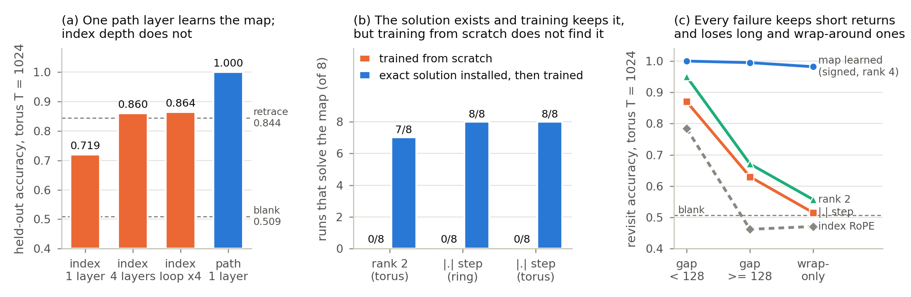

*Figure 1 (`fig_summary`). The paper in three panels (torus, T = 1024 unless marked). (a) One path-integrated layer learns
the map; index attention at one or four layers or looped four times does not (n = 4; dashed: this batch's retrace and
always-blank floors, 0.844 and 0.509). (b) For both constrained classes a solution exists and training keeps it (rank 2:
a rank-2 projection of a solved rank-4 model, 7/8 SOLVED after training; |.| on the ring: held 8/8) or re-finds it (|.|
on the torus: perturbed early, 8/8 SOLVED at the end), while training from scratch solves 0/8. (c) Every failing
one-layer model keeps short-gap revisits and loses long-gap and wrap-only ones; the model that learns the map holds all
three (n = 8 per arm; dashed: always-blank within each stratum).*

## 2. Background

**2.1 Rotary position as an integrator.** Write the phase of rotary channel c (a head and a two-dimensional block) at
token t as theta_{c,t} = omega_c Phi_{c,t}, with Phi_{c,t} = sum_{u <= t} Delta_{c,u} the channel's summed step. The
channel's contribution to the score of query t and key t' depends on position only through
exp(-i omega_c (Phi_{c,t} - Phi_{c,t'})), the identity behind Mamba-3's Proposition 3 (App. E1). Howard et al. (2014)
drive one bank of integrators by a rate alpha(t): a constant rate codes elapsed time (Case I), the speed codes distance
travelled (Case II), and the signed velocity codes position, the same for every visit to a place, "like a bead on a wire"
(Case III). The rotary families, as organised by GRAPE (Zhang et al. 2026), Selective RoPE and Mamba-3, sit in these three
cases with an imaginary rate: index RoPE adds a constant angle per token; CoPE, CARoPE and non-negative content steps
advance by a non-negative, content-dependent amount; MapFormer, Selective RoPE and Mamba-3's data-dependent RoPE add a
signed one, and alpha(t) is the selective-SSM step Delta_t. Velocity-modulated integrators have been trained with a real
Laplace variable (Alipour et al. 2025), and RoPE has been derived as a velocity-controlled oscillator on given coordinates
(GridPE, Li et al. 2024); the machine-learning models of the Howard and Tiganj labs keep the Laplace variable real
(Mochizuki-Freeman et al. 2023; Kabir et al. 2025). In the rotary slot a signed rate is a bounded rotation, and the three
cases differ not in what a channel can represent (Sec. 2.3) but in what the data and the optimiser make of it. TEM and
TEM-t (Whittington et al. 2020, 2022) frame the Case III code as a "where" learned apart from the "what".

**2.2 MapFormer.** MapFormer's working-memory model (MapWM) rotates content queries and keys by
theta_t = omega * cumsum(W_out W_in x_t), a low-rank content-to-angle map; observations learn near-zero steps and opposite
actions opposite steps (their Fig. 3d). In their Table 2, one-layer MapWM with rank 2 solves 2D navigation at 128 steps,
rank 1 does not, and RoPE, TAPE and CoPE with up to four layers fall short; they attribute CoPE's failure to the sign of
its gate. We build on exactly this model. Our implementation reproduces their Table 2 2D result (0.989 for MapWM and 0.987
for MapEM, against 1.00 reported in v4 and 0.99 / 1.0 in v1; App. A4).

**2.3 Representability.** Real non-negative eigenvalues cannot track parity (Sarrof et al. 2024, Thm. 2; Grazzi et al.
2025, Thm. 1). Rotations escape this, and rotations by non-negative angles generate cyclic groups (Grazzi et al., Thm. 3;
Mamba-3, Sec. 3.2). In the rotary slot the sign of a channel's step therefore does not limit what that channel can
represent. Proposition 3 below extends this to our rank-limited step maps, so any difference between signed and
non-negative steps in this paper is a difference in what training finds.

## 3. Setup and how map use is measured

**Models.** MapWM with one layer (up to four where stated), 2 heads, d_model 128, and step Delta = W_out W_in x through a
rank-r latent. Unless stated, r = 4 and the latent is shared across heads; MapFormer's latent is per head, and per-head
variants are named wherever rank is compared. *Per-head rank* is the rank of the map from token to the angles of one
head. Three step parameterisations: *signed* (Delta = s = W_out W_in x), *|.|* (Delta = |s|, applied per channel after
W_out) and *softplus* (Delta = softplus(s), so every step starts at ln 2). *Observation-step-free* variants give steps to
the move tokens only. Each head has 32 two-dimensional rotary blocks (*channels*) with frequencies
omega_i = 2 pi (1/Delta_max)^(i/31), Delta_max the grid size, as in MapFormer; omega is a free parameter whose sign is not
constrained. The layer is otherwise a standard pre-norm transformer block (feed-forward width 4 d_model, dropout 0.1; about
204k parameters at one layer). The index baseline is RoPE with the canonical ladder base^(-2c/d), at 1-4 layers or as one
block looped four times. We also pair PoPE (Gopalakrishnan et al. 2025), a rotary variant with a polar score, with its
path-integrated version MapPoPE, and compare faithful CARoPE, CoPE and Selective RoPE (App. I).

**Training and evaluation.** AdamW (learning rate 1e-3, weight decay 0.05), 5% linear warm-up then cosine decay to 10% of
the peak, 98 batches per epoch (16 walks per batch on the 1024-move torus, 128 on the ring and the 128-move torus),
cross-entropy on revisited observations only (Dyck-2: learning rate 1e-4, next-token loss; App. A2). Torus models are
scored on 100 walks over one held-out map, so every torus number is transfer to a new map; ring models on 400 walks with
freshly drawn maps.

**Tasks.** (i) *2D torus*: a 64 x 64 torus walked by runs of 1-10 repeated moves, interleaved with observations drawn
from 16 objects. Walks have T = 1024 moves (2,048 tokens), 900 epochs; MapFormer's T = 128 is used for the floor analysis
and the PoPE pair. (ii) *1D ring* of 32 cells, T = 128, forward-step probability p_plus (0.5 balanced; 1.0 never
reverses), 300 epochs. (iii) *Dyck-2* at length 32 and nesting depth 12, scored by Hewitt et al.'s (2020)
distance-averaged closing accuracy (chance 0.5). (iv) *Text world*: the torus walk rendered as English (58 words), T =
1024 words. (v) 2D and 3D tori of other sizes for rank against dimension. The loss and the accuracy are on *revisits*:
observations at cells visited before, the only predictable targets.

**Floors.** For each task we measure the best map-free predictor: always-blank, the best n-gram over orders 0-5, and
*retrace*: while the current run of moves undoes the previous run, copy the observation seen when the walk was last at
the cell it is returning to. A score is evidence of a map when it clears these floors.

**Strata.** Revisits are split by what a map-free rule can reach. *Short-gap* revisits come fewer than 128 moves after the
last visit to the cell; *long-gap* revisits come later; *wrap-only* revisits are to a cell seen before only from a
different unwrapped position, a full lap of the torus away. Runs are at most 10 moves, so retrace never reaches a long-gap
or wrap-only revisit; those two strata separate a map from a local rule. Figure 2 shows the strata for every model class
in the paper, and we return to it throughout.

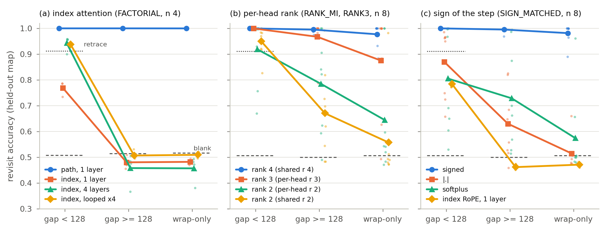

*Figure 2 (`fig_strata_modes`). Revisit accuracy by stratum on the torus at T = 1024; lines: arm means, dots: runs. (a)
Index attention (n = 4): depth and a loop help short-gap revisits only. (b) Per-head rank of the content-to-angle map
(n = 8, same seeds and initial weights): rank 4 is near 1.000 in every stratum; rank 2 loses accuracy with the gap and most
at wrap-only revisits. (c) Sign of the step (n = 8): signed near 1.000 everywhere; |.| and softplus fall from short gaps to
wrap-only revisits; one-layer index RoPE for reference. Dashed: always-blank within each stratum; dotted: retrace within
the short-gap stratum (0.91); floors on each batch's own walks.*

**Run classes and protocol.** A run is *SOLVED* if its mean training loss over the final 5% of epochs is below 0.05;
otherwise *STALLED* if its final-10% mean loss is within 5% of the preceding 10%, and *DESCENDING* otherwise. Every
accuracy and SOLVED contrast reported without the label "(analysis)" is a registered decision or a declared secondary
of a pre-registered batch unless marked "not registered", with n = 8 seeds per arm unless stated, every model trained and tested at the same length and
nesting depth, and exact permutation (accuracy) and Fisher (SOLVED) tests. Floors, strata floors and every number marked
"(analysis)" were computed on stored streams and checkpoints, eval-only. App. A lists every batch with its seeds, its
independent code check and its reproduction status; App. O lists every analysis script with its verification check.

## 4. Theory: maps and clocks in the phase

This section states what the results sections use; proofs are in App. E, and Table 1 gives the status of each statement.
Notation: a channel c has angle a_c(x) = omega_c step_c(x) for token x; for a step map the latent of token x is
z_x = W_in e_x and the channel's readout row is w_c, so step_c(x) = w_c . z_x before any |.| or softplus. The *usage* q_c of
a channel is its mean query norm at move tokens times its mean key norm at observation tokens, normalised to sum to 1. A
channel is *blind* to an inverse pair if both its angles are 0 mod 2 pi.

**Proposition 1 (the prefix sum is in the phase; proved).** The rotary score of channel c is
Re(conj(q~_c) k~_c exp(-i omega_c (Phi_{c,t} - Phi_{c,s}))) with q~ the channel's query as a complex number. If every move
token has a fixed step and every observation step is zero, theta_t = omega P_t, with P_t the unwrapped displacement after
move t, and the score depends on position only through omega (P_t - P_s). One layer then compares two positions at any gap
and any T, and wrapping costs nothing in a channel whose angle per move is a multiple of 2 pi / N.

Index attention sees position only through t - s, so "the moves in (s, t] sum to zero" must be computed in the residual
stream. **Remark 1 (cited).** A global count gives it in two layers in principle: uniform causal attention averages the
moves to P_t / n_t, an MLP rescales and takes the residue, and a second layer matches (Liu et al. 2023, Lemma 6; Yao et al.
2021). The construction needs a normaliser for the 1/n_t of causal averaging, precision 1/n_t (1/2048 per axis at the end
of a torus walk), MLP width of order 4nT (64 x 2048 per axis here, against our 512), and a target whose sensitivity grows
with the gap (Hahn and Rofin 2024, used for direction only). Rules that need no count, undoing the last run (retrace) or a
fixed one-lap offset, are available to one layer. The measured exchange rates are therefore what training
finds, not representational depth bounds.

**Clock and map.** For an inverse pair of moves (x, y) in channel c write the *clock* k_c = a_c(x) + a_c(y) and the *map*
m_c = a_c(y). Over an interval with n_x moves x and n_y moves y, displacement d = n_y - n_x, the phase is
m_c d + k_c n_x exactly. A *map code* has k_c = 0 mod 2 pi in every channel attention uses. To measure how far a trained
code is from one we use a single ratio throughout the paper (Table 4, App. G3, H7): the *clock / map ratio* is the
usage-weighted rms of wrap(k_c) over the usage-weighted rms of the map, with the map's size taken symmetrically over the
pair, (wrap(a_c(x))^2 + wrap(a_c(y))^2) / 2, so that the readout does not depend on which move is called y; sums run over
the inverse pairs and the channels of both heads (for one head, over its channels with its usage normalised to 1).

**Proposition 2 (a bound on the position factor, and the tick rule; proved).** (a) A zero-displacement revisit after n
backward moves reads phase k_c n in channel c. If a usage share s of the channels has kappa <= |k_c| <= K, the same-cell
position factor sum_c q_c cos(k_c n) is at most 1 - s (1 - cos(kappa n)) for n <= pi / K. The bound applies only while n
|k| stays below pi: it says how fast a clock erodes the position match of a revisit, not that every clocked code fails
at long gaps (by (b), a per-move tick of pi is invisible to revisits on the even torus). Index RoPE is the extreme case,
in which every token advances every channel. (b) More generally, if the target is the key at the last visit to the same
cell and returns come at lags with greatest common divisor g (g = 2 on the even torus), a channel can serve place-keyed
retrieval only if its per-move *tick* is 0 mod 2 pi / g.

**Proposition 3 (representability by wrapping; proved).** If at most r tokens step, a |.| model of rank r reproduces any
signed angle table exactly mod 2 pi; annihilating the observation embeddings in W_in leaves only the moves stepping, so
every |.| model in this paper can represent the map. Softplus and exp can too: with the observations annihilated each
steps softplus(0) = ln 2 or exp(0) = 1, and omega' = 2 pi / ln 2 or 2 pi makes that step a full turn.

**Lemma 1 (relative-sign gauge; proved).** Negating a channel's steps (through omega_c) together with the second coordinate
of that channel's query and key projections leaves every attention score unchanged, since J R(phi) J = R(-phi) for
J = diag(1, -1). A non-negative step therefore fixes only the relative signs of the tokens that step in a channel. For an
inverse pair it removes cancellation through zero, angles (a, -a), while the wrapped code (a, 2 pi - a), the same function,
remains.

**Proposition 4 (route inventory; proved).** (a) *Signed, collective route.* The clock vector is k = diag(omega) W u
with u = z_x + z_y. The set {u = 0} cancels every channel at once and leaves the map free; gradient flow on a quadratic
clock surrogate converges to it from every start; for almost every readout it is the only latent set that cancels every
channel. (b) *|.| has neither route from a small start.* The same latent move ends at a(y) = a(x), a clock. At a generic
readout no latent choice cancels more than 2r channels non-blindly. Per channel, an unwrapped |.| pair has |k_c| >=
|m_c|, and its non-blind zero-clock points lie at |k_c| = 2 pi n, across |k_c| = pi from a small start. (c) *Rank.* Let
c be the latent step common to all moves (with the mean observation step added when observations step) and U the map
frame, the half-differences of opposite moves' latents. At per-head rank D, c lies in the plane U spans, c = U beta for
a phantom displacement beta, so a channel is clock-free only by losing resolution along beta; above rank D the part of c
outside the map plane can be cancelled channel by channel with the map untouched (*parking*). (d) *One dimension.* At D
= 1 no readout change alters the drift-to-map ratio; only the collective route acts.

**Proposition 5 (hiding; proved to first order) and Conjecture 1.** At rank D >= 2 with isotropic resolution and a small
drift, rotating a channel's resolution off the drift direction lowers the drift loss at zero first-order cost to the map
(*hiding*). The collective route removes the drift at a rate proportional to the head's resolution along the drift
direction, which hiding lowers. *Conjecture 1:* this feedback keeps the drift in place at rank D >= 2; in 1D there is
nothing to hide along, which fits rank 1 learning the ring. Two empirical claims sit beside these statements and are
tested in Sec. 7.2: that at rank D on the torus the remaining clock is what blocks training (registered support), and
the *clock-exit account*, that rank above D helps because parking gives the clock a map-free exit (Proposition 4(c)
shows the exit exists, not that training uses it; a conjecture, its registered test PARTIAL).

**Remark 2 (exists, kept, not found).** Let S be the solution set of a class and Bas the set of starting points from which
training reaches S within the budget with probability at least one half. "A solution exists and an installed solution is
kept, but training from scratch does not find it" says that S is non-empty, S lies in Bas, and the initialisation
distribution puts little mass on Bas: the obstruction is where training starts, not what the class contains.

**Proposition 6 (readers and codes; proved).** In one layer, the query and key at a scored revisit depend on token
identity only, so the model is a position-only reader of its own code. MapFormer computes theta once from the
embeddings, so a loop or extra layers widen the reader and never change the code family (the set of codes the step map
can produce). Any score of the form sum_c A_c cos(dphi_c + beta_c) splits target coherence into a code term C0 (the
A-weighted cos dphi on the target) and a readout term C - C0; a score rule acts only on the second.

**Proposition 7 (peak pinning; proved given delta = 0).** PoPE's score sets beta_c = -delta_c with delta content-free and,
in trained models, in its clamp's dead zone (delta = 0). Then every head's kernel, for every content pair, is a
non-negative combination of cosines of dphi and peaks at dphi = 0. With a path phase dphi = 0 is the same place, the
revisit target. With an index phase it is the current token, and with PoPE's frequencies (at most 1 rad per token) every
content pair's kernel decreases over offsets 0-3, so no fixed far offset can be preferred in one layer.

*Table 1. Status of the theory (proofs in App. E).*

| statement | status | checked against |
|---|---|---|
| Prop. 1, prefix sum in the phase | proved | same-cell attention of path models at long gaps (Sec. 6) |
| Remark 1, two-layer count | cited (Liu et al. Lemma 6; Yao et al.) | probes: no count in torus index models (Sec. 6) |
| Prop. 2, position-factor bound and tick rule | proved | bound: consistent with the strata of every failing model (Fig. 2), not a test of them; tick rule: text-world channels (Sec. 8) |
| Prop. 3 and Lemma 1, representability and gauge | proved | constructions exact to 1.4e-6 rad (App. D) |
| Prop. 4, route inventory | proved | end-state clocks (Sec. 7.1); frozen latents; hybrid readout; route-with-barrier class (Sec. 7.3) |
| Prop. 5, hiding at first order | proved under small drift, isotropy, near-isometry | drift on the least-resolved axis (Sec. 7.2) |
| At rank D on the torus, the clock is the obstacle | registered causal support (shared rank 2, T = 1024, 900 epochs) | clock forbidden by construction 8/8 against observation steps zeroed 1/8 (Sec. 7.2) |
| Conjecture 1, hiding starves the collective route | conjecture | consistent with rank 1 learning the ring; its premise, a clock that persists at rank D, has the support of the row above; the feedback itself not tested |
| Clock-exit account: rank above D helps through parking | conjecture; registered test PARTIAL | explicit clock exits at rank 2: 3/8 against 1/8, Fisher p 0.57, most runs still descending (Sec. 7.2) |
| Remark 2, basins | definitional | existence and continuation batches (Secs. 7.2-7.3) |
| Prop. 6, readers and codes | proved | one-pass reader fits (Sec. 7.4) |
| Prop. 7, peak pinning | proved given delta = 0 | delta-freedom batch (Sec. 7.4) |
| Prop. 8, CARoPE cannot cancel | proved | trained CARoPE models (Sec. 7.3) |

## 5. One path layer solves the long-walk map

**Short walks mostly do not need a map (analysis).** On MapFormer's T = 128 torus walks retrace scores 0.934 (blank
0.507, n-gram 0.598), and no revisit is wrap-only. The walk moves in runs, and a run that reverses the previous one
returns, step by step, to cells seen moments earlier; over 128 moves nearly every revisit is of this local kind. At
T = 1024 retrace falls to 0.843 (blank 0.506, n-gram 0.575) and 7.9% of revisits are wrap-only (Table 2). At T = 128 the
path model still beats index attention (path 0.971 at rank 2 and 1.000 at rank 4, index 0.805; position effect +0.243 at
rank 2), but index RoPE falls below retrace there and the rank-2 path model clears it by only 0.04.

*Table 2. Torus floors (analysis, on the same evaluation walks as the models) and accuracies at MapFormer's walk length
and at ours (held-out map; n = 8 per model).*

| T (moves) | wrap-only revisits | blank | n-gram | retrace | index RoPE, 1 layer | path, rank 2 | path, rank 4 |
|---|---|---|---|---|---|---|---|
| 128 | 0.000 | 0.507 | 0.598 | 0.934 | 0.805 | 0.971 | 1.000 |
| 1024 | 0.079 | 0.506 | 0.575 | 0.843 | 0.731 | 0.894 | 0.998 |

**One path layer solves the long-walk map; index attention does not.** On the torus at T = 1024 one path layer scores
0.998 +/- 0.004 (8/8 SOLVED) against 0.731 +/- 0.008 for index RoPE (0/8), a difference of +0.267 (permutation and Fisher
p 0.0002). Index RoPE sits below retrace on every run (0.72-0.74; analysis): it does not learn even the map-free rule. Two
further registered batches give the same contrast: 1.000 against 0.722 (n = 8) and 1.000 against 0.719 (n = 4; Fig. 3c).
As Proposition 1 says, the path model's score depends on P_t - P_s directly, and it uses that at every gap.

**Where the difference lives.** By stratum (short gap / long gap / wrap-only), the path model scores 1.000 / 0.995 / 0.982
and one-layer index RoPE 0.784 / 0.462 / 0.471, against stratum floors of 0.506 / 0.500 / 0.507 and retrace 0.911 on short
gaps (analysis) (Fig. 2c). Index attention gains its margin over the constant on short gaps, where retrace does better
still; long-gap and wrap-only revisits require the map, and only the path model has it.

## 6. What index depth buys

Depth is the obvious way to give index attention more computation, so we ask how many index layers one path layer is
worth, with both trained and tested at the same length and nesting depth.

**Dyck-2: about three index layers.** A bracket string is a walk on a stack: an opening bracket steps forward, its closing
partner steps back, and MapFormer's models encode the two as opposite directions. At length 32 and nesting depth 12 one
path layer scores 0.996 (1.000 at 2-4 layers), and index attention 0.648 / 0.889 / 0.964 / 0.982 at 1-4 layers, against a
best stack-free floor of 0.594 (Fig. 3a). The position main effect, averaged over two encodings (MapWM vs RoPE and MapPoPE
vs PoPE; App. F), is +0.353 / +0.130 / +0.045 / +0.024 at 1-4 layers, positive on 8/8 seeds at each depth (sign-flip
p 0.0078). With three times the budget four index layers reach the ceiling (0.997-0.998), and training on a mixture of
depths 4-12 keeps an effect of +0.110 at depth 12 (8/8). The index arms are not held back by their frequency ladder: base
32 and base 10000 agree to 0.001 at four layers.

**A biased 1D walk: the same rate.** The ring dials how often a step is undone: at p_plus 0.5 the walk is balanced, at
0.9 one segment in ten runs backwards, and at 1.0 the walk never reverses and position is a count. On fresh seeds (n = 6)
one path layer scores 1.000 at every bias, and index attention with 1 / 2 / 3 layers 0.710 / 0.949 / 0.998 at p_plus 0.5,
0.677 / 0.962 / 0.998 at 0.75 and 0.824 / 0.987 / 0.999 at 0.9 (Fig. 3b; declared secondary). Wherever a step can be
undone, three index layers come within 0.002 of the path layer; at p_plus 1.0 a single index layer reaches 1.000.

**The 2D torus: more than four.** At T = 1024 (n = 4) one path layer scores 1.000 (4/4 SOLVED) against index attention at
one layer 0.719, at four real layers 0.860 and as one block looped four times 0.864 (each 0/4; complete separations, p
0.029) (Fig. 3c). Depth and the loop each help (+0.140 and +0.145), and the loop matches four real layers with a quarter of
the parameters (203,925 against 798,741). Four layers or a loop lift short-gap revisits from 0.769 to 0.943 / 0.938 and
leave long-gap (0.458 / 0.507) and wrap-only (0.457 / 0.509) revisits at the constant floor (0.515 / 0.517; Fig. 2a).

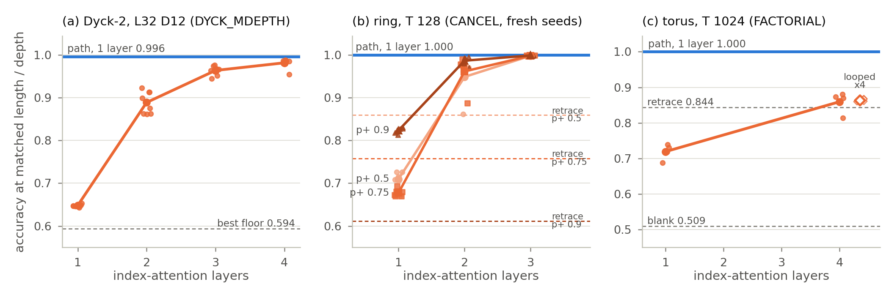

*Figure 3 (`fig_exchange_rate`). Accuracy of index-RoPE attention against its number of layers (orange; dots: runs, line:
means) beside one layer of path integration (blue line), each trained and tested at the same length and depth. (a) Dyck-2
at length 32 and depth 12 (Hewitt closing accuracy; n = 8): index attention needs about three layers to approach one path
layer (0.964 at 3, 0.982 at 4, against 0.996). (b) Ring of 32 cells at T = 128 for three move biases (n = 6 fresh seeds;
declared secondary): three index layers reach one path layer (0.998-0.999 against 1.000). (c) Torus at T = 1024 (n = 4):
four index layers (0.860) or one layer looped four times (0.864) stay far below one path layer (1.000), just above this
batch's retrace floor (0.844; the 0.843 of Table 2 is the floor on the sign batch's walks). Dashed lines: map-free floors
(analysis; Dyck: the best stack-free floor; ring: retrace per bias, on another stream of the same task; torus:
always-blank and retrace on this batch's own walks).*

**Why the rate differs by task.** A revisit asks for an earlier observation at the same cell, that is, for a key whose
moves since then sum to zero. Remark 1 offers index attention a global count or rules that need none. The stored models
show that training finds only the second kind, with a reach that differs by task (analysis; Table 3, App. F). One index
layer learns retrace and the one-lap offset: on the ring it scores 0.68-0.80 on retraces, 0.99-1.00 on one-lap returns
once they are common, and the floor on everything else at p_plus 0.5 and 0.75 (0.487 against 0.491-0.493; at 0.9 an
unexplained 0.592 against 0.502), so at p_plus 1.0, where every revisit is a one-lap return, it matches the path layer.
Three index layers on the ring are flat in the number of direction runs a revisit spans (0.997 / 0.993 / 0.972 at 3-4 /
5-8 / 9-16 runs, wrap-only revisits included; 0.999 / 0.996 / 0.988 on plain revisits only, Fig. 4b) and carry a displacement code over the last ~64 moves (linear-probe R^2
0.72 for the displacement over the last 64 moves, read at moves 96-127); displacement older than 64 moves is not
decodable (R^2 0.01), so no global count is detectable on the ring either, and on 128-move walks a 64-move window covers
most revisits. On the torus no index model carries a count (R^2 at most 0.21). Four layers or the loop solve retraces
(0.996 / 1.000) and decay with the number of runs spanned, at a fixed gap as well as overall (Fig. 4a): at gaps of 32-127 moves
four layers score 0.874 at 2 runs and 0.493 at 17 or more (seed means). Their last layer puts 0.55-0.58 of its attention
on the remembered cell for retraces and 0.00-0.01 at long gaps, where the path layer puts 0.81. Nearly all long-gap
revisits span 17 or more runs (98.5%; median 37), beyond that reach. Short-gap accuracy decomposes over these classes:
the retrace floor is (0.680 x 1 + 0.148 x 0.5) / 0.828 = 0.911, and four layers give (0.680 x 0.996 + 0.148 x 0.699) /
0.828 = 0.943, so depth adds the exact retrace rule plus partial returns over 3-8 runs.

*Table 3. Torus at T = 1024: accuracy by revisit class (analysis; FACTORIAL models, n = 4, eval mode; "runs" = maximal
runs of one move between the two visits; share = fraction of all revisits; class contrasts at n = 4 carry no test).*

| revisit class | share | index 1 layer | index 4 layers | index loop x4 | path 1 layer |
|---|---|---|---|---|---|
| short gap, retrace | 0.680 | 0.833 | 0.996 | 1.000 | 1.000 |
| short gap, not retrace: 3-4 runs | 0.031 | 0.477 | 0.926 | 0.977 | 1.000 |
| ... 5-8 runs | 0.056 | 0.476 | 0.735 | 0.645 | 1.000 |
| ... 9-16 runs | 0.052 | 0.474 | 0.561 | 0.499 | 1.000 |
| ... 17+ runs | 0.009 | 0.472 | 0.493 | 0.502 | 1.000 |
| long gap (>= 128 moves) | 0.090 | 0.480 | 0.458 | 0.507 | 1.000 |
| wrap-only | 0.083 | 0.482 | 0.457 | 0.509 | 1.000 |

So depth buys index attention a local reach measured in direction runs, and the torus rate is "more than four" because
its long-range revisits lie beyond that reach and the global count is not found. The same four passes do something else on
a rank-2 path code: they lift long-gap revisits from 0.671 to 0.927-0.990 and wrap-only revisits from 0.557 to
0.747-0.887 (Sec. 7.4). Extra passes add accuracy where the code carries position information that one pass cannot read,
and none where it carries none.

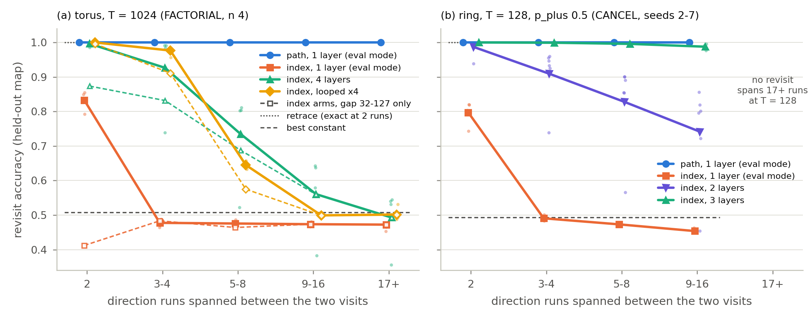

*Figure 4 (`fig_segments`; analysis of registered batches, eval mode). Revisit accuracy against the number of direction
runs (maximal runs of one move) the walk spans between the two visits; lines: means of per-seed accuracies (seed means,
not pooled); dots: seeds. (a) Torus at T = 1024 (FACTORIAL, n = 4). Solid: plain revisits at gaps under 128 moves (2 runs
= retrace; the rows of Table 3). Four index layers fall from 0.996 at 2 runs to 0.926 / 0.735 / 0.561 / 0.493 at 3-4 /
5-8 / 9-16 / 17+ runs and the loop from 1.000 to 0.977 / 0.645 / 0.499 / 0.502; one index layer (eval mode) scores 0.833
on retraces and 0.472-0.477 beyond; one path layer scores 1.000 in every bin. Dashed: plain revisits at gaps of 32-127
moves only, the fixed-gap control: the same decay (four layers 0.874 at 2 runs to 0.493 at 17+, the loop 0.996 to
0.502). (b) Ring of 32 cells at T = 128, p_plus 0.5 (fresh seeds 2-7, n = 6), plain revisits only (wrap-only revisits
and one-lap returns excluded; 2 runs = retrace): three index layers stay flat (1.000 / 0.999 / 0.996 / 0.988 at 2 / 3-4 /
5-8 / 9-16 runs), two layers decay (0.987 / 0.910 / 0.828 / 0.742), and one layer (eval mode) learns retrace only (0.797,
then 0.454-0.491); no ring revisit spans 17 or more runs. Floors on each batch's own walks: retrace is exact on 2-run
revisits (dotted) and falls to the best constant elsewhere (dashed: the torus short-gap stratum's 0.508; the ring's
'neither' class 0.493, a class that includes wrap-only revisits).*

## 7. What decides whether training finds the map

Two choices of the content-to-angle map decide whether the torus map is learned: its per-head rank and the sign
parameterisation of its step. For each, the constrained class fails from scratch, a solution in the class exists and is
constructed explicitly, and that solution, installed and trained, is kept or re-found. Section 4 says what to look for:
whether training removes the clock, and by which route.

### 7.1 The clock and the signature

Training from a small start ends in one of two places on either axis (Table 4, Fig. 5; analysis; the clock / map ratio of Sec.
4). The models that succeed end with clock-free heads: the signed and rank-3/4 arms at arm means 0.001-0.051, with no
head above 0.14, and every solved rank-2 run with at least one clean head (0.03-0.07; two of the four keep a drifting
second head, 0.54 and 0.68). The models that fail end with a clock of the order of their map: the non-negative arms at
1.25-1.57 (arm means; for an unwrapped |.| channel a ratio of at least 1 holds by construction, so the informative part
is that the channels did not wrap) and the unsolved rank-2 runs at 0.54-0.69 (medians 0.58-0.79). The exceptions are
informative too: 4 of the 20 unsolved rank-2 runs end with clock-free heads whose two map axes have collapsed onto one
direction (a map that has lost a dimension; App. G3), and one more sits just above the SOLVED threshold (final loss
0.051). The measured strata show the signature that Proposition 2's bound leads one to expect: shared rank 2 scores
0.950 / 0.671 / 0.557 on short-gap / long-gap / wrap-only revisits and |.| 0.870 / 0.630 / 0.515, against 1.000 / 0.995
/ 0.982 for the signed rank-4 model (Fig. 2b-c). The bound alone does not predict failure: two signed torus runs started
with angle sums past pi solve with clock / map 1.39 and 1.78, with 0.43 and 0.99 of their usage on channels whose
per-pair clock is near pi, where the bound says nothing (App. H7). Weighted by usage, signed steps cancel opposite moves
mod 2 pi in 70-93% of channels and |.| steps in 2-10% (analysis; App. H6).

*Table 4. Clock at the end of training (analysis; clock / map ratio of Sec. 4, one value per run, arm means unless marked;
SOLVED of 8). For unwrapped |.| channels the ratio is at least 1 by construction; the informative rows are the
frozen-latent signed arm and the rank arms.*

| arm | SOLVED | clock / map |
|---|---|---|
| ring, signed (three batches) | 8/8, 7/8, 8/8 | 0.015-0.018 |
| ring, \|.\| from small starts (three batches) | 0/8, 0/8, 1/8 | 1.47-1.57 |
| ring, signed with move latents frozen, \|.\| start | 1/8 | 1.18 (the solved run 0.06) |
| ring, \|.\| from a start past pi | 8/8 | 0.32 (wrapped; 0.82 of usage on cancelling channels) |
| torus, signed / \|.\|, observation-step-free | 8/8 / 1/8 | 0.001 / 1.25 |
| torus, rank 2, unsolved runs (three arms) | 0/8, 2/8, 2/8 | 0.54-0.69 (medians 0.58-0.79); 4 of 20 runs collapsed, clock-free |
| torus, rank 2, solved runs (4): six clean heads / two drifting heads (per head) | 4 runs | 0.03-0.07 / 0.54, 0.68 |
| torus, rank 3 and rank 4, solved runs | 6/8, 8/8, 8/8 | 0.043-0.051 |

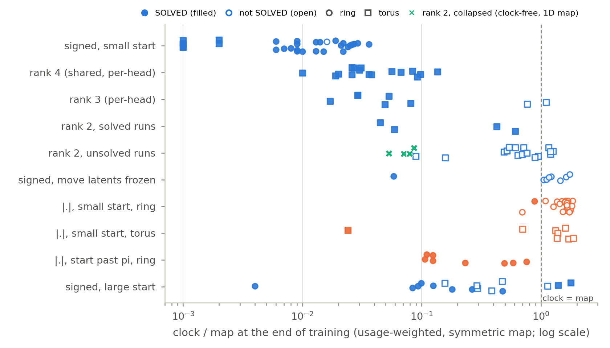

*Figure 5 (`fig_clock_endstate`; analysis of registered batches). Clock / map ratio at the end of training, one dot per
run (circles: ring; squares: torus; filled: SOLVED; log scale), on the one definition of Table 4 throughout (symmetric
map, usage-weighted over both heads). Successes from small starts are clock-free: signed 0.001-0.036 (31 of 32 runs
SOLVED; the unsolved one at 0.016), rank 4 0.010-0.136 (16/16), solved rank 3 0.017-0.081. Failures carry a clock of the
order of the map: |.| from small starts 0.70-1.85 on the ring (1 of 24 SOLVED, at 0.88) and 0.70-1.87 for the unsolved
torus runs (the solved one at 0.024), signed with move latents frozen 1.055-1.741 (the solved run 0.058), unsolved rank 3
0.767-1.105 and unsolved rank 2 up to 1.26 (median 0.62). Four unsolved rank-2 runs are clock-free (0.053-0.086) with their
two map axes collapsed onto one direction (crosses; App. G3). The solved rank-2 runs span 0.045-0.611 (two keep a
drifting second head). Starts past pi cancel by wrapping and solve at larger ratios: |.| on the ring 0.11-0.76 (8/8);
signed 0.004-1.78 (10 of 16, ring and torus), the two solved torus runs at 1.39 and 1.78 with 0.43 and 0.99 of their
usage on channels whose per-pair clock is near pi. For an unwrapped |.| channel a ratio of at least 1 holds by
construction.*

### 7.2 Per-head rank of the content-to-angle map

**Per-head rank decides it.** On the torus at T = 1024 we compare six bottlenecks, all built from the same initial weights
at each seed (Table 5, Fig. 6a). Every arm whose heads each read a rank-2 map solves 0-2 of 8; rank 3 solves 6/8 and rank
4 8/8, whether the latent is shared or per head. At matched sharing (per-head rank 4 against a block-diagonal rank-4 latent
in which each head reads rank 2) the split is 8/8 against 2/8 (Fisher and permutation p 0.0070). Per-head rank 3 improves
on per-head rank 2 by +0.102 in accuracy (permutation p 0.027, Holm 0.054). Total latent size does not track success: the
per-head rank-2 arm and the shared rank-4 arm both have four latent dimensions and land on opposite sides. Nor does the
initial angle scale: two rank-2 arms start at the same scale as rank 4 and fail. Most rank-2 runs flatten at losses of
0.2-0.5, while the rank-3 and rank-4 medians cross the SOLVED threshold at epochs 478-532 (App. G). With MapFormer's
Table 2, the picture is: rank 1 cannot represent a 2D map; rank 2 can, and learns 128-step walks; at 1024 moves reliable
learning needs per-head rank above the map's dimension.

*Table 5. SOLVED (of 8) and held-out accuracy at T = 1024 (mean over 8 seeds) by per-head rank; torus, 900 epochs, every
arm built from the same initial weights at each seed.*

| per-head rank | arm | SOLVED | accuracy |
|---|---|---|---|
| 2 | one rank-2 latent shared by the heads | 0/8 | 0.894 |
| 2 | per-head rank-2 latents | 2/8 (1/6 on seeds 2-7) | 0.885 |
| 2 | block-diagonal rank 4 (each head reads rank 2) | 2/8 | 0.948 |
| 3 | per-head rank 3 | 6/8 | 0.987 |
| 4 | shared rank 4 | 8/8 | 0.998 |
| 4 | per-head rank 4 | 8/8 | 0.999 |

**Twice the budget does not rescue rank 2.** Trained for 1800 epochs from scratch, rank 2 solves 0/8 (0.908) against rank
4's 7/8 (Fisher p 0.0014; accuracy +0.086, permutation p 0.0003). PoPE's polar score does not rescue it either: 3/12
SOLVED under either score at T = 1024, with rank 4 at 8/8 under both (Sec. 7.4 gives the reason).

**Nor does a recipe search (registered).** Rank 2 was given three recipes on fresh seeds (App. G9): the default (learning
rate 1e-3, weight decay 0.05), three times the learning rate and four times the weight decay. It solves 0/8 at each (0/24),
while rank 4 solves 8/8 at the default. Rank 2 at its best recipe (learning rate 3e-3, selected on training loss) scores 0.910 against
rank 4's 1.000 (SOLVED 0/8 against 8/8; decision p 0.0002 on both, selection included). The search favours rank 2, which
picks its best of three while rank 4 gets one. Rank 4 in turn needs weight decay (App. G8), so the rank result reads: rank
D + 1 with weight decay learns the torus, and rank D fails at the best of three recipes.

**The rank-2 solution exists and is held.** The rank-2 projection of each solved rank-4 model scores 0.9955 frozen (at
least 0.981 on every seed). Trained from there it solves 7/8, as many as the rank-4 control trained from its own solution
(7/8), against 1/8 for rank 2 trained further from its own stalled weights (accuracy p 0.0009) (Fig. 7a). A rank-2 map
that solves the torus exists, is kept by training, and is not reached from scratch.

**Rank against the map's dimension.** Rank equal to the map's dimension D is hard in 2D and 3D and not in 1D (Fig. 6b). On
a 2D torus of 32 cells per side rank 2 solves 1/8 against rank 3's 8/8 (Fisher p 0.0014). On a 3D torus of 10 cells per
side rank 3 solves 1/8 (rank 4, 4/8), and rank 4 solves an 18-per-side 3D torus 8/8 (1.000). On the 1D ring rank 1 solves
7/8 against rank 2's 8/8, and with the drift forbidden by construction rank 1 solves 8/8 in a median of 24 epochs instead
of 58.

**On the torus the rank-2 obstacle is the clock (registered).** A registered batch on fresh seeds (torus, T = 1024, 900
epochs, shared rank, seven arms built from the same initial weights at each seed; App. G7) tests this causally. Its
gates replicate the rank split: rank 2 solves 1/8 and rank 4 8/8. In the *drift-forbidden* rank-2 arm the steps of each
inverse pair of moves are tied to exact negatives of one another (+-W_out W_in (e(+x) - e(-x)) / sqrt 2) and every
observation step is 0, so the clock is zero by construction; it solves 8/8 at accuracy 1.000 on every seed, like rank 4,
and scores 1.000 at twice the training length (rank 4: 0.986; descriptive). In the *actions-only* rank-2 arm only the
observation steps are 0 and the four move steps stay free, so the moves' own clock remains; it solves 1/8, no better
than rank 2 (1/8), against the drift-forbidden arm's 8/8 (Fisher p 0.0014). At the rank that fails, removing the clock
is sufficient and removing its observation part is not: what stops rank 2 is the clock, not the rank's capacity to hold
the map, which the existence test above already showed it has. The construction removes the clock without saying how an
unconstrained step map gets rid of one; the next paragraph tests that.

**Why the extra rank helps.** Proposition 4(c) gives a channel above rank D a map-free way to stop reading the clock.
The same batch's registered primary asks whether that exit is why extra rank helps, by giving rank 2 an explicit clock
exit without extra map rank: a learned per-channel slot per move axis (one added to the steps of both x-moves, one to
both y-moves, initialised at zero; +128 parameters), which can cancel the clock's common and axis-differential parts
while the map stays rank 2. It solves 3/8 against rank 2's 1/8 (Fisher p 0.57; accuracy 0.972 against 0.918), and a
single per-token slot, which can cancel only the common part, also solves 3/8: registered PARTIAL, short of the 6/8 with
Fisher p below .05 that would have read "clock exits help" and above the 2/8 that would have read "they do not". Every
class contains a solution and keeps or re-finds it under training (installed frozen at 1.000, SOLVED again after a
60-epoch warm start), so the shortfall is search; and 4 of the 5 unsolved per-axis slot runs were still descending at
900 epochs (3 of 5 per-token), so the batch does not separate slower from unable. "Extra rank helps because it gives the
clock an exit" is therefore not supported at the registered bar, and not refuted. The stored checkpoints are consistent
with parking but do not discriminate it from plain removal of the clock through the latent (analysis; App. G4). Here the
clock is c = a + o, the mean move latent a plus the mean observation latent o, the drift a walk accumulates per move and
observation. In solved heads of rank above D, a and o are each 0.02-0.04 of a map step and point in opposite directions
(cosine -0.79 to -0.999), so they cancel; at T = 1024 both lie mostly in the map plane. What is left of c (0.001-0.025
of a map step) lies almost entirely outside the plane: off-plane share 0.96-1.00 in nine of ten sets of heads, against
0.40-0.71 for a random direction (median), read at 0.09-0.27 of the map's gain. Parking and removal through the latent
would both leave such a residual. Drifting rank-D heads drift along their least-resolved axis (50 of 55 runs, counting
each network once, against 25.1 expected for a random direction), the geometry Proposition 5 leads to. A fresh rank-4
step map trained on the stalled rank-2 networks removes the drift in 16 of 16 heads: its latent clock shrinks 14-85x in
absolute size, and the residual (0.002-0.005 of a map step) lies off the plane (share 0.91-1.00). At rank 1 on the ring,
Proposition 4(d) leaves only the collective route, and Conjecture 1 has nothing to starve: rank 1 learns.

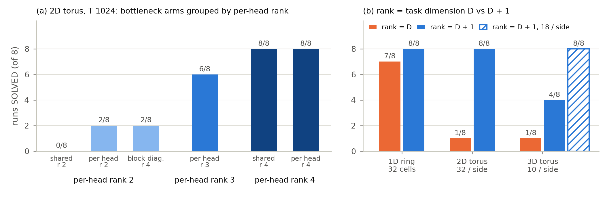

*Figure 6 (`fig_rank_solved`). Runs (of 8) that solve the map, by the per-head rank of the content-to-angle map. (a) Torus,
T = 1024, six bottlenecks built from the same initial weights: every arm whose heads each read a rank-2 map solves 0-2/8,
rank 3 solves 6/8 and rank 4 8/8, whether the latent is shared or per head. (b) Rank equal to the task's dimension D
against D + 1 (separate batches and recipes): on the 1D ring rank 1 solves 7/8 (rank 2, 8/8); on a 2D torus rank 2 solves
1/8 (rank 3, 8/8); on a small 3D torus (10 per side) rank 3 solves 1/8 and rank 4 4/8, and rank 4 solves 8/8 on an
18-per-side torus with few wrap-only revisits (hatched). Torus budget 900 epochs; at 1800 epochs rank 2 still solves 0/8.*

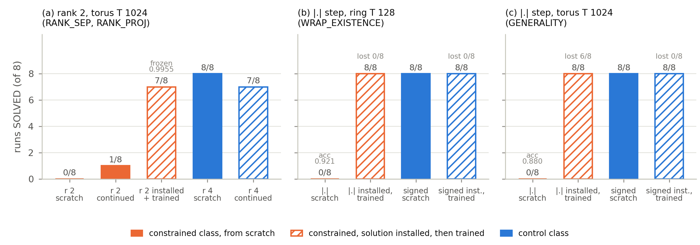

*Figure 7 (`fig_existence`). A solution exists in each constrained class and training keeps or re-finds it, but training
from scratch does not find it. Bars: runs SOLVED of 8 (hatched: the solution was installed and then trained). (a) Rank 2
on the torus: a rank-2 projection of a solved rank-4 model scores 0.9955 frozen and is held when trained (7/8), while rank
2 from scratch solves 0/8, and 1/8 when the stalled runs are trained further. (b) The |.| step on the ring: an installed
exact non-negative solution is held under training (8/8 SOLVED, lost on 0/8), while |.| from scratch solves 0/8 against
signed 8/8. (c) The |.| step on the torus: the installed solution is perturbed (loss above 0.05 on 6/8) and re-found (8/8
SOLVED); from scratch 0/8 against 8/8. "Lost": the maximum per-epoch training loss after the start exceeds 0.3, or exceeds
10x the signed control's maximum at that seed and 0.05.*

### 7.3 The sign of the phase step

**Non-negative steps rarely learn the map from scratch.** On the torus at T = 1024 the |.| step scores 0.821 against 0.998
for the signed step, -0.177 (permutation p 0.0002), and solves 0/8 against 8/8; softplus scores 0.781 and solves 1/8
(-0.218, p 0.0003). On the ring |.| solves 2/8 and 1/8 against 8/8 at p_plus 0.5 and 0.75 (Fisher p 0.007 and 0.0014).
Observation-step-free models show the same: 0/8 against 8/8 on the ring and on the torus (0.880 against 1.000). The
training curves separate (Fig. 8): the signed median crosses the SOLVED threshold at epoch 480 / 57 / 309 / 183 in four
batches and keeps descending, while most |.| runs flatten at a loss of 0.3-0.5.

**The cost holds at each step's best learning rate, on the torus and the ring, without weight decay and at 2 layers
d_model 256** (Table 6). On the T = 1024 torus, with each step at its own best of three learning rates (1e-3 to 1e-2,
weight decay coupled to the rate), |.| solves 0/8 at every rate and 0/8 at its best (3e-3, 0.890) against signed 8/8 at
1e-3 (1.000), with selection-aware p 0.0002 on SOLVED and 0.0095 on accuracy (App. H12). The |.| optimum is interior on
both its loss and its accuracy; the signed optimum is the grid's lowest rate, where it is already at ceiling. On the ring,
at each step's own best of four rates (the |.| optimum, 3e-3, again interior), |.| solves 2/8 against signed 8/8
(selection-aware p 0.0070 on SOLVED and 0.0057 on accuracy). Without weight decay the ring
gives 0/8 against 8/8 (-0.127); at a third of the learning rate, 0/8 against 6/8. A 2-layer, d_model 256 torus model with
eight times the parameters gives 2/8 against 8/8 (0.967 against 0.999, p 0.0005). Across the ring's learning-rate grid, higher
rates hurt the signed step first (8, 8, 4 and 1 of 8 solved at 1e-3, 3e-3, 1e-2 and 3e-2) and do not help |.| past 3e-3
(1, 2, 1 and 0 of 8). On the torus the same holds more sharply: within 900 epochs signed solves 8, 0 and 0 of 8 at 1e-3,
3e-3 and 1e-2 (every run at the higher rates still descending, at 0.975 and 0.968), and |.| none at any rate. Two further non-negative increments behave alike at the two reference rates: exp, the LRU
parameterisation, and softplus, both of which start every token at the same positive step, solve 1/8 to 3/8 against
signed 8/8 (App. H).

*Table 6. The sign cost by task, model and recipe (observation-step-free models unless marked "full"; n = 8 per arm).*

| task and model | recipe | \|.\| accuracy, SOLVED | signed accuracy, SOLVED | test |
|---|---|---|---|---|
| torus, 1 layer, full | default (lr 1e-3, weight decay 0.05) | 0.821, 0/8 | 0.998, 8/8 | perm p 0.0002; Fisher 0.0002 |
| torus, 1 layer | default | 0.880, 0/8 | 1.000, 8/8 | perm p 0.0002; Fisher 0.0002 |
| torus, 1 layer | each step at its best of three rates (\|.\| 3e-3, signed 1e-3) | 0.890, 0/8 | 1.000, 8/8 | selection-aware p 0.0002 (SOLVED), 0.0095 (accuracy) |
| torus, 2 layers, d_model 256 | default | 0.967, 2/8 | 0.999, 8/8 | perm p 0.0005; Fisher 0.0070 |
| ring, full, p_plus 0.5 | default | 0.973, 2/8 | 1.000, 8/8 | Fisher 0.0070 |
| ring | default | 0.911, 1/8 | 1.000, 8/8 | perm p 0.0002; Fisher 0.0014 |
| ring | weight decay 0 | 0.873, 0/8 | 1.000, 8/8 | perm p 0.0002; Fisher 0.0002 |
| ring | lr / 3 (3.3e-4) | 0.841, 0/8 | 0.950, 6/8 | Fisher 0.0070 |
| ring | each step at its best of four rates (\|.\| 3e-3, signed 1e-3) | 0.963, 2/8 | 1.000, 8/8 | selection-aware p 0.0070 (SOLVED), 0.0057 (accuracy) |
| ring, 1-layer diagonal complex SSM (no softmax) | lr 3e-3 | 0.821, 0/8 | 1.000, 8/8 | perm p 0.0002; Fisher 0.0002 |

**The non-negative solution exists, and training keeps or re-finds it.** Proposition 3 constructs it: each solved signed
observation-step-free model is converted exactly into |.| form, with the move latents re-solved to orthogonal directions,
each channel's frequency set to max(|omega|, 1) and each step to the signed angle reduced mod 2 pi. Angles are unchanged
mod 2 pi (error at most 1.4e-6 rad), frozen accuracy equals the source's on 8/8 seeds, and the weights stay within about 5x
of the signed model's, so the test is posed at the scale training uses (App. D). On the ring the constructed |.| model,
trained for 300 more epochs, stays solved on 8/8 seeds and never leaves the solved region, keeping its cancelling code in
the channels attention uses (98%, usage-weighted). On the torus, trained at learning rate 1e-4, it is perturbed early (peak
loss 0.11-0.21), re-enters the solved region for good between epochs 119 and 204, and ends solved on 8/8 seeds at accuracy
1.000. From scratch the same class solves 0/8 on both tasks (Fig. 7b-c).

**Why the non-negative step does not find it.** Proposition 4(b) says the |.| class lacks both routes from a small start,
and the stored models show the consequences (analysis; App. H). At initialisation a latent move produces exactly the change
of angle sums the signed step needs (share 1.000) but only 0.34 of what |.| needs (0.56 usage-weighted); the rest must come
from per-channel readout changes. With the content of a solved model held fixed, the loss along the straight path from the
start to the |.| solution rises above its running minimum by 0.6-1.9 nats on every seed, against 0.04-0.48 for the signed
path (complete separation). Rotating one move latent toward the negative of the other, with nothing else changed, takes
the signed model from 0.30 to 0.72 accuracy and leaves the |.| model at 0.30, since under |.| that move makes a clock. The
cone of Proposition 4(b) is where trained |.| ring models end: 0.25-0.36 of their sub-pi channels lie within 10% of its
boundary, where one move's step is zero, against 0.056 at initialisation. In full training the content co-adapts along the
collective route; with the content frozen, the step map alone rarely takes it from the same-direction start (exploratory:
these CPU runs are not deterministic, and single runs moved by up to 0.43 in accuracy on re-runs; App. H7).

**The cost is carried by the increment, not the readout.** A hybrid whose readout matrix is confined to the non-negative
orthant, a_c(x) = omega_c |w_c| . z_x, but whose latent and hence increment are signed, keeps the collective route. On the
ring it solves 8/8 at both reference rates, at accuracy 1.000 on every seed, exactly as signed, against |.| 0/8 and 2/8
(Fisher p 0.0002 and 0.007), and ends where Proposition 4(a) says: antipodal move latents (median |z_x + z_y| /
(|z_x| + |z_y|) 0.043 and 0.002; cosine -0.996 and -1.000). A |.| control with the move latents tied antipodal by
construction, whose two steps are then equal and whose code is a pure clock, solves 0/16. Non-negativity in the readout
costs nothing; a non-negative increment, which removes both the collective route and the near-side cancelling point, is
what costs.

**The cost is not specific to softmax attention.** Replacing softmax attention by the causal unnormalised kernel, with
every other tensor initialised identically, turns the model into a one-layer diagonal complex state-space model whose
transition is the rotation exp(-i omega Delta(x_t)) (the identity of Mamba-3's Proposition 3; the parallel form equals the
recurrence to 1e-12). On the ring at learning rate 3e-3 the |.| step solves 0/8 against 8/8 for the signed step (0.821
against 1.000, below the 0.864 retrace floor; Fisher and permutation p 0.0002), and softplus solves 1/8 (registered; App.
H10). The signed SSM ends as signed attention does, with antipodal move latents (cosine -1.000) and every non-blind
channel cancelling through zero. The exact non-negative constructions carry over: frozen, the |.|, softplus and exp
models score as their sources on 8/8 seeds, and the |.| model trained further ends solved on 8/8 at both learning rates
tried, after an early perturbation. The cost belongs to the non-negative rotary step, not to softmax normalisation.

**How signed steps reach the map.** Started from the |.| start, with both moves rotating the same way, signed steps still
solve 7/8 on the ring (|.| from the same start: 0/8; Fisher p 0.0014). They end with 98-99% of channels opposite-signed
(analysis): they cancel opposite moves through zero, which Lemma 1 shows the non-negative step excludes for an inverse
pair (Fig. 9). The escape is collective. Freezing the two move latents, with W_out and omega still free, blocks it: 1/8
against 7/8 (Fisher p 0.010), and the frozen-latent model ends where the non-negative step ends (clock / map 1.18,
Table 4). With the latents free, one move's latent moves toward the negative of the other's and every channel cancels
together (82% of channels end opposite-signed, against 15% with the latents frozen). MapFormer described this antipodal end
state (their Figs. 3d and 9b); this is the causal test of how it is reached. A |.| step has only the wrapped branch, and on
the ring it learns the map when its opposite-move angles start with sums past pi (8/8, cancelling by wrapping; Fig. 9d).

**A collective route does not carry the non-negative step past pi.** The hybrid removes both obstacles Proposition 4(b)
names for |.|, the missing collective route and the barrier at |k_c| = pi, so it cannot say which one binds. A registered
2x2 builds the two missing cells on the ring from one common start, the |.| start above, at which all four classes
compute the same function (App. H11). The first adds to |.| one learnable offset per move, a_c(x) = omega_c |w_c . z_x +
tau_x pi / |omega_c||: both angles keep one sign, so the barrier stays, but u = 0 with tau_x + tau_y = 2 cancels every
channel at once by wrapping, for any readout, so the class has a collective route. The second is the signed step with its
move latents frozen: no barrier and no collective route. At learning rate 3e-3 the route class solves 0/8 against signed
8/8 (Fisher p 0.0002). The same class started with every channel past pi solves 7/8 and ends exactly on the collective
wrap point (offset sum 2.00 on every seed, move latents antipodal), so the offsets are usable; started small, the offset
sum stops at 0.13-0.70 on every seed, short of 1, where the offsets alone would carry a channel to pi. The registered
half-reading is that the barrier blocks: a route to the wrap is not enough. The frozen-latent signed class solves 4/8,
between the anchors (|.| 3/8), so whether removing the barrier alone suffices is unmeasured, and the registered reading
of the 2x2 is unmeasured. At 1e-3 the batch's signed anchor solved 5/8 from this start (7/8 in two earlier batches),
below its gate, and that rate is unreadable; the frozen-latent class solved 3/8 there (1/8 in the test above). The
barrier account has one registered half behind it, and the route account is neither confirmed nor excluded: why the
non-negative step fails from a small start remains an account.

**Published content phases also miss the torus map.** Faithful CARoPE cannot represent cancellation. *Proposition 8
(proved):* CARoPE advances every channel by an amount in (0, 1] per token, so the shortest return's phase lies in
(0, 4], never 0 mod 2 pi, and every channel is either a clock or blind over an excursion (App. E5). It scores 0.667 on the
torus (0/8), below index RoPE's 0.722 (p 0.040). Faithful CoPE can represent ring cancellation (we construct the solution;
App. I) yet solves 0/8 on the ring (0.887 against signed 1.000, p 0.0002) while beating index RoPE by +0.157, and it fails a
256-cell line that never wraps (1/16 against signed 8/8), so its obstacle is not what it can represent. Faithful Selective
RoPE, a signed content-dependent phase in its authors' best language-model configuration, builds a phase it relies on (it
beats index RoPE by +0.236, and zeroing its angle drops it from 0.961 to 0.507) but does not learn the torus map within 900
epochs: 0/8 SOLVED against MapWM's 8/8 in the same batch (0.961 against 1.000, p 0.0002), with every run still
descending. Its readouts show why the map is harder for it: every token steps the phase, and an observation steps 0.86-0.96
as far as a move (MapWM: 0.027), so what is seen moves where the model thinks it is. Its state-tracking configuration
carries a positive bias that keeps every learned step non-negative, and it fails as the non-negative steps do (0.769, 0/8).

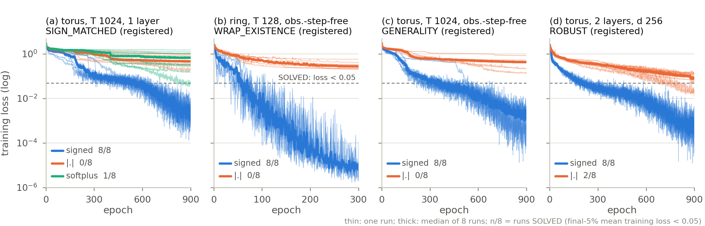

*Figure 8 (`fig_loss_curves`). Training loss per epoch for the signed step (blue) and the non-negative steps |.| (orange)
and softplus (green), every run of four batches (thin lines; thick: median of 8 runs; log scale; training loss with
dropout on). Dashed line: the SOLVED threshold (final-5% mean training loss below 0.05); n/8 = runs SOLVED. (a) Torus,
T = 1024, one layer: signed 8/8, |.| 0/8, softplus 1/8. (b) Ring of 32 cells, observation-step-free: 8/8 against 0/8. (c)
Torus, observation-step-free: 8/8 against 0/8. (d) As (c) at two layers and d_model 256: 8/8 against 2/8. The signed median
crosses the threshold at epoch 480 / 57 / 309 / 183 of 900 / 300 / 900 / 900 and keeps descending; the |.| median never
does.*

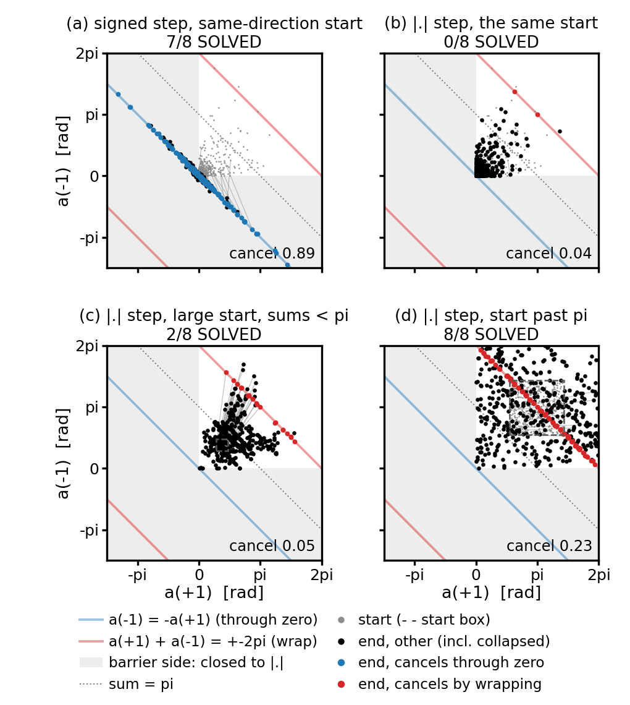

*Figure 9 (`fig_mechanism`; ring, 8 runs per panel; analysis of a registered batch). Move angles (a(+1), a(-1)) of every
rotary channel at the start (grey) and after training (dots). A channel cancels opposite moves when a(+1) + a(-1) = 0 mod
2 pi: on the blue line (through zero, reached only with opposite signs) or the red line (by wrapping). Grey shading marks
the two mixed-sign quadrants, the only region the |.| step cannot reach (omega's sign is free, so both angles may be
negative); dotted: a(+1) + a(-1) = pi; dashed boxes: start ranges. (a) Signed step from the same-sign start: 7/8 runs
solve; one move's angle crosses zero, and 89% of channels cancel at the end (6% at the start). (b) The |.| step from the
same start: 0/8 solve, 4% cancelling. (c) The |.| step from a large start whose sums stay below pi: 2/8 solve, 5%
cancelling, all by wrapping. (d) The |.| step from a large start whose sums exceed pi: 8/8 solve; cancelling rises from 7%
to 23% of channels, all by wrapping (App. H).*

### 7.4 Readers cannot repair a code

**More computation reads a rank-2 code; it does not repair it.** Looping the single block four times (identical
parameters and initialisation) or using four real layers raises rank-2 accuracy from 0.894 to 0.973 and 0.990
(permutation p 0.0034 and 0.0012; SOLVED 2/8 and 5/8 against 0/8; rank 4 0.998, 8/8). By Proposition 6 neither change
alters the code family; both change how a code is read. Fitting a one-pass, position-only reader to each model's own
phase recovers the one-layer models' accuracy (rank 2 0.866 against 0.894; rank 4 1.000 against 0.998) but falls
0.32-0.44 short of the looped and deep models on long-gap and wrap-only revisits (analysis; App. M). Their codes are not
measurably more readable by one pass than plain rank 2's (0.893 and 0.897 against 0.866, below minimum detectable
effects of 0.07-0.08) and stay far from rank 4's (p 0.0002). Run with one pass, the looped weights score 0.381 (mean; 7
of 8 seeds below the 0.51 floor); the right cell is found only at passes 2-4. Only 1 of the 16 runs finds a
two-dimensional code (rank 4: 8/8); half end with x and y moving the phase along one direction. Downstream computation
compensates for the rank-2 deficit and leaves it in place.

**Where the angle comes from and how content uses it are separate choices.** Any rotary score can be written sum_c A_c
cos(dphi_c + beta_c): the phase difference dphi says where, and content sets an amplitude A and, in RoPE, a phase beta.
Path integration changes dphi; PoPE's polar score removes beta, and Proposition 7 then pins every kernel's peak at zero
phase difference. The two predictions have opposite signs, and so do the results. On the short-walk torus PoPE's score
raises the path model (MapPoPE 0.999 against MapWM 0.971) and lowers the index model (PoPE 0.679 against RoPE 0.805), an
interaction of +0.154 (8/8). Probes give the mechanism (analysis; App. L). For the path model the pinned peak aligns the
kernel with the target (target coherence 0.995 against 0.70 for MapWM; Fig. 10b). For the index model no content pair's kernel
prefers offset 3 over offset 1 (0% of pairs, against 53-100% for RoPE, whose kernel is a comb at the retrace offsets; Fig. 10a),
and 0.110 of the 0.126 accuracy gap lies on reversals whose target sits three or more steps back. Freeing PoPE's phase
offset tests this directly (registered): the index model rises by +0.122 (8/8 seeds, sign-flip p 0.0078), most on
multi-step reversals (+0.180), its kernel now prefers offset 3 over offset 1 in 50-100% of content pairs, with peaks at
offsets 3, 4, 7 and 8, and the path model stays at ceiling (-0.018, p 0.31) while its target alignment falls from 0.987
to 0.62. PoPE's pinned offset is the lever: it helps a path phase and hurts an index phase.

**A score rule repairs the readout, not the code.** On the long-walk torus at rank 2 the polar score repairs short-gap
revisits mostly through the readout term (target coherence 0.617 to 0.960, p 0.0002, with the code term moving +0.06)
and leaves the code term low on long-gap revisits (0.80 / 0.91 under the two scores, against 0.99 at rank 4) and
wrap-only revisits (0.40 / 0.48, against 0.97 at rank 4 under either score) (analysis; each stratum read on the head
that carries its same-cell attention; Fig. 10c). The rank-2 phase does not place long-gap or wrapped revisits at zero phase, and
no score rule can make it: under either score rank 2 solves 3/12 (registered).

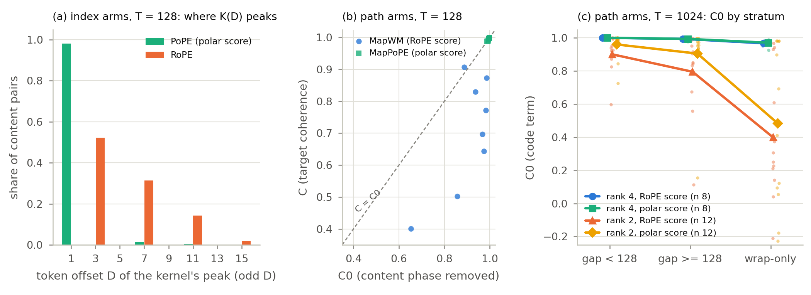

*Figure 10 (`fig_kernel_peak`; analysis of registered batches). (a) Index arms on the torus at T = 128 (PAPER2X2, n =
8): the token offset at which each content pair's kernel K(D) peaks, over the odd offsets where observation keys sit
(1,088 head x action x observation pairs pooled). PoPE's kernel peaks at offset 1 in 98.2% of pairs and in no run does a
pair prefer offset 3 over 1; RoPE's is a comb on the retrace offsets 3 / 7 / 11 / 15 (52.3 / 31.4 / 14.3 / 1.9% of pairs;
53-100% prefer 3 over 1, per run). (b) Path arms at T = 128: target coherence C against C0, the same with the content
phase removed, one dot per seed: MapWM 0.703 against 0.905 (C below C0 on 7 of 8 seeds), MapPoPE 0.995 against 0.996,
on the diagonal. (c) C0 by stratum on the torus at T = 1024 (SCORE_RANK rank 2, n = 12; RANK_MI rank 4, n = 8), each
stratum read on the head with most same-cell attention in that stratum: rank 2 has 0.90 / 0.96 on short gaps, 0.80 /
0.91 on long gaps and 0.40 / 0.48 on wrap-only revisits (RoPE / polar score); rank 4 0.97-1.00 in every stratum under
either score. Lines: means; dots: seeds.*

## 8. Maps from words

The text world asks whether the path model can find its actions when nobody marks them. Each move of the torus walk is
written as a sentence: a direction word chosen from three synonyms, verbs that do not move the walker, optional adverbs and
fillers, and, after some moves, an aside that names an object without visiting it ("she thought about a cat ."). Nothing
in the input says which words move the walker (vocabulary and step tables: App. J). A walk of 1024 words is about 132
moves, so the retrace rule of Sec. 5 scores 0.934 here (analysis), beside the constant (0.505) and reversal-copy (0.597)
floors.

**One path layer learns navigation told in English.** On fresh seeds (n = 6) one path layer scores 0.979 +/- 0.048 (6/6
SOLVED) against 0.505 for one-layer index RoPE (0/6), +0.474 (permutation and Fisher p 0.0022); two index layers reach
0.793 (0/6). With the attention-dropout evaluation scale (App. C9) the path layer scores 0.993 over all eight seeds.
Both index models stay below retrace on every seed (the best two-layer seeds reach 0.927 and 0.926 against 0.934). The
decisive revisits are the 13.4% that retrace cannot reach, places reached by a route other than undoing the last run
(Table 7; analysis, all 200 evaluation walks): there the path layer scores 0.956 over all eight seeds (re-scored; 0.978
on the fresh seeds, 0.934 in eval mode), while two index layers score 0.411 and one index layer 0.454, both below the
constant 'nothing' (0.506). Of these revisits, the 6.6% whose cell holds an object are the ones retrace gets wrong (on
blank cells its default 'nothing' is right by chance); there the path layer scores 0.925 (0.967 on the fresh seeds), two
index layers 0.129, the best constant 0.088 ('nothing' excluded by construction), and one index layer 0.004, since it
predicts 'nothing'. Two index layers learn part of retrace and nothing that needs the map.

*Table 7. Text world: accuracy by whether the retrace rule can reach a revisit (analysis; registered batch, all 200
evaluation walks of the registered stream, 6,381 revisits; mean over 8 seeds, fresh seeds 2-7 in brackets; path models
re-scored with the attention-dropout scale unless marked).*

| model (n = 8) | all revisits | retrace applies (n 5,525) | retrace cannot reach (n 856) | ... cell holds an object (n 423) |
|---|---|---|---|---|
| path, 1 layer | 0.993 | 0.999 | 0.956 (0.978) | 0.925 (0.967) |
| path, 1 layer, eval mode | 0.969 | 0.975 | 0.934 (0.958) | 0.884 (0.927) |
| index RoPE, 2 layers | 0.772 | 0.828 | 0.411 (seeds 0.34-0.55) | 0.129 |
| index RoPE, 1 layer | 0.505 | 0.513 | 0.454 | 0.004 |
| best constant | 0.505 ('nothing') | -- | 0.506 ('nothing') | 0.088 ('cat') |

**What the step table holds.** On every seed, opposite direction words cancel once the component common to the four
directions is removed (0.002-0.012), synonyms collapse to one step (cosine 1.000), and zeroing the direction steps drops
accuracy to the constant floor (0.39-0.51) (declared secondaries; Fig. 11). The rest of the vocabulary is organised by how
often a word occurs per move (analysis, 32 models): adverbs and fillers, whose count per move varies, get steps of
0.004-0.03 of a move; words that occur once per move (verb, seeing words, object, full stop) may carry a common tick; aside
sentences get sizeable word steps that cancel within the sentence, leaving the aside's noun 0.04-0.16 of a move off the
place. Words whose count per move varies get no net step; the steps that remain belong to words that occur once per move
or cancel within their sentence.

**The offset is why learned steps beat being told.** A model whose steps are restricted to the twelve direction words stops
at 0.970-0.974 on every seed, and its errors name objects told in an aside at that place: with no other word stepping, the
aside's noun sits at the place's phase. Moving each aside back onto its place's phase at evaluation, with the phase after
it unchanged, drops the learned-step models at ceiling from 0.989-1.000 to 0.952-0.975, with 71-100% of their errors now of
the same kind; offsetting the oracle's aside words by half a move lifts it from 0.962-0.981 (on the analysis stream) to 0.999-1.000
on every seed (analysis). "Only actions move" is the wrong separation in language: some words that are not actions need steps, so that
what is mentioned is not filed where it is not.

**Half the models also count moves, in channels they do not use.** On four of the eight registered seeds the direction
words' common component points along the verbs' step (cosine +0.999 to +1.000), and 31-38 of 64 channels drift between
visits to the same cell (declared secondary; drift from the first visit). Across 24 learned-step models (analysis), 10
carry such a per-move tick, which drifts in 26-38 channels between consecutive visits. It counts moves: an aside
sentence adds at most 0.06 of a tick, a filler word at most 0.007. In Howard et al.'s terms these channels integrate
distance travelled (Case II) beside the others' position (Case III). Proposition 2(b) says such channels cannot serve
retrieval by place, and they do not: the tick alone predicts which channels drift (agreement 0.98-1.00; informative on
the 10 clock models, where the predicted and observed counts of drifting channels match exactly), 79-99% of retrieval
usage sits in channels whose tick is zero modulo pi (on the even torus a return always takes an even number of moves),
and removing the 26-38 clock channels from the score costs at most 0.009 on each of the seven clock models at ceiling,
while removing as many map channels collapses accuracy (to 0.03-0.65, means over random draws). The three clock models
below ceiling still lean on their clock channels (removal costs 0.09-0.26). The clock seeds' extra dependence on
non-direction words follows the direction words' common component in the used channels (Spearman +0.905 over the 8
registered seeds, exact permutation p 0.0046), which those words cancel within each move.

**What must and must not move.** The same rule covers the what-to-where leak on a task with new objects in every episode.
A step that depends on an object's identity spreads objects at one place over identity-dependent offsets; removing the
objects' steps, or normalising the step input, lets every run converge (16/16 SOLVED against 0/8 for MapWM; 8/8 against 0/8
on fresh seeds; App. K). A token's offset from its place should depend on its role, not on its identity.

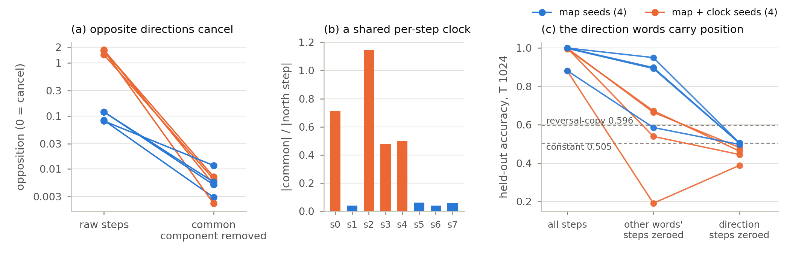

*Figure 11 (`fig_textworld`). What a one-layer path model learns from a torus walk told in English (n = 8 seeds). (a)
Opposition of the learned direction-word steps, |A + B| / |A| averaged over north/south and west/east (0 = opposites
cancel): after removing the component common to all four directions, opposites cancel to 0.002-0.012 on every seed. (b)
That common component is small on four seeds (blue, 4-6% of a direction step) and large on the other four (orange,
0.48-1.14), where it points along the verbs' step: a per-move clock beside the map (31-38 of 64 phase channels drift
between visits to the same cell, counted from the first visit). (c) Held-out accuracy with every step, with the steps of
all non-direction words zeroed, and with the direction words' steps zeroed: removing the direction steps drops every seed
to the constant floor (0.505, dashed) or below. Eval mode without the dropout re-scale (App. C9).*

## 9. Discussion and related work

**What the two failure axes share.** For per-head rank 2 and for non-negative steps, a solution in the class exists (the
rank-2 projection scores 0.9955; the |.| construction is exact), training keeps or re-finds it (7/8 at rank 2; held 8/8
on the ring and re-found 8/8 on the torus for |.|), and training from scratch does not reach it (0-2/8; 0/8). In Remark
2's terms the initialisation sits outside the basin of a non-empty, stable solution set. The route inventory accounts
for this, proved for the routes and conjectured for the rank-D dynamics, and the two axes fail differently inside it. A
non-negative increment has no collective route and its per-channel targets lie past pi; restoring a signed increment
under a non-negative readout restores learning (16/16), while giving |.| a collective route to the wrap with the barrier
left in place does not (0/8; the 2x2 that would separate the two is unmeasured). At rank D the collective route exists, but no channel can be
both clock-free and a full map while a clock remains, and in two or more dimensions hiding offers a free local move
that, by Conjecture 1, starves the collective route; one more latent dimension adds a local move, parking, that costs
the map nothing. That the clock is what blocks rank D is tested on the torus: with the clock forbidden by construction,
rank 2 solves on every seed (registered). That parking is why one more dimension helps is not shown: an explicit clock
exit at rank 2 solves 3/8 against 1/8 within 900 epochs, most unsolved runs still descending (registered PARTIAL), so it
remains a conjecture. Both failures end in the same measured place: a clock of the order of the map (or, in a few rank-2
runs, a map that has lost a dimension), and strata that keep short-gap revisits and lose the rest. Giving the rest of
the network four times the computation or the parameters reads that code better and does not find the rank-2 solution:
the deficit is local to the content-to-angle map. Shakerinava et al. (2026) report "representable but not learned" for
non-Abelian rotations in diagonal SSMs; we find it in single-layer Abelian tasks, produced by one rank or
parameterisation choice, and give its routes.

**Not every search failure is of this kind.** Single-origin MapEM represents k-back recency exactly (installed and frozen,
1.000) and finds the rewind per query token, and four times the budget closes most of its deficit (0.578 to 0.928; not registered), whereas
rank 2 stays at 0/8 with twice the budget (App. N).

**Design guidance.** Keep the phase increment signed; a non-negative readout is harmless. Give each head rank above the
map's dimension (D + 1). Keep observations from stepping the phase: a step that depends on what is seen moves where the
model thinks it is. Where the inverse pairs of actions are known, also tying their steps to exact negatives removes the
clock by construction, and rank D then suffices (rank 2 on the torus, 8/8). Measure map use where retracing no longer
suffices, against measured map-free floors and by stratum: the long-gap and wrap-only revisits separate a map from a
local rule, and an aggregate accuracy near 0.9 can be either. To tell whether a trained model's phase is a map or a
clock, read the used-channel clock ratio, not the growth of the phase with the token index.

**What and where.** In the long-walk regime, the model that learns the map separates where from what, and the models
that fail do not (analysis; App. K). For the signed rank-4 model at T = 1024, one shared position kernel per head times
a per-pair content gain plus offset reproduces its accuracy exactly (0.998); removing token identity within type from
the score costs 0.032 (0.966; 8/8 seeds lower, sign-flip p 0.008, uncorrected; Holm over the 24 contrasts 0.08); and the
content-averaged score carries 92.5% of the score's within-row sum of squares (SS(P) / SS(S)). Token type (move or
observation) is essential: without it the model falls to 0.113. The non-negative and index models lose 0.25-0.31 when
token identity within type is removed, and a shared kernel times a gain does not restore them; within the non-negative
arms, accuracy tracks the share that survives the removal (Spearman 0.84 over 16 runs, p 5e-5). Separation is a property
of the solution training finds, not of the architecture. MapFormer showed the separation in the learned embeddings
(their Fig. 9); these checks show that the models rely on it where a map is needed, in the sense TEM proposed.

**The integrator view.** A learned, signed, content-dependent rate can realise all three of Howard et al.'s cases, and
which one a channel realises is set by what the readout keys on. Split each step into the frequency-weighted mean, a
clock, and a content part, and write rho_c for the clock part over the content part at the training length (Remark 3,
App. E13). For targets keyed to a place reached at variable lags the used channels must be clock-free (Proposition
2(b)), and the models put them there: torus 0.064-0.079, text world 0.06-0.23 (23 of 24 learned-step models; the
unconverged one 2.5; analysis). For targets keyed to a count back, the used channels are clocks: k-back recency, the
same one-layer signed class, gives 21.8-22.1. One text-world model can do both at once, with distance travelled in idle
channels and position in used ones. In the rotary slot the cases coincide in what they can represent (Proposition 3), so
the sign result is about learnability: a non-negative step could hold a Case III code and does not find one.

**Text.** On ordinary text at small scale (n = 3 pilots; the ratios are analysis), the channels attention uses are clock-dominated (rho 9.9-12.3
on TinyStories, Eldan and Li 2023; 4.5-6.6 on code; against 0.06-0.23 in the text world), MapWM matches index RoPE on
TinyStories (1.5053 against 1.5050 nats per token), and at matched length path integration costs on code (+0.0056 bits
per byte, 3/3 seeds). The phase grows linearly with the token index there (R^2 0.994-0.999), as it does in text-world
models that carry a perfect map, where the growth is carried by channels attention does not use. The used-channel ratio
separates the two; the growth exponent does not.

**Egocentric actions.** The cumulative phase assumes allocentric moves. With turn-and-forward actions the step depends on
the heading, and recoding the actions allocentrically, what head-direction cells supply, restores path integration's
advantage (position effect +0.050 to +0.488, n = 8, in a short-walk recipe; not registered; App. A5).

**Related work.** *Optimisation, not expressivity.* Shakerinava et al. (2026) find that input-dependent rotations in
unit-modulus SSMs can represent non-Abelian state tracking but do not learn it from scratch, while near-solution starts
recover it. Grazzi et al. (2025) and Mamba-3 own the representability of rotations with non-negative angles; ours is the
learnability cost in the rotary slot, in attention and in a diagonal complex SSM, and its route account.
Orientation-fixing parameterisations have a history: scoRNN fixes the +/-1 diagonal of its Cayley transform (Helfrich et al. 2018); a reparameterised weight w = |u| cannot change
sign under gradient flow (Amid and Warmuth 2020, Prop. 2; Woodworth et al. 2020); the LRU initialises its phases near zero
(Orvieto et al. 2023). With fixed frequencies the parameter symmetries of rotary attention are per-plane complex scalars
(Wang and Wang 2025; Tran et al. 2026); a learnable step adds the reflection of Lemma 1. *Depth and recurrence.* Depth can
substitute for recurrence through shortcuts (Liu et al. 2023; Yao et al. 2021), though shallow transformers learn
sensitive functions unreliably (Hahn and Rofin 2024), while Selective RoPE and PaTH (Yang et al. 2025) solve parity or
Flip-Flop with one layer. We give the rate at matched depth, the mechanism trained models use, and where it breaks.
*Integrators.* Howard et al. (2014) for the three rate cases; GridPE for RoPE as a velocity-controlled oscillator; TEM and
TEM-t for the "where" apart from the "what".

## 10. Limitations

- The models are small (1-4 layers, 2 heads, d_model 128-256) and the tasks synthetic; natural text appears only as a
  three-seed pilot. Actions are allocentric translations.
- "Not found" is relative to the stated budgets (300-1800 epochs). Learning rates for the sign contrast were swept on
  the ring (four rates) and on the one-layer torus (three rates, 1e-3 to 1e-2); on the torus AdamW's decay was coupled to
  the rate (three times the default's at the |.| optimum) with no decay-matched control, and 5 of the 8 |.| runs at its
  best rate were still descending. No other optimiser was tried. On the
  torus, in the 2-layer d_model 256 model, the sign gap is a quarter of the one-layer gap in accuracy and most |.| runs
  were still descending, so at scale part of the cost may be speed. Selective RoPE's runs were all still descending at
  900 epochs, as were most unsolved clock-slot runs of the clock-exit test (Sec. 7.2), which therefore does not separate
  a slower exit from none. The exp and softplus increments start at a constant positive step and were run at two fixed
  rates.
- Rank results use two heads; our latent is shared across heads where MapFormer's is per head (per-head arms are
  reported); the clock-route batch (Sec. 7.2) is shared rank only, on one task and length. The torus exchange rate is a
  lower bound measured at n = 4.
- Every rank and sign batch uses weight decay 0.05 except where marked. Rank 4's success depends on it: in a registered
  test on fresh seeds, shared rank 4 solves the torus 8/8 with AdamW weight decay 0.05 on all parameters and 1/8 without
  it within 900 epochs (Fisher p 0.0014; 5 of the 7 unsolved runs still descending; App. G8), although a solved rank-4
  model trained further without weight decay keeps its solution. The result is credited to the optimiser setting, not
  to the step map or the clock specifically. The sign cost, by contrast, holds without weight decay (Table 6). Rank 2
  was given three recipes (the default, three times the learning rate, four times the weight decay; App. G9) and failed
  at each, but both alternatives raise the total decay, there is no lower-decay or combined arm, and 12 of the 24 rank-2
  runs were still descending at 900 epochs. The rank claim is therefore "rank D + 1 with weight decay is needed, and
  rank D fails at the best of three recipes", not that no recipe rescues rank D.
- The theory of Sec. 4 was developed after the registered batches, except the clock-route batch (Sec. 7.2), which was
  registered to test its rank account. Its proved statements concern the step parameterisation and quadratic surrogates;
  the hiding feedback at rank D is a conjecture, and the per-channel dynamics of |.| are not derived. The checks marked
  (analysis) are post hoc, on one batch per arm, without fresh-seed replication; their thresholds and statistics chosen
  after the data were seen are listed in App. O, and one CPU analysis (the step-map basin) is not deterministic and is
  reported as exploratory.
- The text world is scripted (58 words, one movement clause per move, context-free direction words), and its walks are
  short enough that retrace scores 0.934; the map evidence there is the revisits retrace cannot reach and the mechanism.
- The state-space test (App. H10) is one layer on the ring, without Mamba's decay, output gate or input scaling by the
  step, and from scratch at one learning rate (3e-3). There exp was unstable (8/8 runs diverging in step size), so it
  carries no learnability statement; most unsolved softplus runs were still descending; the installed |.| solution was
  perturbed and re-found rather than held under the registered rule. No other recurrent baseline.
- The route-versus-barrier test (Sec. 7.3, App. H11) is on the ring only, from one start (the |.| start, not the default),
  at 300 epochs. It is readable at one learning rate (3e-3; at 1e-3 its signed anchor failed the gate), and there only
  half of it reads: the route class fails, the frozen-latent class lands between the anchors. The offsets it adds move
  about ten times less per channel per optimiser step than the latents; its control shows they are usable, not that the
  two routes are equally fast.

## References

Titles and author lists checked against arXiv, OpenReview, Crossref, ACL Anthology or PMLR metadata on 2026-10-15/16;
entries marked * were not re-checked (venue, or the whole entry where stated in the notes file).

- Alipour, A., James, T., Brown, J. W. and Tiganj, Z. Self-supervised learning of scale-invariant neural representations
  of space and time. J. Comput. Neurosci. 53:131, 2025*.
- Amid, E. and Warmuth, M. K. Reparameterizing mirror descent as gradient descent. NeurIPS 2020*; arXiv:2002.10487.
- Eldan, R. and Li, Y. TinyStories: how small can language models be and still speak coherent English? arXiv:2305.07759,
  2023*.
- Golovneva, O., Wang, T., Weston, J. and Sukhbaatar, S. Contextual position encoding: learning to count what's important
  (CoPE). arXiv:2405.18719, 2024.
- Gopalakrishnan, A., Csordas, R., Schmidhuber, J. and Mozer, M. C. Decoupling the "what" and "where" with polar
  coordinate positional embedding (PoPE). arXiv:2509.10534, 2025*.
- Grazzi, R., Siems, J., Zela, A., Franke, J. K. H., Hutter, F. and Pontil, M. Unlocking state-tracking in linear RNNs
  through negative eigenvalues. ICLR 2025*; arXiv:2411.12537.
- Hahn, M. and Rofin, M. Why are sensitive functions hard for transformers? ACL 2024 (long papers); arXiv:2402.09963.
- Helfrich, K., Willmott, D. and Ye, Q. Orthogonal recurrent neural networks with scaled Cayley transform. ICML 2018*;
  arXiv:1707.09520.
- Hewitt, J., Hahn, M., Ganguli, S., Liang, P. and Manning, C. D. RNNs can generate bounded hierarchical languages with
  optimal memory. EMNLP 2020*; arXiv:2010.07515.
- Howard, M. W., MacDonald, C. J., Tiganj, Z., Shankar, K. H., Du, Q., Hasselmo, M. E. and Eichenbaum, H. A unified
  mathematical framework for coding time, space, and sequences in the hippocampal region. J. Neurosci. 34(13):4692-4707,
  2014.
- Kabir, M. R., Mochizuki-Freeman, J. and Tiganj, Z. Deep reinforcement learning with time-scale invariant memory. AAAI
  2025*; arXiv:2412.15292.
- Lahoti, A., Li, K. Y., Chen, B., Wang, C., Bick, A., Kolter, J. Z., Dao, T. and Gu, A. Mamba-3: improved sequence modeling
  using state space principles. ICLR 2026; arXiv:2603.15569.
- Li, B., Wu, Y., Huang, N. and Zhang, W. GridPE: a grid cell-inspired unified position embedding for
  arbitrary-dimensional spaces. arXiv:2406.07049, 2024*.
- Liu, B., Ash, J. T., Goel, S., Krishnamurthy, A. and Zhang, C. Transformers learn shortcuts to automata. ICLR 2023;
  arXiv:2210.10749.
- Mochizuki-Freeman, J., Maini, S. S. and Tiganj, Z. Characterizing neural activity in cognitively inspired RL agents
  during an evidence accumulation task. IJCNN 2023*.
- Movahedi, S., Carstensen, T., Afzal, A., Hutter, F., Orvieto, A. and Cevher, V. Selective rotary position embedding.
  ICLR 2026; arXiv:2511.17388.
- Orvieto, A., Smith, S. L., Gu, A., Fernando, A., Gulcehre, C., Pascanu, R. and De, S. Resurrecting recurrent neural
  networks for long sequences (LRU). ICML 2023*; arXiv:2303.06349.
- Rambaud, V., Mascarenhas, S. and Lakretz, Y. MapFormer: self-supervised learning of cognitive maps with input-dependent
  positional embeddings. arXiv:2511.19279 (v4, 10 May 2026).
- Sarrof, Y., Veitsman, Y. and Hahn, M. The expressive capacity of state space models: a formal language perspective.
  NeurIPS 2024; arXiv:2405.17394.
- Shakerinava, M., Khavari, B., Ravanbakhsh, S. and Chandar, S. The expressive limits of diagonal SSMs for
  state-tracking. ICLR 2026; arXiv:2603.01959.
- Su, J., Lu, Y., Pan, S., Murtadha, A., Wen, B. and Liu, Y. RoFormer: enhanced transformer with rotary position
  embedding. Neurocomputing 568:127063, 2024*; arXiv:2104.09864.
- Tran, V.-H., Bui, V. K., Trinh, V.-H., Lai Ngoc, T. and Nguyen, T. M. Functional equivalence in attention: a
  comprehensive study with applications to linear mode connectivity. ICML 2026 (PMLR 306); arXiv:2606.17830.
- Veisi, A., Fartoot, D. and Amirzadeh, H. Context-aware rotary position embedding (CARoPE). arXiv:2507.23083, 2025.
- Wang, H. and Wang, K. Complete characterization of gauge symmetries in transformer architectures. Symmetry and Geometry
  in Neural Representations (NeurReps), PMLR 282:622-663, 2025.
- Whittington, J. C. R., Muller, T. H., Mark, S., Chen, G., Barry, C., Burgess, N. and Behrens, T. E. J. The
  Tolman-Eichenbaum Machine: unifying space and relational memory through generalization in the hippocampal formation
  (TEM). Cell 183(5):1249-1263, 2020.
- Whittington, J. C. R., Warren, J. and Behrens, T. E. J. Relating transformers to models and neural representations of the
  hippocampal formation (TEM-t). ICLR 2022; arXiv:2112.04035.
- Woodworth, B., Gunasekar, S., Lee, J. D., Moroshko, E., Savarese, P., Golan, I., Soudry, D. and Srebro, N. Kernel and
  rich regimes in overparametrized models. COLT 2020*; arXiv:2002.09277.
- Yang, S., Shen, Y., Wen, K., Tan, S., Mishra, M., Ren, L., Panda, R. and Kim, Y. PaTH attention: position encoding via
  accumulating Householder transformations. NeurIPS 2025; arXiv:2505.16381.
- Yao, S., Peng, B., Papadimitriou, C. and Narasimhan, K. Self-attention networks can process bounded hierarchical
  languages. ACL 2021*; arXiv:2105.11115.
- Zhang, Y., Chen, Z., Liu, Y., Qin, Z., Yuan, H., Xu, K., Yuan, Y., Gu, Q. and Yao, A. C.-C. Group representational
  position encoding (GRAPE). ICLR 2026; arXiv:2512.07805.
